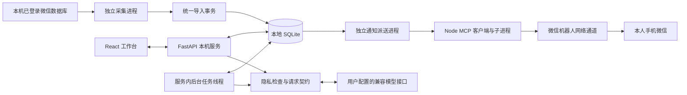
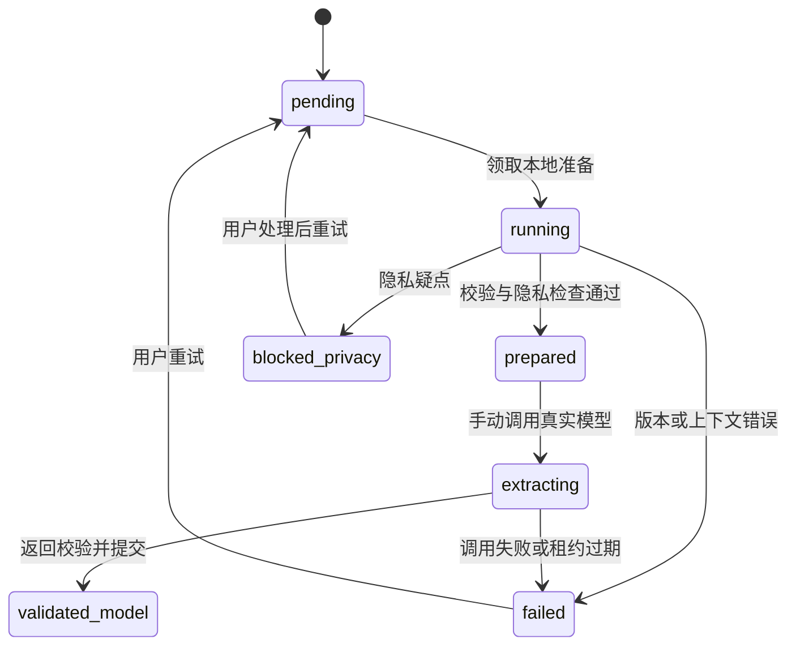
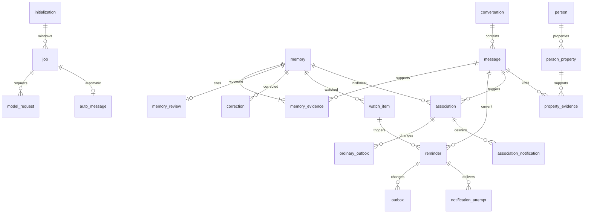

# 微信聊天记忆助手：当前系统完整技术文档

文档基准：2026-10-29（Asia/Shanghai）  
项目位置：项目根目录  
读者：使用者、后续维护开发者  
数据库版本：19  
范围：当前本机源码、数据库结构、页面和已有验收记录。本文是实现说明，不是未来需求清单。

版本 19 的通知策略、自动备份、登录和轮询变更详见文末增补；原有结构采集和验收章节标注的版本 18 属于升级前基线。

## 目录

1. [系统定位与实现边界](#s1)
2. [架构、进程与技术栈](#s2)
3. [页面与用户操作](#s3)
4. [采集、导入与搜索](#s4)
5. [记忆、证据与人工核对](#s5)
6. [历史初始化](#s6)
7. [AI 与新消息自动处理](#s7)
8. [人物资料与隐私替换](#s8)
9. [提醒、通知与变更日志](#s9)
10. [运行生命周期与异常恢复](#s10)
11. [代码模块与依赖](#s11)
12. [配置、部署与维护](#s12)
13. [测试、验证与现有限制](#s13)
14. [完整数据库字典](#s14)
15. [完整 HTTP 接口与请求契约](#s15)
16. [文档核验清单](#s16)

<a id="s1"></a>
## 1. 系统定位与实现边界

系统在个人 Windows 电脑上运行，读取已经绑定的微信账号与“指定联系人”单人会话，保存双方文字及非文字消息的类型信息。用户能查找原话、整理记忆、核对 AI 提炼结果、设置关注词，并在新的聊天与历史有关时收到微信机器人通用提示。

目前无需自建转发服务器，也没有 Android 客户端。电脑承担业务计算；外部模型接口承担推理；微信机器人借用微信消息通道到达手机。无需自建服务器不等于完全离线：模型调用和机器人发送都需要网络及相应外部服务。

| 业务 | 当前实现 | 关键边界 |
| --- | --- | --- |
| 微信采集 | 已接固定账号与指定联系人会话；首次历史导入及持续检查 | 不是所有联系人采集，不自动切换账号，不读取群聊 |
| 聊天搜索 | 本地 FTS5 字符分词，短词字面搜索 | 不是语义搜索；每次最多 50 条 |
| 记忆库 | 人工整理、AI 提炼、多条原文证据、确认、更正、停用 | 待核对和已确认都可供关联检索；确认不等于训练模型 |
| 历史处理 | 全量/所选范围冻结、后台准备窗口、逐窗口手动 AI 提炼 | 没有全历史一键自动付费提炼 |
| 新消息处理 | 开启后新增实时文字自动提炼、召回历史、判断提醒价值 | 仅处理开启后入库的新文字；不是重新扫描全部旧记录 |
| 特别关注 | 精确关注词，可附带已有记忆 | 不需要 AI；匹配不代表确认意图 |
| 普通提醒 | 候选经模型判断后形成提醒 | 召回仍用字面与人物线索，可能漏掉纯语义关联 |
| 手机通知 | 机器人向扫码本人发送固定通用提示 | 不含聊天详情、无手机详情同步/已读回执 |
| 人物资料 | 人工确认别名、历史号码、有效期与证据 | 同名、共用号码不自动合并人物 |
| 隐私处理 | 本地映射、敏感疑点阻断、返回代号校验 | 自由文本识别不完备；不能承诺自动匿名化全部内容 |

当前实现边界包括：手机改用机器人提示；详情仍在电脑；数据为标准 SQLite；没有向量库、OCR、语音转写、回复生成或对指定联系人自动发送消息的业务。

<a id="s2"></a>
## 2. 架构、进程与技术栈



以上箭头表示逻辑数据流。采集进程创建不启动后台线程的应用对象，通过 `app.state.ingest` 直接复用导入函数，不通过 HTTP 将聊天上传至本机服务；独立进程通过同一 SQLite 协作。

| 层次 | 实现 |
| --- | --- |
| 界面 | React、TypeScript、原生 CSS、Vite；hash 导航，无新增路由框架 |
| 本机 HTTP | Python / FastAPI / Uvicorn，单进程，`127.0.0.1:8765` |
| 数据 | Python sqlite3、SQLite WAL、FTS5、代码内顺序迁移 |
| 模型 | httpx 调用兼容 `/chat/completions` 接口；Pydantic 校验返回 |
| 凭据 | 模型密钥经 Windows DPAPI 保护；机器人凭据另存本机文件 |
| 采集 | 本地读取模块、绑定微信进程、数据库/WAL 快照、Python 规范化导入 |
| 通知 | Python 派送 → Node → stdio MCP → 项目内微信 MCP 实现 |
| 测试 | pytest、Playwright、Node 协议测试、隔离合成数据 |

依赖版本以 requirements.lock.txt、frontend/package-lock.json 和对应依赖清单为准；本文不记录个人电脑的已安装运行时版本。

<a id="s3"></a>
## 3. 页面与用户操作

登录页要求启动窗口显示的本次会话令牌。令牌仅存 React 内存，刷新网页后需重新输入；重启后端会生成新令牌。

| 一级菜单 | 二级页面 / hash | 使用方式与内容 |
| --- | --- | --- |
| 首页 | `#/home` | 已导入、文字、有效记忆、当前提醒；采集/机器人开关；常用入口 |
| 聊天与记忆 | `#/memory/search` | 搜索原话，选择证据供其他页面使用 |
| 聊天与记忆 | `#/memory/library` | 人工整理记忆；展开记忆库；待核对/已确认；证据、更正历史 |
| 聊天与记忆 | `#/memory/people` | 建独立人物，确认别名和号码，查提及消息 |
| 提醒中心 | `#/reminders/list` | 普通 AI 关联、特别关注卡片、处理诊断、标错隐藏 |
| 提醒中心 | `#/reminders/watch` | 添加关注词、开关关注、查看关联记忆是否仍有效 |
| 任务管理 | `#/tasks/automatic` | 开关新消息自动处理、设置最近 24 小时调用上限、查看状态 |
| 任务管理 | `#/tasks/history` | 创建历史范围、准备/预览/手动提炼、暂停/重试/取消 |
| 设置与帮助 | `#/settings/model` | 基础 API 地址、模型名称、密钥、启用、测试、删除配置 |
| 设置与帮助 | `#/settings/privacy` | 创建真实值与代号映射、本地预览、处理映射冲突 |
| 设置与帮助 | `#/settings/import` | 读取 JSON 文件或粘贴统一格式并导入 |
| 设置与帮助 | `#/settings/help` | 按模块介绍功能和常见使用步骤 |

页面通过 `hidden` 隐藏而不卸载，切换时保留搜索、选择和草稿；这不是跨刷新保存。选中证据后，顶部选择条可跳到记忆、人物、历史任务页面。桌面左侧菜单和标题区固定，右侧内容滚动；窄屏改用紧凑导航。

首页状态与提醒约每 3 秒刷新，采集/机器人状态约每 3 秒，新消息自动处理约每 3 秒，历史任务与记忆核对数量约每 5 秒。隐藏页面的组件仍挂载，相关轮询不会随导航停止。刷新失败显示旧数据与错误提示；首页“当前提醒”是两个有条数上限的列表长度之和，不是不限量的全库统计。

记忆库默认收纳，每页展示 10 条，接口取 11 条判断下一页；展开单条才看原文证据与更正。页面切换、按钮、处理中提示采用轻量动画；`prefers-reduced-motion` 会关闭动画。AI 动态条没有百分比，表示等待处理；历史覆盖条使用实际计数，统计口径见第 6 节。

<a id="s4"></a>
## 4. 采集、导入与搜索

### 4.1 固定来源与读取路径

`data/collector/binding.json` 保存账号目录、账号标识、目标联系人标识、微信 PID 和进程创建时间。程序同时核验 PID 与创建时间，避免 PID 被其他进程复用；微信重启后旧绑定不能继续使用，需要重新核验绑定。

`tools/contact_reader.py` 优先核验本机绑定的联系人标识；首次绑定使用本机环境变量 WECHAT_CONTACT_NAME 指定备注或昵称，必须唯一且不是群聊。读取路径包括联系人库和消息分片；构造固定联系人的 `Msg_` 表名，仅查询该会话。只加载 vendored `wechatauto.db` 模块，不初始化其 GUI 包，也绕过会尝试其他账号并保存密钥的构造器。读取所需密钥驻留内存，不主动保存密钥缓存。

快照处理固定为 4096 字节页：读取前后核对主库与 WAL 的文件签名；验证 WAL 头、salt、帧校验和；仅应用最后已提交事务内的帧；将解密快照放到 `data/collector-tmp` 临时目录；以只读 immutable SQLite 打开并执行 quick_check。正常上下文退出会清理快照，强制终止时不能保证临时明文立即清理。快照可暂时包含整个消息分片，持久导出与业务入库只保留指定会话。

首次读取生成 `initial.json` 与绑定文件，首次导入后写 `initialized.json`。持续模式启动时重新核验所有必需数据库的密钥、账号和联系人。新分片缺少已验证密钥、联系人不唯一、发送方不能归属、文字解码失败等情况下停止，不猜测归属。

### 4.2 持续采集与更新

一次读取结束后等待约 15 秒再检查，实际周期还包含读取和入库时间。未改变的分片复用内存缓存；改变的分片重新读取目标会话。每轮仍汇总快照，并和业务库已存记录比较，不是仅靠一条游标读取增量。

源 `local_id` 与分片路径共同标识消息；账号和联系人在业务层转换为 SHA-256 标识；适配器名为 `wechat-local-db-v1`。新记录 revision=1；正文、类型、时间或角色改变时 revision 增加。类型支持 text/image/voice/video/system/unsupported，非文字正文留空，不做媒体理解。缺失源消息只计 `source_missing`，不会自动删除本地记录，也不等同于微信撤回。

每批最多 500 条变更，调用同一导入事务；整个大历史分多批提交。中断后可幂等重放已提交批次。连续三次读取 OSError/ValueError 后停止；不将聊天内容或密钥写入运行异常日志。

### 4.3 统一导入事务

公共 JSON 请求每批 1–1000 条，每条文字最多 20000 字符。只允许一个会话，并固定 account_ref/contact_ref；生产库已绑定真实会话后不能直接导入另一会话的演示文件。

```json
{
  "account_ref": "synthetic-account",
  "contact_ref": "synthetic-contact",
  "mode": "history",
  "messages": [{
    "conversation_id": "synthetic-conversation",
    "source": {"adapter": "manual-json", "partition": "example", "id": "1"},
    "sender_role": "peer",
    "event_time": "2026-10-01T10:00:00+08:00",
    "type": "text",
    "text": "合成示例：最近下午不喝咖啡。",
    "revision": 1
  }]
}
```

以上仅为格式示例，不应拿到已绑定真实会话的库中测试。`schema_version` 默认 1，`observed_at` 可选。无时区或缺失 event_time 时 event_utc=NULL；不猜测时区。

唯一键是 `(conversation_id, adapter, partition, source_id)`。来源 ID 不同的同秒同文消息分别保留。较低版本跳过；相同版本但正文/类型/角色/原始时间不一致时整批 409 回滚；较高版本覆盖当前 message，同时使相关记忆、人物证据、任务、提醒失效并更新全文索引。

`history` 不触发新提醒和自动提炼。仅全新 `live` 消息执行近期关联失效、关注更新、普通候选入队及自动任务入队；已有消息修订不作为新消息重新触发。`ingestion_checkpoint` 是该适配器分区最后提交的输入来源 ID，不是采集端已经验证的增量游标。

### 4.4 搜索

消息和记忆全文索引均先对文本 `casefold()` 后按字符空格分隔。查询构造成加引号的 FTS 字面短语，不允许用户输入变成 FTS 运算表达式。消息搜索词长度最多 200，空词或超长返回空列表；按 event_utc/id 倒序最多 50 条。记忆搜索只显示 active，可按核对状态、ID 游标分页。索引由 Python 业务事务手动维护，并非自动同步触发器。

<a id="s5"></a>
## 5. 记忆、证据与人工核对

一条记忆是“摘要＋语义标签＋版本化证据”，不是复制的一条聊天。摘要最多 2000 字符，人工证据 1–20 段；AI 返回每条最多引用 12 条本次窗口消息。

| 属性 | 允许值与含义 |
| --- | --- |
| subject | self 我、peer 对方、third_party 第三方、unknown 未知 |
| polarity | positive 肯定、negative 否定、uncertain 不确定 |
| assertion | direct 本人陈述、reported 转述、inferred 推测 |
| temporal_kind | preference 偏好、plan 计划、past_event 已发生、fact 事实、unknown 未知 |
| origin | manual 人工、model 真实模型、synthetic 合成、manual_correction 人工更正 |
| status | active 有效、stale 源版本失效、incorrect 标错停用、superseded 被更正版替代 |

每段证据保存消息 ID、消息 revision、`[span_start, span_end)` 字符范围。原文从本机 message 取出，不使用模型提供的引文。范围按 Python 字符串索引解释，不是 UTF-8 字节偏移。本人陈述的 self/peer 主体必须由同角色原文支持；结构校验不能证明语义一定正确。

指纹为摘要、标签及排序证据的 SHA-256，完全相同且仍有效的内容返回已有 ID；已停用指纹不自动复活。这是严格幂等，不是语义去重。

“确认正确”写 memory_review 的当前 version，移入已确认列表，不删除记忆、证据、不关闭关注，也不向模型训练接口提交反馈。移回待核对删除确认记录。确认状态必须匹配当前 active 版本；更正后的新记录需重新确认。关联候选对所有 active 记忆召回，不只使用已确认记忆。

“标错并停用”范围较宽：写 correction，并将该记忆依赖的消息版本写 suppressed_evidence；使用相同消息版本的其他记忆也会停用，相关任务失效、附带记忆的关注提醒撤回。它不是只隐藏一张卡片。人工“更正内容”使用原证据建立新记忆、旧记忆变 superseded，以 supersedes_id 串接历史，明确允许此次更正版使用原证据，但阻止普通流程再次自动生成被纠错内容。

原文高版本覆盖后不保留完整旧正文副本。memory_evidence 保留旧版本号；版本不匹配时 quote=null，界面提示旧引用不可用。更正历史接口沿 supersedes_id 最多取 100 条；这不是全部源文本历史仓库。

<a id="s6"></a>
## 6. 历史初始化

历史初始化发生在消息已入库之后，用于冻结要处理的文字范围、拆窗口和准备模型输入，不是创建所有数据库表。表由服务启动迁移创建，原文导入和 AI 提炼是独立阶段。

全量模式选取截止时间 T0 之前的文字（包括时间未知记录，后续准备时会报错）；分批模式选择不超过 10000 个消息 ID。每窗口最多 12 条，相邻重叠 2 条，按 UTC 时间与 ID 排序；冻结消息 ID 和 revision，后续新消息不会自动进入旧范围。只允许一个 active/paused 的非 auto 范围。

后台自动执行“本地准备”：检查源版本、时间、纠错抑制、累计 12000 字符上限、隐私替换。成功为 prepared，绝不等同于已调用 AI。跨 30 分钟、有限窗口、会话含非文字等上下文警告随请求携带；非文字警告按整个会话保守标记，不代表窗口内一定有媒体。



范围可 active/paused/cancelled；cancelled 不能恢复。暂停会使正在 running/extracting 的工作退回 pending 并清理租约，迟到结果不能提交；取消会将所属任务取消，但不删除已生成记忆。重试仅使 failed/blocked_privacy 回 pending，不把输入换成新 revision。源版本变化时需重新创建范围。

本地准备租约 60 秒；真实提炼租约 60 秒。准备租约过期可重领；模型租约过期改 failed，不自动重发计费请求。预览也会写 model_request，并将该 job 先前 issued 请求标为 superseded，但不联网。

覆盖率按 `(message_id, revision)` 去重。一条消息出现在多个重叠窗口时，只有所有相关窗口均 validated_model 才计入真实提炼覆盖；prepared 口径包括 prepared/extracting/validated_synthetic/validated_model。没有记忆输出的合法空结果也算该窗口完成提炼。当前范围不会自动改为 completed；接口单独返回 extraction_complete。列表只返回最近 20 个历史范围，每个范围前 200 个任务，当前没有任务翻页接口，因此大范围后续窗口的手动操作入口受此限制。

<a id="s7"></a>
## 7. AI 与新消息自动处理

### 7.1 模型配置与请求边界

配置包含 base_url、model、api_key、enabled。基础地址不含 `/chat/completions`，程序自动追加；远程必须 HTTPS，本机 localhost/127.0.0.1/::1 可 HTTP；不允许 URL 内凭据、查询串或片段。更换 API 地址必须重新填密钥，相同地址留空可保留已有密钥。配置写临时文件再替换；密钥用 DPAPI 加密后 Base64 存储，读取接口只返回 has_key。

模型采用非流式 JSON 输出：`stream=false`、`max_tokens=4096`、`response_format={type:json_object}`。httpx 超时配置 30 秒（网络操作超时，不是严格全程总时限），不跟随重定向、不采用环境代理；HTTP 必须 200，响应最多 256000 字节，finish_reason 必须 stop，content 必须字符串。测试调用只发固定合成连接检查，不发聊天。HTTP 成功但 JSON 不满足要求仍失败。

模型“允许调用”开关是实际发送门槛；新消息自动处理还有独立开关。手动提炼与连接测试不使用 auto_call 的自动额度，所以自动额度不是全系统费用上限。

### 7.2 提炼契约

提示词版本 `extract-v2-zh`。外发字段为 source_ref（s1 等本次临时编号）、role、隐私替换后的 text、上下文限制与警告。系统不附带账号标识、源 ID、文件路径、完整映射表、独立的精确时间字段；但正文自身的日期未被统一删除，`exact_dates_omitted` 不能理解为正文完全无日期。

输出为 `{"memories":[...]}`，最多 30 条，每条具备摘要、subject/polarity/assertion/temporal_kind 四个语义标签和 source_refs。摘要提示要求简体中文；实际最低程序校验是真实模型摘要必须含汉字，不是完整中文语言检测。允许空 memories。聊天中的命令被提示视作数据，程序没有给模型开放工具执行能力；这降低越权面，不保证模型理解绝无误差。

提交前同时复核：任务范围仍 active、租约/owner、源版本、隐私检查、映射指纹、完整输入哈希、返回字段类型与额外字段、引用编号、代号合法性。代号只能来自当前请求；本地还原后再写记忆。同请求重复提交相同结果幂等，不同结果拒绝；整批记忆原子提交，任一失败不会只保存一半。

### 7.3 新消息自动链路

1. 用户开启自动处理，建立 `mode=auto` 的 initialization，auto_control 指向它。
2. 新增 live 且有已知 UTC 时间的文字入库，最近 120 秒最多 8 条上下文中取文字建 auto_extract job，ready_at=当前入库时刻+10 秒。
3. 新上下文将范围内旧 pending/processing 自动任务置 superseded，对应 job 取消；已经完成的旧记忆不因此删除。10 秒是处理前等待，不是手机通知总时延保证。
4. 后台优先准备 auto_extract，准备完成且等待到时、配置允许、额度足够时，auto_message 变 processing，租约 300 秒。
5. 调用一次模型提炼，随后重算当前可用历史候选；只在触发消息来自 peer 时有普通关联候选。self 新消息可提炼并使旧关联失效，但不会独立产生新的普通提醒。
6. 最多执行 3 次候选判断；其余 pending 候选标 rejected/candidate_limit。判断 true 形成 confirmed_model，false 为 rejected；不以字面匹配直接当确认。
7. 自动任务结束为 done/partial/failed/blocked_privacy；结果已被新上下文替代或暂停时，不覆盖 superseded。
8. 独立机器人派送器发现有效提醒后发送通用通知。

候选先对近期文字和记忆摘要做字符二元组交集计分，附加有证据人物提及交集，最多召回 10 条。所有历史证据必须严格早于近期窗口最早消息，防止刚提炼的当前片段被当历史提醒。判断输入含当前文字、历史摘要/证据、近期角色消息、语义标签、经隐私处理的人物候选，累计限制 12000 字符；人物提及最多 40 条。模型只返回严格布尔 `confirmed`，不确定、闲聊、已解决或无提醒价值时应返回 false。

默认最近 24 小时自动调用上限 200，可设 1–2000。每次请求发送前记录 auto_call，失败也计入；不是自然日归零，也不按 Token/金额计费。额度满时未开始的任务等待；一窗口最多 1 次提炼＋3 次判断。部分完成不会自动无限补发。自动任务 processing 租约过期标 failed/interrupted，避免中断后重复计费。

暂停自动处理会取消尚未完成的自动窗口、使相关 pending/judging/confirmed_model 关联失效，但保留已保存记忆；已发出的 API 请求可能仍收费。恢复只建新范围并处理此后新入库消息。程序重启与用户“暂停”不同：持久开关仍启用时，待处理任务可继续；过期的已开始任务按失败处理。采集停机期间漏入库、恢复后首次以 live 入库的消息仍可能进入自动任务，目前没有单独按事件年龄压制过期通知的策略。

<a id="s8"></a>
## 8. 人物资料与隐私替换

人物 person 与隐私映射 entity_value 是不同概念。人物可同名、号码可属于多人；人物 label 不等于自动身份识别。person_property 支持 alias/phone、有效期、确认说明、可选原文证据，新增时必须 confirmed=true。号码写对应 PHONE 隐私映射；别名关系本身不自动成为 PERSON 替换规则。

有效期是 `[valid_from,valid_to)`，输入必须带时区并转换 UTC。查找别名/号码返回候选、歧义与时间不确定标记，`identity_confirmed=false`。查询模式为按当前人工记录回溯，不是声称重建当时所有身份信息。人物消息浏览按 ID 游标每页 50 条，内部可能扫描大量消息。

进入 AI 关联的人物关系要求有证据、证据版本未变且证据早于当前窗口；无证据关系可在本机管理与查找，但不作为 AI 有证据的人物上下文。撤回关系不删除旧代号，防止历史含义被改写。

隐私映射支持 PERSON/PHONE/EMAIL/ADDRESS/ID，随机代号稳定存本机。电话规范化移除空格/连字符，对完整中国手机号才移除 +86/0086 前缀，其他种类保持字面值。替换只执行一遍，避免替换后的代号再次被处理。

原文已包含合法代号样式时先阻断；未替换内容出现手机号、邮箱、身份证样式或住址/病历/诊断等疑点也阻断。规则不覆盖所有姓名、地址、日期、金额或自由表达。`preview_only` 仅表示本地检查通过，没有代表全局模型已关闭；实际发送由模型配置与任务路径决定。

同一规范化值有多个旧代号时产生映射冲突。用户明确确认候选组并选择未来使用的代号；服务器比较 expected_tokens 防止基于旧页面覆盖变化。mapping_resolution 不重写历史映射真实值。映射表、决议和规范化版本整体参与模型指纹，变化会拒绝迟到结果并使已确认关联重新检查。

<a id="s9"></a>
## 9. 提醒、通知与变更日志

### 9.1 两种提醒

特别关注由 watch_item 定义，对方文字包含完整关注词（casefold 后子串匹配）时生成“可能相关”。可选择已有 active 记忆作为历史依据，历史证据必须早于当前窗口。近期 120 秒/8 条内补充会更新已有卡片，self 补充只更新不新建；同窗口内已标错卡片不复活。关闭/重新启用关注都会增加 revision 并撤回旧提醒。

普通关联由 association 表保存召回与判断状态，只有 confirmed_model 或演示的 confirmed_synthetic 出现在普通卡片。显示与发送前重新核验来源、记忆版本、上下文及映射指纹，不再符合时持久化 stale。标错普通关联只 dismissed 此关联，不自动删除历史记忆。合成确认不会进入真实普通通知派送。

### 9.2 机器人链路与去重

机器人登录、派送开关、AI 自动开关互相独立。通知程序每轮优先关注提醒，否则普通模型提醒，每轮最多一条，之后等待约 10 秒。启动后可处理已有未尝试的有效提醒，不只处理启动后生成的提醒。

BotSender 启动 `node tools/wechat_bot.mjs notify`，不传联系人、正文或任意收件人参数。Node 通过项目内 MCP 获取账号，必须恰好一个配置完成的本人账号，使用其 userId 作为接收人，并要求本机保存本人会话上下文令牌。通知正文固定为“有一条待查看提醒，请在电脑工作台查看详情”，不含聊天内容。

发送前事务预占 uncertain，网络 I/O 在事务之外执行。关注通知按 reminder_id/channel 去重；普通通知按 association_id/channel 去重，额外抑制同触发消息、同记忆 120 秒内重复，以及同触发已有 accepted/uncertain 关注通知的情况。accepted 仅是接口接受，不是手机展示或已读确认。uncertain 保留并停止当前派送循环，重启不会重发该记录；没有自动无限重试。

Node 机器模式看门狗约 40 秒，关闭子进程另留 3 秒；Python 子进程等待上限 55 秒。历史上对本人手机的合成通知已有用户确认收到且弹通知，但长期会话有效性、离线/换网恢复和所有手机环境未穷尽验证。已发送微信消息不会因本地撤回而消失。

### 9.3 Outbox 不等于发送队列接口

outbox / ordinary_outbox 由 SQLite 触发器记录提醒版本变化，使用独立 seq 游标。`backend/outbox.py` 的 changes/ordinary_changes 以游标取事件并合并为当前状态，返回 ID/status/revision，不返回聊天。它们是本地函数，没有手机读取 HTTP 路由、设备注册、游标确认或已读协议。

实际机器人派送直接查 reminder/association 与发送记录，不通过 outbox 消费。删除或回滚发送记录可能引起重复通知，不能将其当缓存随意清空。

<a id="s10"></a>
## 10. 运行生命周期与异常恢复

真实 `data` 目录的后端启动时持有 Windows workbench 字节锁，并写唯一 session 标记。采集/通知启动时绑定当前 session，循环检查 stop.request 和 session 是否仍有效。正常退出创建两个停止文件；强制结束时操作系统释放锁，子程序检测原 session 失效，不会被后来新开的工作台接管。

关闭浏览器不会结束后台。关闭工作台命令行窗口会使两个受管程序停止；已经发起的读取、API 调用或发送可能短暂收尾。采集在源读取完成后再查 session，避免结束后开始新一轮入库。自动处理在每次新增模型调用前检查停止事件，但已经发出的网络请求无法撤回。后台线程停止等待上限 15 秒，不应理解为所有外部请求的硬终止期限。

独立 collector/bot 单实例锁避免重复启动。运行接口综合锁、状态文件、心跳与 stop.request 返回 starting/running/stopping/stopped/unresponsive/error；状态更新时间超过 90 秒且持锁可标 unresponsive。采集详情另外有 watching/retrying/history_imported/stale 等状态，不能和运行接口枚举混用。

PreparationWorker 串行循环恢复过期模型任务、准备一个窗口、处理自动任务；演示模式使用 fixture。活跃时等待约 0.05 秒，空闲约 0.5 秒。SQLite 锁忙等待 1 秒再试；其他未处理异常停止线程并输出不含聊天的错误码，页面可“恢复后台准备”。仅重新开启线程不等于自动重试失败付费任务。

<a id="s11"></a>
## 11. 代码模块与依赖

### 11.1 后端与采集/通知适配器

| 文件（相对项目根目录） | 职责 |
| --- | --- |
| `backend/__main__.py` | 生成应用、显示会话令牌、绑定回环地址启动服务 |
| `backend/app.py` | 应用组装、边界中间件、生命周期、统一导入、搜索、关注/提醒接口 |
| `backend/models.py` | 严格请求模型、消息契约、时间转换 |
| `backend/store.py` | SQLite 连接、19 版顺序迁移、FTS 字符分词 |
| `backend/collector.py` | 源行规范化、版本比较、500 条分批入库、采集状态 |
| `backend/wechat_snapshot.py` | 源库/WAL 一致性、解密临时快照与只读校验 |
| `backend/memories.py` | 证据记忆、确认、停用、更正链、索引与来源失效 |
| `backend/jobs.py` | 历史范围、窗口、本地准备、租约和覆盖统计 |
| `backend/model_contract.py` | 提炼提示、请求指纹、隐私与返回契约、原子提交 |
| `backend/extraction.py` | 合成 provider 编排、过期提炼恢复；真实发送在 ai_settings |
| `backend/ai_settings.py` | DPAPI、模型配置、HTTP 调用、测试与手动提炼 |
| `backend/automatic.py` | 新 live 消息入队、防抖、自动额度、真实提炼与判断编排 |
| `backend/worker.py` | 服务内单后台线程、循环与异常状态 |
| `backend/associations.py` | 近期上下文、候选召回、判断、指纹核验、普通提醒 |
| `backend/watches.py` | 关注词命中、近期卡片更新与撤回 |
| `backend/entities.py` | 人物、别名、号码、有效期、引用证据及回溯消息 |
| `backend/entity_context.py` | 供关联判断使用的有证据人物提及候选 |
| `backend/privacy.py` | 稳定代号、号码规范化、替换预览、疑点阻断 |
| `backend/mapping_conflicts.py` | 规范化映射冲突、人工决议 |
| `backend/outbox.py` | 两种本地变更日志的游标合并读取 |
| `backend/notifications.py` | 发送预占、去重、结果记录；另有 ServerChan 适配类 |
| `backend/bot_sender.py` | Python 到固定 Node 通知客户端桥接 |
| `backend/runtime.py` | 工作台/子程序锁、session 生命周期、开关与状态 |
| `backend/__init__.py` | Python 包入口标记 |
| `tools/wechat_source.py` | 仅加载 vendor 数据库模块，来源目录探测 |
| `tools/contact_reader.py` | 固定账号/指定联系人解析、分片读取、首次绑定导出 |
| `tools/collect_contact.py` | 首次导入、持续采集、进程绑定与停止处理 |
| `tools/bot_dispatch.py` | 通知派送循环、隔离合成队列样本 |
| `tools/wechat_bot.mjs` | 项目 MCP 登录/检查/固定本人测试与通知 |

### 11.2 前端

`main.tsx` 负责登录、主状态、轮询、页面组装、消息搜索、导入、关注与隐私预览；`Navigation.tsx` 定义菜单/hash/保留挂载；`style.css` 定义布局、适配和动画；`Processing.tsx` 是无百分比的状态动效。

记忆模块为 `MemoryEditor.tsx`（整理/关联关注）、`MemoryLibrary.tsx`（核对分页）、`MemoryRevision.tsx`（更正/历史）。人物模块为 `Entities.tsx`、`EntityLookup.tsx`、`EntityMessages.tsx`。提醒模块为 `OrdinaryReminders.tsx`、`AssociationStatus.tsx`。任务为 `Tasks.tsx`、`Automatic.tsx`；设置为 `AISettings.tsx`、`MappingConflicts.tsx`；运行开关为 `RuntimeControls.tsx`；使用帮助为 `Help.tsx`。组件共用由主界面传入的 API 函数和操作回调，没有全局状态管理库。

### 11.3 第三方代码和测试工具

`tools/wechatauto-replica` 是来源读取所依赖的第三方源码目录，当前业务仅使用数据库模块；其中 GUI、发送、朋友圈等大量能力不代表本项目启用这些业务。`tools/wechat-mcp` 是本地第三方 MCP 实现，当前桥接仅用账号、登录、测试接收及固定通知发送路径；媒体和任意好友发送不暴露为本项目工作台接口。其 sendMessage 本地业务回执修复有独立协议测试，升级 vendor 时需保留并核验现有行为。

`tools/synthetic_demo.py`、`context_fixture.py` 提供隔离演示；`browser_check.py` 启动临时测试服务；`smoke.py`、`initialization_restart_check.py`、`check_collector_control.py`、`automatic_acceptance.py` 分别用于冒烟、任务恢复、采集控制与模型合成验收。`notification_demo.py` 默认仅本地模拟；加 `--serverchan-test` 才真实调用 Server酱（凭据从环境变量 SERVERCHAN_SENDKEY 或交互输入读取，不持久保存）。`notification-demo.cmd` 对应本地模拟，`notification-wechat-test.cmd` 对应 Server酱测试。这个备用测试适配器未接入工作台日常派送；机器人测试入口则可能真实发送本人通知。

<a id="s12"></a>
## 12. 配置、部署与维护

### 12.1 文件与状态

| 路径 | 内容与保留规则 |
| --- | --- |
| `data/memory.sqlite3` 及 `-wal` / `-shm` | 原文、记忆、任务、隐私映射、发送记录；不是临时缓存 |
| `data/ai-settings.json` | 基础地址、模型、启用状态、DPAPI 密文 key_encrypted |
| `data/collector/binding.json` | 本机来源绑定，含账号路径/标识；不对外分享 |
| `data/collector/initial.json` | 指定会话首次导出，包含真实聊天；并非匿名样本 |
| `data/collector/initialized.json` | 首次导入标记，不是完整数据校验报告 |
| `data/collector/status.json`、`worker.log` | 采集心跳、计数与运行诊断 |
| `data/collector/collector.lock`、`stop.request` | 采集锁和停止信号；锁文件存在不代表持锁 |
| `data/collector-tmp` | 读取期间临时解密快照；异常强杀可能留下文件 |
| `data/bot/status.json`、`worker.log`、`bot.lock`、`stop.request` | 通知运行状态与控制 |
| `data/runtime/workbench.lock`、`session` | 工作台存活锁及非凭据性质的生命周期标识 |
| `data/wechat-bot` | 机器人账号凭据、本人会话上下文、临时目录；未做 DPAPI 保护 |
| `data/bot-acceptance` | 隔离合成队列及持久发送去重记录 |
| `data/backups` | 已有阶段性人工备份；不代表已实现自动备份服务 |
| `frontend/dist` | 已构建静态页面，由 FastAPI 托管 |
| `.venv`、`frontend/node_modules`、`tools/wechat-mcp/node_modules` | 项目依赖，重建依赖清单而不是业务数据库 |
| `docs/screenshots`、`samples`、`tests` | 合成验收截图、合成输入、测试源码 |

### 12.2 启动与重建

日常双击项目根目录 `run.cmd`，访问 `http://127.0.0.1:8765`，输入窗口令牌，从首页启用采集/机器人。机器人已登录不等于派送正在运行；启用 AI 配置不等于自动处理已开启。自动调用开关持久保存，但采集/机器人不会因为重新打开页面而自行启动。

`setup.cmd` 创建虚拟环境、按 `requirements.lock.txt` 安装 Python 包、在 frontend 执行 npm ci 和构建。它不完成微信绑定、机器人登录，也不自动安装/构建所有 vendor 目录，不能视为完整一键交付安装包。源码与已编译 vendor 内容、各 lock 文件均需保持一致。

```powershell
# 项目根目录：安装本项目依赖与构建前端
.\setup.cmd
# 单独重建前端（先进入 frontend）
npm.cmd ci
npm.cmd run build
# 机器人 MCP（先进入 tools\wechat-mcp；保留本地回执修复）
npm.cmd ci --ignore-scripts
npm.cmd run build
```

常用入口：`collect-contact.cmd` / `stop-contact.cmd` 控制已绑定采集；`wechat-bot-login.cmd` 扫码；`wechat-bot-notifications.cmd` 派送；`wechat-bot-test.cmd` / `wechat-bot-queue-test.cmd` 是可能真实发送的合成测试。`demo.cmd` / `demo-context.cmd` 使用隔离临时库，和真实工作台共用端口，不能同时运行。首次绑定属于本机开发工具操作，尚无通用联系人选择/重新绑定向导。

### 12.3 安全与访问边界

仅监听回环；Host 精确允许 localhost:8765/127.0.0.1:8765；有 Origin 时同样严格限制；`/api/` 要求 Bearer 会话令牌并用恒定时间比较。没有账户系统、多租户、角色权限、远程设备登录。FastAPI 自带 docs/redoc/openapi HTTP 路由关闭。

正常响应设置 no-store、nosniff、no-referrer、CSP（self 资源、禁止嵌入）。边界中间件提前返回的拒绝响应未经过后续头设置。React 使用文本渲染聊天，不执行聊天中的 HTML。静态前端不需要令牌，业务 API 才需要。不能将服务改成公网监听后直接当多用户服务使用。

业务数据库和映射表为明文 SQLite；机器人凭据是本机文件；模型 Key 有 DPAPI 但不代表整库加密。DPAPI 密文不保证能被另一个 Windows 用户直接解密。项目没有验证卷加密、彻底擦除或自动全量脱敏。

### 12.4 运维现状与排查

| 现象 | 当前可用检查与处理 |
| --- | --- |
| 页面 401 / 刷新失败 | 检查服务是否运行，使用当前启动窗口令牌；旧页面可能只显示上次数据 |
| 采集停止或绑定失效 | 看运行状态；微信重启后需重新核验进程/账号/联系人绑定，不自动回退其他账号 |
| 新消息没提炼 | 检查是否新增 live 文字、时间已知、自动开关、模型开关/密钥、额度、后台线程、隐私阻断 |
| 历史 prepared 但无记忆 | prepared 仅是本地准备；需手动发起提炼；合法空 memories 也可能无新增记忆 |
| 模型 failed / 超时 | 查看任务/自动记录；不盲目重试，超时可能已收费；源版本变化需新范围 |
| 提醒没弹手机 | 先确认是否生成有效提醒、机器人是否运行、登录与本人上下文是否有效；查看 accepted/uncertain |
| 机器人 uncertain 后停止 | 先核对手机；记录保留，不清库重发；再次启动可处理其他未尝试提醒 |
| 数据库忙 | worker 会有限间隔重试；其他接口受 SQLite 10 秒连接等待限制，不保证永不锁冲突 |
| 历史全量列表只显示部分窗口 | 当前每范围返回前 200 个 job，没有后续任务分页入口 |

当前没有工作台备份/恢复/导出/删除全数据向导，没有备份保留计划或自动恢复演练。维护层可使用 SQLite 在线备份能力或停完所有写入者后的完整副本，但这是数据库维护手段，不是已交付的产品功能；运行中只复制主文件而忽略 WAL 不可靠。恢复数据还涉及隐私映射、机器人凭据、发送去重记录和 Windows 密钥身份，不能只恢复一张消息表。本文编写未执行备份、恢复或清理。

<a id="s13"></a>
## 13. 测试、验证与现有限制

最近一次导航/生命周期交付已完成 149 项 Python 测试、前端构建、主流程浏览器验收和上下文演示浏览器验收。两种工作台退出方式（正常、强制结束）用独立进程和隔离源验证了采集与机器人停止。测试使用模拟源/发送器，不是再次读取真实微信或发送通知。本次文档任务只做只读结构核对和文档完整性检查，不将此前测试表述为本次重新全量运行。

真实验收依据包括：此前真实会话导入及新消息更新验证；用户确认两轮本人手机合成通知弹出；已配置模型用隔离合成输入完成 2 次调用、1 条确认关联、模拟发送一次（公开文档不收录个人验收记录）。这些不构成长期稳定性或全部自然语言语义准确率保证。

| 测试文件组 | 主要覆盖 |
| --- | --- |
| test_core / collector / wechat_snapshot | 导入、来源版本、字面搜索、源规范化、WAL 提交与快照 |
| test_memories / replacement / memory_review | 证据、纠错传播、更正链、版本确认与分页 |
| test_jobs / worker_recovery / extraction | 固定范围、租约、恢复、合成提炼 |
| test_model_contract / injection_boundary / recent_context | 返回契约、聊天指令边界、上下文变化与迟到结果 |
| test_automatic / ai_settings | 自动调用门槛、额度、暂停、HTTP/配置与 DPAPI 路径 |
| test_entities / entity_* / normalization / mapping_conflicts | 人物关系、历史号码、提及候选、规范化与冲突 |
| test_associations / association_diagnostics / watch_context / memory_watches | 普通判断、诊断、近期关注和附带记忆 |
| test_outbox / ordinary_outbox / notifications / bot_sender | 变更日志、预占去重、发送异常 |
| test_runtime / workbench_lifetime | 进程开关、锁、工作台退出联动 |
| frontend/e2e/workflow.mjs / context.mjs | 登录、导航、表单保留、搜索/记忆/隐私、窄屏、动效及合成上下文 |
| tests/wechat_bot_protocol.test.mjs | 机器人协议业务回执解释；离线模拟，不发消息 |

复现命令（不要在真实服务占用 8765 时启动浏览器测试）：

```powershell
.\.venv\Scripts\python.exe -m pytest -q
.\.venv\Scripts\python.exe -m tools.browser_check
.\.venv\Scripts\python.exe -m tools.browser_check --context
node --test tests/wechat_bot_protocol.test.mjs
```

现有限制还包括：没有已量化的提醒准确率/漏报率评估集、长时间在线与网络切换验收、付费 Token/金额仪表盘、全局并发调用控制、语义向量召回、自动话题边界、过期事件通知策略、统一人工处理全部失败队列、完整数据库源修订历史、多设备详情和同步回执。这里描述的是当前边界，不是本次实施计划。

状态文案已按真实执行路径更新：worker 的 scope 表示准备窗口和按开关执行自动处理，普通关联诊断的 scope 仅表示候选诊断；privacy.preview 的 external_enabled=false 仅表示此次本地预览不外发，不能解释为全系统禁止模型或机器人调用。机器人通道接受显示为“已发送（通道已接受）”，不代表手机已展示。

<a id="s14"></a>
## 14. 完整数据库字典

本节依据生产库只读 `sqlite_master`、`table_xinfo`、`foreign_key_list`、`index_list` 采集，并与临时新库执行 1→18 迁移后的结构逐项比对一致。没有读取或收录真实聊天行、隐私映射值或凭据。

共 40 个表对象：27 张应用普通表、2 张 FTS5 虚拟表、10 张 FTS5 内部影子表、1 张 SQLite 序列表。索引及触发器另列。完整建表 SQL 是物理约束依据；Python/Pydantic 的枚举与长度约束并非全部有数据库 CHECK。

### 14.1 存储约定与关系

连接使用 sqlite3.Row，timeout=10，开启 foreign_keys；上下文成功提交、异常回滚、结束关闭。初始化设 WAL；迁移以 BEGIN IMMEDIATE、DDL、user_version 更新、COMMIT 同一事务执行。数据库版本高于 19 或 mapping_policy 规范化版本不是 1 时拒绝启动。

消息 event_utc 是带时区 ISO 字符串；部分 created_at 使用 SQLite CURRENT_TIMESTAMP（UTC，无显式时区后缀）；lease/ready_at/auto_call.at 等 REAL 为 Unix 秒。BOOLEAN 业务值使用 INTEGER。除表 SQL 明确声明，外键不级联删除，JSON 字段为应用解释的 TEXT，没有 JSON CHECK。普通 TEXT 主键的 NULL 约束以 PRAGMA/SQL 为准，不能将应用必填当成数据库 NOT NULL。



图为主要逻辑关系，具体外键及可空性以下方逐表定义为准。memory.supersedes_id 自引用更正链；auto_control.initialization_id 指向当前自动范围；mapping_resolution.selected_token 指向 entity_value.token。FTS rowid 对应 message.id/memory.id 由应用维护，无物理外键。

### 14.2 迁移历史

| user_version | 变化 |
| --- | --- |
| 1 | 会话、消息/FTS、关注、提醒、隐私映射、导入检查点 |
| 2 | 记忆/证据/FTS、纠错与抑制 |
| 3 | 初始化范围、任务及状态索引 |
| 4 | 模型请求 |
| 5 | 关注关联 source_memory_id |
| 6 | 关注 outbox 和创建/状态变化触发器 |
| 7 | 普通 association |
| 8 | 关联 context_hash |
| 9 | 提醒 context_json 与上下文变化触发器 |
| 10 | 记忆 supersedes_id |
| 11 | ordinary_outbox、合成关联发布触发器 |
| 12 | 人物与属性 |
| 13 | 映射规范化版本 |
| 14 | 人物属性证据 |
| 15 | 映射冲突决议 |
| 16 | 关注通知发送记录 |
| 17 | 自动控制、自动消息、自动调用计数、普通通知记录；发布触发器支持真实模型 |
| 18 | 记忆人工确认记录 |

无降级迁移实现；schema 版本不是产品功能完成阶段。以下字段“非空”忠实使用 PRAGMA，主键位置单列，主键的实际语义还需结合 CREATE SQL。

### 14.3 逐表、逐字段与物理约束

| 表 | 用途 |
| --- | --- |
| [`association`](#table-association) | 普通关联候选与判断 |
| [`association_notification`](#table-association_notification) | 普通通知尝试 |
| [`auto_call`](#table-auto_call) | 自动模型额度流水 |
| [`auto_control`](#table-auto_control) | 自动处理设置 |
| [`auto_message`](#table-auto_message) | 新消息自动处理队列 |
| [`conversation`](#table-conversation) | 固定会话 |
| [`correction`](#table-correction) | 人工纠错记录 |
| [`entity_value`](#table-entity_value) | 隐私映射 |
| [`ingestion_checkpoint`](#table-ingestion_checkpoint) | 导入提交检查点 |
| [`initialization`](#table-initialization) | 处理范围 |
| [`job`](#table-job) | 持久窗口任务 |
| [`mapping_policy`](#table-mapping_policy) | 映射规范化规则版本 |
| [`mapping_resolution`](#table-mapping_resolution) | 隐私代号冲突决议 |
| [`memory`](#table-memory) | 有证据的记忆 |
| [`memory_evidence`](#table-memory_evidence) | 记忆引用证据 |
| [`memory_fts`](#table-memory_fts) | 全文检索虚拟表 |
| [`memory_fts_config`](#table-memory_fts_config) | FTS5 内部配置 |
| [`memory_fts_content`](#table-memory_fts_content) | FTS5 内部内容副本 |
| [`memory_fts_data`](#table-memory_fts_data) | FTS5 内部索引块 |
| [`memory_fts_docsize`](#table-memory_fts_docsize) | FTS5 内部文档词元长度 |
| [`memory_fts_idx`](#table-memory_fts_idx) | FTS5 内部索引段定位 |
| [`memory_review`](#table-memory_review) | 人工核对确认 |
| [`message`](#table-message) | 规范化原文 |
| [`message_fts`](#table-message_fts) | 全文检索虚拟表 |
| [`message_fts_config`](#table-message_fts_config) | FTS5 内部配置 |
| [`message_fts_content`](#table-message_fts_content) | FTS5 内部内容副本 |
| [`message_fts_data`](#table-message_fts_data) | FTS5 内部索引块 |
| [`message_fts_docsize`](#table-message_fts_docsize) | FTS5 内部文档词元长度 |
| [`message_fts_idx`](#table-message_fts_idx) | FTS5 内部索引段定位 |
| [`model_request`](#table-model_request) | 提炼请求凭据与结果 |
| [`notification_attempt`](#table-notification_attempt) | 关注通知尝试 |
| [`ordinary_outbox`](#table-ordinary_outbox) | 普通关联变更日志 |
| [`outbox`](#table-outbox) | 关注提醒变更日志 |
| [`person`](#table-person) | 独立人物 |
| [`person_property`](#table-person_property) | 人工确认人物属性 |
| [`property_evidence`](#table-property_evidence) | 人物属性证据 |
| [`reminder`](#table-reminder) | 特别关注提醒 |
| [`sqlite_sequence`](#table-sqlite_sequence) | SQLite 自增序列 |
| [`suppressed_evidence`](#table-suppressed_evidence) | 被纠错抑制的消息版本 |
| [`watch_item`](#table-watch_item) | 特别关注规则 |

<a id="table-association"></a>
#### 14.3.1 `association` — 普通关联候选与判断

独立于关键词提醒；保留被拒绝、失效与错误状态供诊断。

| 字段 | SQLite 类型 | 非空 | 默认值 | 主键顺序 | 含义 |
| --- | --- | --- | --- | --- | --- |
| `id` | INTEGER | 否 | 无 | 1 | 候选编号 |
| `trigger_id` | INTEGER | 是 | 无 | — | 对方触发消息 |
| `trigger_revision` | INTEGER | 是 | 无 | — | 触发消息版本 |
| `memory_id` | INTEGER | 是 | 无 | — | 历史记忆 |
| `memory_version` | INTEGER | 是 | 无 | — | 候选建立时历史记忆版本 |
| `state` | TEXT | 是 | 'pending' | — | pending/judging/confirmed_synthetic/confirmed_model/rejected/failed/blocked_privacy/stale/dismissed |
| `owner` | TEXT | 否 | 无 | — | 判断领取者随机 ID |
| `lease_until` | REAL | 否 | 无 | — | 判断租约截止 Unix 秒 |
| `error` | TEXT | 否 | 无 | — | 判断失败、候选超额或上下文变化码 |
| `context_hash` | TEXT | 否 | 无 | — | 判断输入与映射指纹组合，用于发送/展示前复核 |

外键（均未声明级联删除）：

- `memory_id` → `memory.id`；更新 NO ACTION，删除 NO ACTION。
- `trigger_id` → `message.id`；更新 NO ACTION，删除 NO ACTION。

索引：

- `sqlite_autoindex_association_1`：唯一；来源 `UNIQUE 约束`，全量索引。列顺序见下方主键/唯一约束或第 14.4 节索引 SQL。

当前实际建表定义：

```sql
CREATE TABLE association (
 id INTEGER PRIMARY KEY, trigger_id INTEGER NOT NULL REFERENCES message(id),
 trigger_revision INTEGER NOT NULL, memory_id INTEGER NOT NULL REFERENCES memory(id),
 memory_version INTEGER NOT NULL, state TEXT NOT NULL DEFAULT 'pending',
 owner TEXT, lease_until REAL, error TEXT, context_hash TEXT,
 UNIQUE(trigger_id,trigger_revision,memory_id,memory_version)
);
```

<a id="table-association_notification"></a>
#### 14.3.2 `association_notification` — 普通通知尝试

预占和结果持久化，支持同触发及同记忆短期去重。

| 字段 | SQLite 类型 | 非空 | 默认值 | 主键顺序 | 含义 |
| --- | --- | --- | --- | --- | --- |
| `association_id` | INTEGER | 是 | 无 | 1 | 普通关联 ID |
| `channel` | TEXT | 是 | 无 | 2 | 当前 wechat-bot |
| `state` | TEXT | 是 | 无 | — | uncertain/accepted/rejected/skipped_duplicate；无数据库 CHECK |
| `created_at` | REAL | 是 | 无 | — | 预占 Unix 秒，也用于 120 秒去重 |

外键（均未声明级联删除）：

- `association_id` → `association.id`；更新 NO ACTION，删除 NO ACTION。

索引：

- `sqlite_autoindex_association_notification_1`：唯一；来源 `主键`，全量索引。列顺序见下方主键/唯一约束或第 14.4 节索引 SQL。

当前实际建表定义：

```sql
CREATE TABLE association_notification (
 association_id INTEGER NOT NULL REFERENCES association(id), channel TEXT NOT NULL,
 state TEXT NOT NULL, created_at REAL NOT NULL, PRIMARY KEY(association_id,channel)
);
```

<a id="table-auto_call"></a>
#### 14.3.3 `auto_call` — 自动模型额度流水

每次自动网络请求前写一行；只计数量，不含金额、Token 或供应商回执。没有自动清理旧行。

| 字段 | SQLite 类型 | 非空 | 默认值 | 主键顺序 | 含义 |
| --- | --- | --- | --- | --- | --- |
| `id` | INTEGER | 否 | 无 | 1 | 调用预留编号 |
| `at` | REAL | 是 | 无 | — | 调用预留 Unix 秒，最近 86400 秒的行数为 used |

物理外键：无。

PRAGMA 独立索引列表：无（INTEGER PRIMARY KEY 可能直接使用 rowid，不另列索引）。

当前实际建表定义：

```sql
CREATE TABLE auto_call (id INTEGER PRIMARY KEY, at REAL NOT NULL);
```

<a id="table-auto_control"></a>
#### 14.3.4 `auto_control` — 自动处理设置

唯一 id=1，持久开关与额度；新启用时指向新 auto 范围。

| 字段 | SQLite 类型 | 非空 | 默认值 | 主键顺序 | 含义 |
| --- | --- | --- | --- | --- | --- |
| `id` | INTEGER | 否 | 无 | 1 | 固定 1，数据库 CHECK |
| `enabled` | INTEGER | 是 | 0 | — | 1 启用，0 暂停，初始 0 |
| `initialization_id` | INTEGER | 否 | 无 | — | 当前自动范围，可空 |
| `daily_limit` | INTEGER | 是 | 200 | — | 滚动最近 24 小时调用上限，默认 200；API 限制 1–2000 |

外键（均未声明级联删除）：

- `initialization_id` → `initialization.id`；更新 NO ACTION，删除 NO ACTION。

PRAGMA 独立索引列表：无（INTEGER PRIMARY KEY 可能直接使用 rowid，不另列索引）。

当前实际建表定义：

```sql
CREATE TABLE auto_control (
 id INTEGER PRIMARY KEY CHECK(id=1), enabled INTEGER NOT NULL DEFAULT 0,
 initialization_id INTEGER REFERENCES initialization(id), daily_limit INTEGER NOT NULL DEFAULT 200
);
```

<a id="table-auto_message"></a>
#### 14.3.5 `auto_message` — 新消息自动处理队列

一个新触发消息对应一个窗口任务；10 秒防抖与处理租约。

| 字段 | SQLite 类型 | 非空 | 默认值 | 主键顺序 | 含义 |
| --- | --- | --- | --- | --- | --- |
| `trigger_id` | INTEGER | 否 | 无 | 1 | 新消息 ID，主键保证该触发只建一次 |
| `job_id` | INTEGER | 是 | 无 | — | 对应 auto_extract job |
| `state` | TEXT | 是 | 'pending' | — | pending/processing/done/partial/failed/blocked_privacy/superseded |
| `ready_at` | REAL | 是 | 无 | — | 允许开始处理的 Unix 秒 |
| `lease_until` | REAL | 否 | 无 | — | processing 截止时间，300 秒租约 |
| `error` | TEXT | 否 | 无 | — | 处理失败、取代或部分完成原因 |
| `created_at` | TEXT | 是 | CURRENT_TIMESTAMP | — | 入队 UTC 时间 |

外键（均未声明级联删除）：

- `job_id` → `job.id`；更新 NO ACTION，删除 NO ACTION。
- `trigger_id` → `message.id`；更新 NO ACTION，删除 NO ACTION。

PRAGMA 独立索引列表：无（INTEGER PRIMARY KEY 可能直接使用 rowid，不另列索引）。

当前实际建表定义：

```sql
CREATE TABLE auto_message (
 trigger_id INTEGER PRIMARY KEY REFERENCES message(id), job_id INTEGER NOT NULL REFERENCES job(id),
 state TEXT NOT NULL DEFAULT 'pending', ready_at REAL NOT NULL, lease_until REAL,
 error TEXT, created_at TEXT NOT NULL DEFAULT CURRENT_TIMESTAMP
);
```

<a id="table-conversation"></a>
#### 14.3.6 `conversation` — 固定会话

固定账号与联系人组合；应用限制单会话，表本身没有单行 CHECK。

| 字段 | SQLite 类型 | 非空 | 默认值 | 主键顺序 | 含义 |
| --- | --- | --- | --- | --- | --- |
| `id` | TEXT | 否 | 无 | 1 | 应用会话标识；采集生成 wechat-加联系人摘要 |
| `account_ref` | TEXT | 是 | 无 | — | 账号引用；真实采集使用账号标识 SHA-256 |
| `contact_ref` | TEXT | 是 | 无 | — | 联系人引用；真实采集使用联系人标识 SHA-256 |

物理外键：无。

索引：

- `sqlite_autoindex_conversation_1`：唯一；来源 `主键`，全量索引。列顺序见下方主键/唯一约束或第 14.4 节索引 SQL。

当前实际建表定义：

```sql
CREATE TABLE conversation (
 id TEXT PRIMARY KEY, account_ref TEXT NOT NULL, contact_ref TEXT NOT NULL
);
```

<a id="table-correction"></a>
#### 14.3.7 `correction` — 人工纠错记录

记录标错或更正依据；不是完整旧正文快照。

| 字段 | SQLite 类型 | 非空 | 默认值 | 主键顺序 | 含义 |
| --- | --- | --- | --- | --- | --- |
| `id` | INTEGER | 否 | 无 | 1 | 纠错记录编号 |
| `memory_id` | INTEGER | 是 | 无 | — | 被纠错的记忆 |
| `reason` | TEXT | 是 | 无 | — | 人工纠错说明 |
| `created_at` | TEXT | 是 | CURRENT_TIMESTAMP | — | 纠错 UTC 时间 |

外键（均未声明级联删除）：

- `memory_id` → `memory.id`；更新 NO ACTION，删除 NO ACTION。

PRAGMA 独立索引列表：无（INTEGER PRIMARY KEY 可能直接使用 rowid，不另列索引）。

当前实际建表定义：

```sql
CREATE TABLE correction (
 id INTEGER PRIMARY KEY, memory_id INTEGER NOT NULL REFERENCES memory(id),
 reason TEXT NOT NULL, created_at TEXT NOT NULL DEFAULT CURRENT_TIMESTAMP
);
```

<a id="table-entity_value"></a>
#### 14.3.8 `entity_value` — 隐私映射

本地真实值与稳定代号；kind/value 唯一，电话规范化在 Python 层。

| 字段 | SQLite 类型 | 非空 | 默认值 | 主键顺序 | 含义 |
| --- | --- | --- | --- | --- | --- |
| `id` | INTEGER | 否 | 无 | 1 | 映射编号 |
| `kind` | TEXT | 是 | 无 | — | PERSON/PHONE/EMAIL/ADDRESS/ID |
| `value` | TEXT | 是 | 无 | — | 本地真实值，明文，不在文档列示实际值 |
| `token` | TEXT | 是 | 无 | — | 稳定随机代号，唯一 |

物理外键：无。

索引：

- `sqlite_autoindex_entity_value_2`：唯一；来源 `UNIQUE 约束`，全量索引。列顺序见下方主键/唯一约束或第 14.4 节索引 SQL。
- `sqlite_autoindex_entity_value_1`：唯一；来源 `UNIQUE 约束`，全量索引。列顺序见下方主键/唯一约束或第 14.4 节索引 SQL。

当前实际建表定义：

```sql
CREATE TABLE entity_value (
 id INTEGER PRIMARY KEY, kind TEXT NOT NULL, value TEXT NOT NULL,
 token TEXT NOT NULL UNIQUE, UNIQUE(kind, value)
);
```

<a id="table-ingestion_checkpoint"></a>
#### 14.3.9 `ingestion_checkpoint` — 导入提交检查点

复合键按适配器和分区保存最后提交输入，不能当作源库完整增量游标。

| 字段 | SQLite 类型 | 非空 | 默认值 | 主键顺序 | 含义 |
| --- | --- | --- | --- | --- | --- |
| `adapter` | TEXT | 是 | 无 | 1 | 来源适配器 |
| `partition` | TEXT | 是 | 无 | 2 | 来源分区 |
| `cursor` | TEXT | 是 | 无 | — | 本批最后提交的来源 source.id |

物理外键：无。

索引：

- `sqlite_autoindex_ingestion_checkpoint_1`：唯一；来源 `主键`，全量索引。列顺序见下方主键/唯一约束或第 14.4 节索引 SQL。

当前实际建表定义：

```sql
CREATE TABLE ingestion_checkpoint (
 adapter TEXT NOT NULL, partition TEXT NOT NULL, cursor TEXT NOT NULL,
 PRIMARY KEY(adapter, partition)
);
```

<a id="table-initialization"></a>
#### 14.3.10 `initialization` — 处理范围

历史 full/batch 和新消息 auto 共用，历史列表排除 auto。

| 字段 | SQLite 类型 | 非空 | 默认值 | 主键顺序 | 含义 |
| --- | --- | --- | --- | --- | --- |
| `id` | INTEGER | 否 | 无 | 1 | 范围编号 |
| `mode` | TEXT | 是 | 无 | — | full 全量、batch 选定、auto 自动 |
| `cutoff` | TEXT | 是 | 无 | — | 建立范围时的 UTC 截止时间 |
| `state` | TEXT | 是 | 'active' | — | active/paused/cancelled；无自动 completed 状态 |
| `created_at` | TEXT | 是 | CURRENT_TIMESTAMP | — | 创建 UTC 时间 |

物理外键：无。

PRAGMA 独立索引列表：无（INTEGER PRIMARY KEY 可能直接使用 rowid，不另列索引）。

当前实际建表定义：

```sql
CREATE TABLE initialization (
 id INTEGER PRIMARY KEY, mode TEXT NOT NULL, cutoff TEXT NOT NULL,
 state TEXT NOT NULL DEFAULT 'active', created_at TEXT NOT NULL DEFAULT CURRENT_TIMESTAMP
);
```

<a id="table-job"></a>
#### 14.3.11 `job` — 持久窗口任务

固定输入、领取租约、准备与提炼结果；自动与历史共用。

| 字段 | SQLite 类型 | 非空 | 默认值 | 主键顺序 | 含义 |
| --- | --- | --- | --- | --- | --- |
| `id` | INTEGER | 否 | 无 | 1 | 窗口编号 |
| `initialization_id` | INTEGER | 是 | 无 | — | 所属范围 |
| `idempotency_key` | TEXT | 是 | 无 | — | 历史范围/窗口指纹或 auto:触发消息 ID，唯一 |
| `kind` | TEXT | 是 | 'prepare_window' | — | prepare_window 历史准备；auto_extract 新消息 |
| `state` | TEXT | 是 | 'pending' | — | pending/running/prepared/extracting/validated_synthetic/validated_model/failed/blocked_privacy/cancelled |
| `input_json` | TEXT | 是 | 无 | — | 固定 messages[{id,revision}]、context_limited、context_warnings |
| `owner` | TEXT | 否 | 无 | — | 准备者随机 ID；提炼时为 request_id |
| `lease_until` | REAL | 否 | 无 | — | 租约截止 Unix 秒 |
| `attempt` | INTEGER | 是 | 0 | — | 本地准备领取次数，不是模型计费次数 |
| `result_json` | TEXT | 否 | 无 | — | 准备后的消息/代号/上下文说明；含本地 ID 和时间，不直接原样外发 |
| `error` | TEXT | 否 | 无 | — | 失败或阻断原因码 |

外键（均未声明级联删除）：

- `initialization_id` → `initialization.id`；更新 NO ACTION，删除 NO ACTION。

索引：

- `job_state`：普通；来源 `显式创建`，全量索引。列顺序见下方主键/唯一约束或第 14.4 节索引 SQL。
- `sqlite_autoindex_job_1`：唯一；来源 `UNIQUE 约束`，全量索引。列顺序见下方主键/唯一约束或第 14.4 节索引 SQL。

当前实际建表定义：

```sql
CREATE TABLE job (
 id INTEGER PRIMARY KEY, initialization_id INTEGER NOT NULL REFERENCES initialization(id),
 idempotency_key TEXT NOT NULL UNIQUE, kind TEXT NOT NULL DEFAULT 'prepare_window',
 state TEXT NOT NULL DEFAULT 'pending', input_json TEXT NOT NULL,
 owner TEXT, lease_until REAL, attempt INTEGER NOT NULL DEFAULT 0,
 result_json TEXT, error TEXT
);
```

<a id="table-mapping_policy"></a>
#### 14.3.12 `mapping_policy` — 映射规范化规则版本

迁移插入版本 1；应用读取首行并拒绝其他版本，表无单行键约束。

| 字段 | SQLite 类型 | 非空 | 默认值 | 主键顺序 | 含义 |
| --- | --- | --- | --- | --- | --- |
| `normalization_version` | INTEGER | 是 | 无 | — | 当前必须为 1 |

物理外键：无。

PRAGMA 独立索引列表：无（INTEGER PRIMARY KEY 可能直接使用 rowid，不另列索引）。

当前实际建表定义：

```sql
CREATE TABLE mapping_policy (normalization_version INTEGER NOT NULL);
```

<a id="table-mapping_resolution"></a>
#### 14.3.13 `mapping_resolution` — 隐私代号冲突决议

为已核对的规范化冲突组选择以后替换使用的代号，不改写历史值。

| 字段 | SQLite 类型 | 非空 | 默认值 | 主键顺序 | 含义 |
| --- | --- | --- | --- | --- | --- |
| `kind` | TEXT | 是 | 无 | 1 | 映射类型 |
| `normalized_value` | TEXT | 是 | 无 | 2 | 冲突值经规范化后的结果 |
| `token_group` | TEXT | 是 | 无 | — | 当时排序代号数组的 JSON，组变化会使决议不匹配 |
| `selected_token` | TEXT | 是 | 无 | — | 选择使用的已有 entity_value.token |
| `note` | TEXT | 是 | 无 | — | 人工核对依据 |
| `updated_at` | TEXT | 是 | CURRENT_TIMESTAMP | — | 决议更新 UTC 时间 |

外键（均未声明级联删除）：

- `selected_token` → `entity_value.token`；更新 NO ACTION，删除 NO ACTION。

索引：

- `sqlite_autoindex_mapping_resolution_1`：唯一；来源 `主键`，全量索引。列顺序见下方主键/唯一约束或第 14.4 节索引 SQL。

当前实际建表定义：

```sql
CREATE TABLE mapping_resolution (
 kind TEXT NOT NULL, normalized_value TEXT NOT NULL, token_group TEXT NOT NULL,
 selected_token TEXT NOT NULL REFERENCES entity_value(token), note TEXT NOT NULL,
 updated_at TEXT NOT NULL DEFAULT CURRENT_TIMESTAMP,
 PRIMARY KEY(kind,normalized_value)
);
```

<a id="table-memory"></a>
#### 14.3.14 `memory` — 有证据的记忆

摘要、语义标签与当前状态；真实原话通过 memory_evidence 取回。

| 字段 | SQLite 类型 | 非空 | 默认值 | 主键顺序 | 含义 |
| --- | --- | --- | --- | --- | --- |
| `id` | INTEGER | 否 | 无 | 1 | 记忆编号，也是 memory_fts.rowid |
| `summary` | TEXT | 是 | 无 | — | 用户可读摘要 |
| `subject` | TEXT | 是 | 无 | — | self/peer/third_party/unknown |
| `polarity` | TEXT | 是 | 无 | — | positive/negative/uncertain |
| `assertion` | TEXT | 是 | 无 | — | direct/reported/inferred |
| `temporal_kind` | TEXT | 是 | 无 | — | preference/plan/past_event/fact/unknown |
| `status` | TEXT | 是 | 'active' | — | active/stale/incorrect/superseded |
| `origin` | TEXT | 是 | 'manual' | — | manual/model/synthetic/manual_correction |
| `version` | INTEGER | 是 | 1 | — | 当前版本，失效/停用会增加；人工确认需匹配 |
| `created_at` | TEXT | 是 | CURRENT_TIMESTAMP | — | 创建 UTC 时间 |
| `fingerprint` | TEXT | 是 | 无 | — | 摘要、标签、排序证据的 SHA-256，幂等唯一键 |
| `supersedes_id` | INTEGER | 否 | 无 | — | 此更正版替代的旧记忆 ID，自引用，可空 |

外键（均未声明级联删除）：

- `supersedes_id` → `memory.id`；更新 NO ACTION，删除 NO ACTION。

索引：

- `sqlite_autoindex_memory_1`：唯一；来源 `UNIQUE 约束`，全量索引。列顺序见下方主键/唯一约束或第 14.4 节索引 SQL。

当前实际建表定义：

```sql
CREATE TABLE memory (
 id INTEGER PRIMARY KEY, summary TEXT NOT NULL, subject TEXT NOT NULL,
 polarity TEXT NOT NULL, assertion TEXT NOT NULL, temporal_kind TEXT NOT NULL,
 status TEXT NOT NULL DEFAULT 'active', origin TEXT NOT NULL DEFAULT 'manual',
 version INTEGER NOT NULL DEFAULT 1, created_at TEXT NOT NULL DEFAULT CURRENT_TIMESTAMP,
 fingerprint TEXT NOT NULL UNIQUE
, supersedes_id INTEGER REFERENCES memory(id));
```

<a id="table-memory_evidence"></a>
#### 14.3.15 `memory_evidence` — 记忆引用证据

连接记忆与版本化消息片段；主键不含 message_revision，但单条记录锁定一个版本。

| 字段 | SQLite 类型 | 非空 | 默认值 | 主键顺序 | 含义 |
| --- | --- | --- | --- | --- | --- |
| `memory_id` | INTEGER | 是 | 无 | 1 | 所属记忆 |
| `message_id` | INTEGER | 是 | 无 | 2 | 原文消息 |
| `message_revision` | INTEGER | 是 | 无 | — | 引用时消息 revision |
| `span_start` | INTEGER | 是 | 无 | 3 | Python 字符下标起点，包含 |
| `span_end` | INTEGER | 是 | 无 | 4 | Python 字符下标终点，不包含 |

外键（均未声明级联删除）：

- `message_id` → `message.id`；更新 NO ACTION，删除 NO ACTION。
- `memory_id` → `memory.id`；更新 NO ACTION，删除 NO ACTION。

索引：

- `sqlite_autoindex_memory_evidence_1`：唯一；来源 `主键`，全量索引。列顺序见下方主键/唯一约束或第 14.4 节索引 SQL。

当前实际建表定义：

```sql
CREATE TABLE memory_evidence (
 memory_id INTEGER NOT NULL REFERENCES memory(id),
 message_id INTEGER NOT NULL REFERENCES message(id), message_revision INTEGER NOT NULL,
 span_start INTEGER NOT NULL, span_end INTEGER NOT NULL,
 PRIMARY KEY(memory_id,message_id,span_start,span_end)
);
```

<a id="table-memory_fts"></a>
#### 14.3.16 `memory_fts` — 全文检索虚拟表

FTS5 unicode61；业务先做字符分词，rowid 逻辑对应原表 ID。隐藏列由 FTS5 定义，不是业务输入。

| 字段 | SQLite 类型 | 非空 | 默认值 | 主键顺序 | 含义 |
| --- | --- | --- | --- | --- | --- |
| `summary` | 未声明 | 否 | 无 | — | 分词后的索引文本，不是唯一原文事实源 |
| `memory_fts`（隐藏） | 未声明 | 否 | 无 | — | FTS5 隐藏命令/表列 |
| `rank`（隐藏） | 未声明 | 否 | 无 | — | FTS5 隐藏排序列 |

物理外键：无。

PRAGMA 独立索引列表：无（INTEGER PRIMARY KEY 可能直接使用 rowid，不另列索引）。

当前实际建表定义：

```sql
CREATE VIRTUAL TABLE memory_fts USING fts5(summary, tokenize='unicode61');
```

<a id="table-memory_fts_config"></a>
#### 14.3.17 `memory_fts_config` — FTS5 内部配置

由 memory_fts 自动管理的影子表；不得作为业务表单独写入或删除，格式属于 SQLite 内部实现。

| 字段 | SQLite 类型 | 非空 | 默认值 | 主键顺序 | 含义 |
| --- | --- | --- | --- | --- | --- |
| `k` | 未声明 | 是 | 无 | 1 | FTS5 配置键 |
| `v` | 未声明 | 否 | 无 | — | FTS5 配置值 |

物理外键：无。

索引：

- `sqlite_autoindex_memory_fts_config_1`：唯一；来源 `主键`，全量索引。列顺序见下方主键/唯一约束或第 14.4 节索引 SQL。

当前实际建表定义：

```sql
CREATE TABLE 'memory_fts_config'(k PRIMARY KEY, v) WITHOUT ROWID;
```

<a id="table-memory_fts_content"></a>
#### 14.3.18 `memory_fts_content` — FTS5 内部内容副本

由 memory_fts 自动管理的影子表；不得作为业务表单独写入或删除，格式属于 SQLite 内部实现。

| 字段 | SQLite 类型 | 非空 | 默认值 | 主键顺序 | 含义 |
| --- | --- | --- | --- | --- | --- |
| `id` | INTEGER | 否 | 无 | 1 | FTS 文档 rowid |
| `c0` | 未声明 | 否 | 无 | — | 第一个用户索引列的文本副本 |

物理外键：无。

PRAGMA 独立索引列表：无（INTEGER PRIMARY KEY 可能直接使用 rowid，不另列索引）。

当前实际建表定义：

```sql
CREATE TABLE 'memory_fts_content'(id INTEGER PRIMARY KEY, c0);
```

<a id="table-memory_fts_data"></a>
#### 14.3.19 `memory_fts_data` — FTS5 内部索引块

由 memory_fts 自动管理的影子表；不得作为业务表单独写入或删除，格式属于 SQLite 内部实现。

| 字段 | SQLite 类型 | 非空 | 默认值 | 主键顺序 | 含义 |
| --- | --- | --- | --- | --- | --- |
| `id` | INTEGER | 否 | 无 | 1 | FTS5 索引记录/块标识 |
| `block` | BLOB | 否 | 无 | — | 内部压缩二进制索引块 |

物理外键：无。

PRAGMA 独立索引列表：无（INTEGER PRIMARY KEY 可能直接使用 rowid，不另列索引）。

当前实际建表定义：

```sql
CREATE TABLE 'memory_fts_data'(id INTEGER PRIMARY KEY, block BLOB);
```

<a id="table-memory_fts_docsize"></a>
#### 14.3.20 `memory_fts_docsize` — FTS5 内部文档词元长度

由 memory_fts 自动管理的影子表；不得作为业务表单独写入或删除，格式属于 SQLite 内部实现。

| 字段 | SQLite 类型 | 非空 | 默认值 | 主键顺序 | 含义 |
| --- | --- | --- | --- | --- | --- |
| `id` | INTEGER | 否 | 无 | 1 | FTS 文档 rowid |
| `sz` | BLOB | 否 | 无 | — | 内部编码的各列词元数量 |

物理外键：无。

PRAGMA 独立索引列表：无（INTEGER PRIMARY KEY 可能直接使用 rowid，不另列索引）。

当前实际建表定义：

```sql
CREATE TABLE 'memory_fts_docsize'(id INTEGER PRIMARY KEY, sz BLOB);
```

<a id="table-memory_fts_idx"></a>
#### 14.3.21 `memory_fts_idx` — FTS5 内部索引段定位

由 memory_fts 自动管理的影子表；不得作为业务表单独写入或删除，格式属于 SQLite 内部实现。

| 字段 | SQLite 类型 | 非空 | 默认值 | 主键顺序 | 含义 |
| --- | --- | --- | --- | --- | --- |
| `segid` | 未声明 | 是 | 无 | 1 | 索引段编号 |
| `term` | 未声明 | 是 | 无 | 2 | 段内定位词项 |
| `pgno` | 未声明 | 否 | 无 | — | 索引页定位信息 |

物理外键：无。

索引：

- `sqlite_autoindex_memory_fts_idx_1`：唯一；来源 `主键`，全量索引。列顺序见下方主键/唯一约束或第 14.4 节索引 SQL。

当前实际建表定义：

```sql
CREATE TABLE 'memory_fts_idx'(segid, term, pgno, PRIMARY KEY(segid, term)) WITHOUT ROWID;
```

<a id="table-memory_review"></a>
#### 14.3.22 `memory_review` — 人工核对确认

只确认指定记忆版本，不修改记忆事实或阻止 AI 使用其他 active 记忆。

| 字段 | SQLite 类型 | 非空 | 默认值 | 主键顺序 | 含义 |
| --- | --- | --- | --- | --- | --- |
| `memory_id` | INTEGER | 否 | 无 | 1 | 记忆 ID，一个记忆最多一行确认 |
| `confirmed_version` | INTEGER | 是 | 无 | — | 被人工确认的 version |
| `confirmed_at` | TEXT | 是 | CURRENT_TIMESTAMP | — | 确认 UTC 时间 |

外键（均未声明级联删除）：

- `memory_id` → `memory.id`；更新 NO ACTION，删除 NO ACTION。

PRAGMA 独立索引列表：无（INTEGER PRIMARY KEY 可能直接使用 rowid，不另列索引）。

当前实际建表定义：

```sql
CREATE TABLE memory_review (
 memory_id INTEGER PRIMARY KEY REFERENCES memory(id),
 confirmed_version INTEGER NOT NULL, confirmed_at TEXT NOT NULL DEFAULT CURRENT_TIMESTAMP
);
```

<a id="table-message"></a>
#### 14.3.23 `message` — 规范化原文

保存当前消息版本，非文字正文为空；source 唯一键防止重放。

| 字段 | SQLite 类型 | 非空 | 默认值 | 主键顺序 | 含义 |
| --- | --- | --- | --- | --- | --- |
| `id` | INTEGER | 否 | 无 | 1 | 本地消息编号，也是 message_fts.rowid |
| `conversation_id` | TEXT | 是 | 无 | — | 所属会话 |
| `adapter` | TEXT | 是 | 无 | — | 来源适配器名称 |
| `source_id` | TEXT | 是 | 无 | — | 来源消息 ID；采集为源 local_id |
| `partition` | TEXT | 是 | 无 | — | 源分片或导出分区 |
| `sender_role` | TEXT | 是 | 无 | — | self/peer/system |
| `event_time` | TEXT | 否 | 无 | — | 来源原始 ISO 时间，可缺失或无时区 |
| `event_utc` | TEXT | 否 | 无 | — | 已知时区后转换的 UTC ISO 时间，否则 NULL |
| `observed_at` | TEXT | 否 | 无 | — | 观察/导入时间，可空 |
| `text` | TEXT | 是 | 无 | — | 当前文字正文，非文字为空 |
| `type` | TEXT | 是 | 无 | — | text/image/voice/video/system/unsupported |
| `revision` | INTEGER | 是 | 无 | — | 来源内容版本，应用要求 >=1 |

外键（均未声明级联删除）：

- `conversation_id` → `conversation.id`；更新 NO ACTION，删除 NO ACTION。

索引：

- `sqlite_autoindex_message_1`：唯一；来源 `UNIQUE 约束`，全量索引。列顺序见下方主键/唯一约束或第 14.4 节索引 SQL。

当前实际建表定义：

```sql
CREATE TABLE message (
 id INTEGER PRIMARY KEY, conversation_id TEXT NOT NULL REFERENCES conversation(id),
 adapter TEXT NOT NULL, source_id TEXT NOT NULL, partition TEXT NOT NULL,
 sender_role TEXT NOT NULL, event_time TEXT, event_utc TEXT, observed_at TEXT,
 text TEXT NOT NULL, type TEXT NOT NULL, revision INTEGER NOT NULL,
 UNIQUE(conversation_id, adapter, partition, source_id)
);
```

<a id="table-message_fts"></a>
#### 14.3.24 `message_fts` — 全文检索虚拟表

FTS5 unicode61；业务先做字符分词，rowid 逻辑对应原表 ID。隐藏列由 FTS5 定义，不是业务输入。

| 字段 | SQLite 类型 | 非空 | 默认值 | 主键顺序 | 含义 |
| --- | --- | --- | --- | --- | --- |
| `text` | 未声明 | 否 | 无 | — | 分词后的索引文本，不是唯一原文事实源 |
| `message_fts`（隐藏） | 未声明 | 否 | 无 | — | FTS5 隐藏命令/表列 |
| `rank`（隐藏） | 未声明 | 否 | 无 | — | FTS5 隐藏排序列 |

物理外键：无。

PRAGMA 独立索引列表：无（INTEGER PRIMARY KEY 可能直接使用 rowid，不另列索引）。

当前实际建表定义：

```sql
CREATE VIRTUAL TABLE message_fts USING fts5(text, tokenize='unicode61');
```

<a id="table-message_fts_config"></a>
#### 14.3.25 `message_fts_config` — FTS5 内部配置

由 message_fts 自动管理的影子表；不得作为业务表单独写入或删除，格式属于 SQLite 内部实现。

| 字段 | SQLite 类型 | 非空 | 默认值 | 主键顺序 | 含义 |
| --- | --- | --- | --- | --- | --- |
| `k` | 未声明 | 是 | 无 | 1 | FTS5 配置键 |
| `v` | 未声明 | 否 | 无 | — | FTS5 配置值 |

物理外键：无。

索引：

- `sqlite_autoindex_message_fts_config_1`：唯一；来源 `主键`，全量索引。列顺序见下方主键/唯一约束或第 14.4 节索引 SQL。

当前实际建表定义：

```sql
CREATE TABLE 'message_fts_config'(k PRIMARY KEY, v) WITHOUT ROWID;
```

<a id="table-message_fts_content"></a>
#### 14.3.26 `message_fts_content` — FTS5 内部内容副本

由 message_fts 自动管理的影子表；不得作为业务表单独写入或删除，格式属于 SQLite 内部实现。

| 字段 | SQLite 类型 | 非空 | 默认值 | 主键顺序 | 含义 |
| --- | --- | --- | --- | --- | --- |
| `id` | INTEGER | 否 | 无 | 1 | FTS 文档 rowid |
| `c0` | 未声明 | 否 | 无 | — | 第一个用户索引列的文本副本 |

物理外键：无。

PRAGMA 独立索引列表：无（INTEGER PRIMARY KEY 可能直接使用 rowid，不另列索引）。

当前实际建表定义：

```sql
CREATE TABLE 'message_fts_content'(id INTEGER PRIMARY KEY, c0);
```

<a id="table-message_fts_data"></a>
#### 14.3.27 `message_fts_data` — FTS5 内部索引块

由 message_fts 自动管理的影子表；不得作为业务表单独写入或删除，格式属于 SQLite 内部实现。

| 字段 | SQLite 类型 | 非空 | 默认值 | 主键顺序 | 含义 |
| --- | --- | --- | --- | --- | --- |
| `id` | INTEGER | 否 | 无 | 1 | FTS5 索引记录/块标识 |
| `block` | BLOB | 否 | 无 | — | 内部压缩二进制索引块 |

物理外键：无。

PRAGMA 独立索引列表：无（INTEGER PRIMARY KEY 可能直接使用 rowid，不另列索引）。

当前实际建表定义：

```sql
CREATE TABLE 'message_fts_data'(id INTEGER PRIMARY KEY, block BLOB);
```

<a id="table-message_fts_docsize"></a>
#### 14.3.28 `message_fts_docsize` — FTS5 内部文档词元长度

由 message_fts 自动管理的影子表；不得作为业务表单独写入或删除，格式属于 SQLite 内部实现。

| 字段 | SQLite 类型 | 非空 | 默认值 | 主键顺序 | 含义 |
| --- | --- | --- | --- | --- | --- |
| `id` | INTEGER | 否 | 无 | 1 | FTS 文档 rowid |
| `sz` | BLOB | 否 | 无 | — | 内部编码的各列词元数量 |

物理外键：无。

PRAGMA 独立索引列表：无（INTEGER PRIMARY KEY 可能直接使用 rowid，不另列索引）。

当前实际建表定义：

```sql
CREATE TABLE 'message_fts_docsize'(id INTEGER PRIMARY KEY, sz BLOB);
```

<a id="table-message_fts_idx"></a>
#### 14.3.29 `message_fts_idx` — FTS5 内部索引段定位

由 message_fts 自动管理的影子表；不得作为业务表单独写入或删除，格式属于 SQLite 内部实现。

| 字段 | SQLite 类型 | 非空 | 默认值 | 主键顺序 | 含义 |
| --- | --- | --- | --- | --- | --- |
| `segid` | 未声明 | 是 | 无 | 1 | 索引段编号 |
| `term` | 未声明 | 是 | 无 | 2 | 段内定位词项 |
| `pgno` | 未声明 | 否 | 无 | — | 索引页定位信息 |

物理外键：无。

索引：

- `sqlite_autoindex_message_fts_idx_1`：唯一；来源 `主键`，全量索引。列顺序见下方主键/唯一约束或第 14.4 节索引 SQL。

当前实际建表定义：

```sql
CREATE TABLE 'message_fts_idx'(segid, term, pgno, PRIMARY KEY(segid, term)) WITHOUT ROWID;
```

<a id="table-model_request"></a>
#### 14.3.30 `model_request` — 提炼请求凭据与结果

记录发送前输入快照和校验指纹；预览也会建行，不代表发生网络调用。

| 字段 | SQLite 类型 | 非空 | 默认值 | 主键顺序 | 含义 |
| --- | --- | --- | --- | --- | --- |
| `id` | TEXT | 否 | 无 | 1 | 随机 request_id |
| `job_id` | INTEGER | 是 | 无 | — | 对应窗口 |
| `input_hash` | TEXT | 是 | 无 | — | payload 与 refs 的 SHA-256 |
| `mapping_hash` | TEXT | 是 | 无 | — | 隐私映射、冲突决议、规范化版本指纹 |
| `prompt_version` | TEXT | 是 | 无 | — | 当前 extract-v2-zh |
| `provider` | TEXT | 是 | 无 | — | synthetic 或 compatible |
| `state` | TEXT | 是 | 'issued' | — | issued/superseded/validated/failed |
| `payload_json` | TEXT | 是 | 无 | — | 本地保存 {payload,refs}；refs 为临时编号到消息版本的映射，不外发 |
| `created_at` | TEXT | 是 | CURRENT_TIMESTAMP | — | 创建 UTC 时间 |
| `result_hash` | TEXT | 否 | 无 | — | 结构化返回摘要哈希 |
| `memory_ids_json` | TEXT | 否 | 无 | — | 成功提交的记忆 ID 数组，合法空结果为 [] |

外键（均未声明级联删除）：

- `job_id` → `job.id`；更新 NO ACTION，删除 NO ACTION。

索引：

- `sqlite_autoindex_model_request_1`：唯一；来源 `主键`，全量索引。列顺序见下方主键/唯一约束或第 14.4 节索引 SQL。

当前实际建表定义：

```sql
CREATE TABLE model_request (
 id TEXT PRIMARY KEY, job_id INTEGER NOT NULL REFERENCES job(id),
 input_hash TEXT NOT NULL, mapping_hash TEXT NOT NULL, prompt_version TEXT NOT NULL,
 provider TEXT NOT NULL, state TEXT NOT NULL DEFAULT 'issued',
 payload_json TEXT NOT NULL, created_at TEXT NOT NULL DEFAULT CURRENT_TIMESTAMP,
 result_hash TEXT, memory_ids_json TEXT
);
```

<a id="table-notification_attempt"></a>
#### 14.3.31 `notification_attempt` — 关注通知尝试

发送前预占 uncertain；防止超时/进程重启后重复通知。

| 字段 | SQLite 类型 | 非空 | 默认值 | 主键顺序 | 含义 |
| --- | --- | --- | --- | --- | --- |
| `reminder_id` | INTEGER | 是 | 无 | 1 | 关注提醒 ID |
| `channel` | TEXT | 是 | 无 | 2 | 当前生产渠道 wechat-bot；函数允许其他渠道标识 |
| `state` | TEXT | 是 | 无 | — | uncertain/accepted/rejected，有数据库 CHECK |
| `attempts` | INTEGER | 是 | 1 | — | 尝试次数；普通 worker 不自动重试，内部函数可明确重试 rejected |
| `updated_at` | TEXT | 是 | CURRENT_TIMESTAMP | — | 最后结果更新 UTC 时间 |

外键（均未声明级联删除）：

- `reminder_id` → `reminder.id`；更新 NO ACTION，删除 NO ACTION。

索引：

- `sqlite_autoindex_notification_attempt_1`：唯一；来源 `主键`，全量索引。列顺序见下方主键/唯一约束或第 14.4 节索引 SQL。

当前实际建表定义：

```sql
CREATE TABLE notification_attempt (
 reminder_id INTEGER NOT NULL REFERENCES reminder(id),
 channel TEXT NOT NULL,
 state TEXT NOT NULL CHECK(state IN ('uncertain','accepted','rejected')),
 attempts INTEGER NOT NULL DEFAULT 1,
 updated_at TEXT NOT NULL DEFAULT CURRENT_TIMESTAMP,
 PRIMARY KEY(reminder_id,channel)
);
```

<a id="table-ordinary_outbox"></a>
#### 14.3.32 `ordinary_outbox` — 普通关联变更日志

独立游标空间；确认发布及已发布关联的后续状态变化都会记版本。

| 字段 | SQLite 类型 | 非空 | 默认值 | 主键顺序 | 含义 |
| --- | --- | --- | --- | --- | --- |
| `seq` | INTEGER | 否 | 无 | 1 | 普通变更游标，AUTOINCREMENT |
| `association_id` | INTEGER | 是 | 无 | — | 普通关联 ID |
| `revision` | INTEGER | 是 | 无 | — | 该关联变更版本 |
| `created_at` | TEXT | 是 | CURRENT_TIMESTAMP | — | 事件 UTC 时间 |

外键（均未声明级联删除）：

- `association_id` → `association.id`；更新 NO ACTION，删除 NO ACTION。

索引：

- `sqlite_autoindex_ordinary_outbox_1`：唯一；来源 `UNIQUE 约束`，全量索引。列顺序见下方主键/唯一约束或第 14.4 节索引 SQL。

当前实际建表定义：

```sql
CREATE TABLE ordinary_outbox (
 seq INTEGER PRIMARY KEY AUTOINCREMENT,
 association_id INTEGER NOT NULL REFERENCES association(id),
 revision INTEGER NOT NULL,
 created_at TEXT NOT NULL DEFAULT CURRENT_TIMESTAMP,
 UNIQUE(association_id,revision)
);
```

<a id="table-outbox"></a>
#### 14.3.33 `outbox` — 关注提醒变更日志

触发器写入；保存版本事件，不保存每次正文快照。

| 字段 | SQLite 类型 | 非空 | 默认值 | 主键顺序 | 含义 |
| --- | --- | --- | --- | --- | --- |
| `seq` | INTEGER | 否 | 无 | 1 | 全局递增游标，AUTOINCREMENT |
| `reminder_id` | INTEGER | 是 | 无 | — | 关注提醒 ID |
| `revision` | INTEGER | 是 | 无 | — | 该提醒的变更版本 |
| `created_at` | TEXT | 是 | CURRENT_TIMESTAMP | — | 事件 UTC 时间 |

外键（均未声明级联删除）：

- `reminder_id` → `reminder.id`；更新 NO ACTION，删除 NO ACTION。

索引：

- `sqlite_autoindex_outbox_1`：唯一；来源 `UNIQUE 约束`，全量索引。列顺序见下方主键/唯一约束或第 14.4 节索引 SQL。

当前实际建表定义：

```sql
CREATE TABLE outbox (
 seq INTEGER PRIMARY KEY AUTOINCREMENT, reminder_id INTEGER NOT NULL REFERENCES reminder(id),
 revision INTEGER NOT NULL, created_at TEXT NOT NULL DEFAULT CURRENT_TIMESTAMP,
 UNIQUE(reminder_id,revision)
);
```

<a id="table-person"></a>
#### 14.3.34 `person` — 独立人物

同名仍是不同记录；不是微信账号主表。

| 字段 | SQLite 类型 | 非空 | 默认值 | 主键顺序 | 含义 |
| --- | --- | --- | --- | --- | --- |
| `id` | INTEGER | 否 | 无 | 1 | 独立人物编号 |
| `label` | TEXT | 是 | 无 | — | 本地人物标签/名称 |
| `token` | TEXT | 是 | 无 | — | 人物随机 PERSON 代号；与隐私映射表代号空间用途不同 |

物理外键：无。

索引：

- `sqlite_autoindex_person_1`：唯一；来源 `UNIQUE 约束`，全量索引。列顺序见下方主键/唯一约束或第 14.4 节索引 SQL。

当前实际建表定义：

```sql
CREATE TABLE person (
 id INTEGER PRIMARY KEY, label TEXT NOT NULL, token TEXT NOT NULL UNIQUE
);
```

<a id="table-person_property"></a>
#### 14.3.35 `person_property` — 人工确认人物属性

支持多别名/历史号码/有效期；不按号码自动合并人物。

| 字段 | SQLite 类型 | 非空 | 默认值 | 主键顺序 | 含义 |
| --- | --- | --- | --- | --- | --- |
| `id` | INTEGER | 否 | 无 | 1 | 属性编号 |
| `person_id` | INTEGER | 是 | 无 | — | 所属人物 |
| `kind` | TEXT | 是 | 无 | — | alias 或 phone |
| `value` | TEXT | 是 | 无 | — | 人工确认的别名或号码 |
| `value_token` | TEXT | 否 | 无 | — | phone 属性关联隐私代号，逻辑关联，无物理外键；alias 可空 |
| `valid_from` | TEXT | 否 | 无 | — | 有效起点 UTC ISO，含端点；可空 |
| `valid_to` | TEXT | 否 | 无 | — | 有效终点 UTC ISO，不含端点；可空 |
| `confirmation_note` | TEXT | 是 | 无 | — | 人工确认依据，必填 |
| `status` | TEXT | 是 | 'active' | — | active/retracted/stale |
| `created_at` | TEXT | 是 | CURRENT_TIMESTAMP | — | 建立 UTC 时间 |

外键（均未声明级联删除）：

- `person_id` → `person.id`；更新 NO ACTION，删除 NO ACTION。

PRAGMA 独立索引列表：无（INTEGER PRIMARY KEY 可能直接使用 rowid，不另列索引）。

当前实际建表定义：

```sql
CREATE TABLE person_property (
 id INTEGER PRIMARY KEY, person_id INTEGER NOT NULL REFERENCES person(id),
 kind TEXT NOT NULL, value TEXT NOT NULL, value_token TEXT,
 valid_from TEXT, valid_to TEXT, confirmation_note TEXT NOT NULL,
 status TEXT NOT NULL DEFAULT 'active',
 created_at TEXT NOT NULL DEFAULT CURRENT_TIMESTAMP
);
```

<a id="table-property_evidence"></a>
#### 14.3.36 `property_evidence` — 人物属性证据

关系可无证据用于本地管理；AI 候选要求有效且时间足够早的证据。

| 字段 | SQLite 类型 | 非空 | 默认值 | 主键顺序 | 含义 |
| --- | --- | --- | --- | --- | --- |
| `property_id` | INTEGER | 是 | 无 | 1 | 所属人物属性 |
| `message_id` | INTEGER | 是 | 无 | 2 | 引用消息 |
| `message_revision` | INTEGER | 是 | 无 | — | 引用消息版本 |
| `span_start` | INTEGER | 是 | 无 | 3 | 字符起点，包含 |
| `span_end` | INTEGER | 是 | 无 | 4 | 字符终点，不包含 |

外键（均未声明级联删除）：

- `message_id` → `message.id`；更新 NO ACTION，删除 NO ACTION。
- `property_id` → `person_property.id`；更新 NO ACTION，删除 NO ACTION。

索引：

- `sqlite_autoindex_property_evidence_1`：唯一；来源 `主键`，全量索引。列顺序见下方主键/唯一约束或第 14.4 节索引 SQL。

当前实际建表定义：

```sql
CREATE TABLE property_evidence (
 property_id INTEGER NOT NULL REFERENCES person_property(id),
 message_id INTEGER NOT NULL REFERENCES message(id), message_revision INTEGER NOT NULL,
 span_start INTEGER NOT NULL, span_end INTEGER NOT NULL,
 PRIMARY KEY(property_id,message_id,span_start,span_end)
);
```

<a id="table-reminder"></a>
#### 14.3.37 `reminder` — 特别关注提醒

只代表关键词可能相关；近期补充可更新同一卡片。

| 字段 | SQLite 类型 | 非空 | 默认值 | 主键顺序 | 含义 |
| --- | --- | --- | --- | --- | --- |
| `id` | INTEGER | 否 | 无 | 1 | 关注提醒编号 |
| `trigger_id` | INTEGER | 是 | 无 | — | 当前卡片触发/最新片段消息，补充时可变 |
| `watch_id` | INTEGER | 是 | 无 | — | 所属关注 |
| `watch_revision` | INTEGER | 是 | 无 | — | 命中时关注版本 |
| `reason` | TEXT | 是 | 无 | — | 生成原因说明 |
| `status` | TEXT | 是 | 'active' | — | active/withdrawn/incorrect |
| `context_json` | TEXT | 是 | '[]' | — | 近期消息 ID 数组，如 [1,2]；不是文字副本 |

外键（均未声明级联删除）：

- `watch_id` → `watch_item.id`；更新 NO ACTION，删除 NO ACTION。
- `trigger_id` → `message.id`；更新 NO ACTION，删除 NO ACTION。

索引：

- `sqlite_autoindex_reminder_1`：唯一；来源 `UNIQUE 约束`，全量索引。列顺序见下方主键/唯一约束或第 14.4 节索引 SQL。

当前实际建表定义：

```sql
CREATE TABLE reminder (
 id INTEGER PRIMARY KEY, trigger_id INTEGER NOT NULL REFERENCES message(id),
 watch_id INTEGER NOT NULL REFERENCES watch_item(id), watch_revision INTEGER NOT NULL,
 reason TEXT NOT NULL, status TEXT NOT NULL DEFAULT 'active', context_json TEXT NOT NULL DEFAULT '[]',
 UNIQUE(trigger_id, watch_id, watch_revision)
);
```

<a id="table-sqlite_sequence"></a>
#### 14.3.38 `sqlite_sequence` — SQLite 自增序列

SQLite 自动维护 outbox/ordinary_outbox 等 AUTOINCREMENT 表的序列，不由业务手动修改。

| 字段 | SQLite 类型 | 非空 | 默认值 | 主键顺序 | 含义 |
| --- | --- | --- | --- | --- | --- |
| `name` | 未声明 | 否 | 无 | — | 使用 AUTOINCREMENT 的表名 |
| `seq` | 未声明 | 否 | 无 | — | 该表已使用的最大自增序号 |

物理外键：无。

PRAGMA 独立索引列表：无（INTEGER PRIMARY KEY 可能直接使用 rowid，不另列索引）。

当前实际建表定义：

```sql
CREATE TABLE sqlite_sequence(name,seq);
```

<a id="table-suppressed_evidence"></a>
#### 14.3.39 `suppressed_evidence` — 被纠错抑制的消息版本

阻止普通流程重复用同一被标错消息版本生成记忆；明确人工更正有受限例外。

| 字段 | SQLite 类型 | 非空 | 默认值 | 主键顺序 | 含义 |
| --- | --- | --- | --- | --- | --- |
| `message_id` | INTEGER | 是 | 无 | 1 | 被抑制消息 |
| `message_revision` | INTEGER | 是 | 无 | 2 | 被抑制的特定版本，新版本不由该行自动抑制 |

外键（均未声明级联删除）：

- `message_id` → `message.id`；更新 NO ACTION，删除 NO ACTION。

索引：

- `sqlite_autoindex_suppressed_evidence_1`：唯一；来源 `主键`，全量索引。列顺序见下方主键/唯一约束或第 14.4 节索引 SQL。

当前实际建表定义：

```sql
CREATE TABLE suppressed_evidence (
 message_id INTEGER NOT NULL REFERENCES message(id), message_revision INTEGER NOT NULL,
 PRIMARY KEY(message_id,message_revision)
);
```

<a id="table-watch_item"></a>
#### 14.3.40 `watch_item` — 特别关注规则

关注词与事实分开存；切换 enabled 同时增加 revision，撤回旧提醒。

| 字段 | SQLite 类型 | 非空 | 默认值 | 主键顺序 | 含义 |
| --- | --- | --- | --- | --- | --- |
| `id` | INTEGER | 否 | 无 | 1 | 关注编号 |
| `user_text` | TEXT | 是 | 无 | — | 完整关注词，大小写折叠后按子串匹配 |
| `enabled` | INTEGER | 是 | 1 | — | 1 开启，0 关闭 |
| `revision` | INTEGER | 是 | 1 | — | 规则版本，提醒记录锁定此版本 |
| `source_memory_id` | INTEGER | 否 | 无 | — | 可选关联的历史记忆，须仍 active |

外键（均未声明级联删除）：

- `source_memory_id` → `memory.id`；更新 NO ACTION，删除 NO ACTION。

PRAGMA 独立索引列表：无（INTEGER PRIMARY KEY 可能直接使用 rowid，不另列索引）。

当前实际建表定义：

```sql
CREATE TABLE watch_item (
 id INTEGER PRIMARY KEY, user_text TEXT NOT NULL, enabled INTEGER NOT NULL DEFAULT 1,
 revision INTEGER NOT NULL DEFAULT 1
, source_memory_id INTEGER REFERENCES memory(id));
```

### 14.4 显式索引与全部触发器

#### `job_state`（index）

按 job.state、initialization_id 查询任务的显式复合索引。

```sql
CREATE INDEX job_state ON job(state,initialization_id);
```

#### `association_published`（trigger）

状态改变且进入 confirmed_synthetic/confirmed_model，或此前已有发布日志时，追加普通 outbox 版本。未发布候选的普通状态变更不一定写日志。

```sql
CREATE TRIGGER association_published AFTER UPDATE OF state ON association
WHEN OLD.state!=NEW.state AND (NEW.state IN ('confirmed_synthetic','confirmed_model')
 OR EXISTS(SELECT 1 FROM ordinary_outbox WHERE association_id=NEW.id)) BEGIN
 INSERT INTO ordinary_outbox(association_id,revision)
 SELECT NEW.id,COALESCE(MAX(revision),0)+1 FROM ordinary_outbox WHERE association_id=NEW.id;
END;
```

#### `reminder_changed`（trigger）

status 或 reason 真的改变时，为该提醒追加最大 revision+1。

```sql
CREATE TRIGGER reminder_changed AFTER UPDATE OF status,reason ON reminder
WHEN OLD.status!=NEW.status OR OLD.reason!=NEW.reason BEGIN
 INSERT INTO outbox(reminder_id,revision)
 SELECT NEW.id,COALESCE(MAX(revision),0)+1 FROM outbox WHERE reminder_id=NEW.id;
END;
```

#### `reminder_context_changed`（trigger）

trigger_id/context_json 改变且 status/reason 没变时追加版本，避免与状态触发器双记。

```sql
CREATE TRIGGER reminder_context_changed AFTER UPDATE OF trigger_id,context_json ON reminder
WHEN (OLD.trigger_id!=NEW.trigger_id OR OLD.context_json!=NEW.context_json)
 AND OLD.status=NEW.status AND OLD.reason=NEW.reason BEGIN
 INSERT INTO outbox(reminder_id,revision)
 SELECT NEW.id,COALESCE(MAX(revision),0)+1 FROM outbox WHERE reminder_id=NEW.id;
END;
```

#### `reminder_created`（trigger）

每次新关注提醒建立第 1 版 outbox。

```sql
CREATE TRIGGER reminder_created AFTER INSERT ON reminder BEGIN
 INSERT INTO outbox(reminder_id,revision) VALUES(NEW.id,1);
END;
```

### 14.5 JSON 字段与状态的业务约束

JSON TEXT 字段不由 SQLite 自动验证：job.input_json/result_json、model_request.payload_json/memory_ids_json、reminder.context_json、mapping_resolution.token_group 由相应业务模块序列化。唯一约束负责防重复，版本/时间/隐私/状态交叉校验在 Python 事务内完成。直接写数据库可能绕过这些语义校验。数据库没有审计所有用户操作的通用审计表；correction、memory_review、请求记录与 outbox 各有有限用途。

<a id="s15"></a>
## 15. 完整 HTTP 接口与请求契约

原有 44 个方法/路径组合，版本 19 新增 4 个，合计 48 个（新增契约见文末）。下表从临时隔离应用的路由元数据枚举，未请求或修改生产服务；请求模型字段由当前 Pydantic/OpenAPI 定义生成。应用没有公开 OpenAPI HTTP 页面，维护代码仍可调用 app.openapi() 检查结构。

所有 `/api/` 请求均需 `Authorization: Bearer <本次会话令牌>`。有 JSON 请求体时使用 Content-Type: application/json。通常成功为 HTTP 200；401 为缺少/不匹配令牌，403 为 Host/Origin 拒绝，404 为对象不存在，409 为状态/版本/绑定冲突，422 为输入/契约无效，502 为模型网络/返回错误，504 为模型超时。错误体通常为 `{ "detail": "说明或校验错误列表" }`。部分不存在 ID 的幂等隐藏接口仍返回 ok，不保证全部接口统一 404。

多数路由未声明 response_model，因此不能把框架通用成功 schema 当成完整返回契约。以下返回说明来自实际实现；请求体详细字段、默认值和限制见第 15.2 节。

### 15.1 全部路由

#### `POST /api/memories` — 人工建立记忆

路径/查询参数：无。

请求体：`MemoryDraft`，见下节。

返回与副作用：id/duplicate。

#### `GET /api/memories` — 记忆搜索/核对筛选/游标分页

| 参数 | 位置 | 必填 | 类型与约束 |
| --- | --- | --- | --- |
| `q` | query | 否 | `{"type":"string","default":""}` |
| `review` | query | 否 | `{"enum":["all","pending","confirmed"],"type":"string","default":"all"}` |
| `limit` | query | 否 | `{"type":"integer","maximum":100,"minimum":1,"default":100}` |
| `before` | query | 否 | `{"type":"integer","minimum":0,"default":0}` |

请求体：无。

返回与副作用：active 记忆卡数组，含 confirmed/confirmed_at/evidence，最多 100。

#### `GET /api/memories/review-counts` — 核对统计

路径/查询参数：无。

请求体：无。

返回与副作用：pending/confirmed。

#### `POST /api/memories/{memory_id}/review/{action}` — 确认正确或移回待核对

| 参数 | 位置 | 必填 | 类型与约束 |
| --- | --- | --- | --- |
| `memory_id` | path | 是 | `{"type":"integer"}` |
| `action` | path | 是 | `{"enum":["confirm","reopen"],"type":"string"}` |

请求体：`Review`，见下节。

返回与副作用：ok/confirmed；expected_version 并发校验。

#### `POST /api/memories/{memory_id}/correct` — 停用记忆及共享证据版本

| 参数 | 位置 | 必填 | 类型与约束 |
| --- | --- | --- | --- |
| `memory_id` | path | 是 | `{"type":"integer"}` |

请求体：`Correction`，见下节。

返回与副作用：ok；影响范围见第 5 节。

#### `POST /api/memories/{memory_id}/replace` — 明确更正并建替代链

| 参数 | 位置 | 必填 | 类型与约束 |
| --- | --- | --- | --- |
| `memory_id` | path | 是 | `{"type":"integer"}` |

请求体：`Replacement`，见下节。

返回与副作用：id/duplicate；新记录使用原证据。

#### `GET /api/memories/{memory_id}/history` — 读取更正链

| 参数 | 位置 | 必填 | 类型与约束 |
| --- | --- | --- | --- |
| `memory_id` | path | 是 | `{"type":"integer"}` |

请求体：无。

返回与副作用：最多 100 张记忆卡，当前起向旧版本遍历。

#### `GET /api/initializations` — 历史任务列表与覆盖率

路径/查询参数：无。

请求体：无。

返回与副作用：最近 20 范围，含 counts/message_coverage/extraction_complete/context_warnings/jobs；每范围前 200 jobs。

#### `POST /api/initializations` — 创建历史固定范围

路径/查询参数：无。

请求体：`Initialization`，见下节。

返回与副作用：id/cutoff/message_count；已有 active/paused 非 auto 范围返回 409。

#### `POST /api/initializations/process-next` — 执行一窗口本地准备

路径/查询参数：无。

请求体：无。

返回与副作用：processed；处理时另含 job_id/state；领取按优先级，可能处理 auto job。

#### `POST /api/initializations/{init_id}/control` — 暂停/恢复/重试/取消范围

| 参数 | 位置 | 必填 | 类型与约束 |
| --- | --- | --- | --- |
| `init_id` | path | 是 | `{"type":"integer"}` |

请求体：`backend__jobs__Control`，见下节。

返回与副作用：ok；cancelled 不可恢复。

#### `POST /api/model-requests/preview/{job_id}` — 冻结并预览模型请求

| 参数 | 位置 | 必填 | 类型与约束 |
| --- | --- | --- | --- |
| `job_id` | path | 是 | `{"type":"integer"}` |

请求体：无。

返回与副作用：request_id/system/data/response_schema/external_enabled/provider；会写请求记录，不联网。

#### `GET /api/ordinary-reminders/diagnostics` — 普通关联诊断

路径/查询参数：无。

请求体：无。

返回与副作用：counts/items/truncated/scope；最近 100 状态记录；读取时可协调失效。

#### `GET /api/ordinary-reminders` — 有效普通关联卡

路径/查询参数：无。

请求体：无。

返回与副作用：最多 100，id/origin/memory/trigger；读取时可持久化失效状态。

#### `POST /api/ordinary-reminders/{candidate_id}/dismiss` — 隐藏普通关联

| 参数 | 位置 | 必填 | 类型与约束 |
| --- | --- | --- | --- |
| `candidate_id` | path | 是 | `{"type":"integer"}` |

请求体：无。

返回与副作用：ok；state=dismissed，不删除记忆。

#### `GET /api/entities` — 人物及属性列表

路径/查询参数：无。

请求体：无。

返回与副作用：人物数组，每人带 properties 和关系 evidence。

#### `POST /api/entities` — 创建独立人物

路径/查询参数：无。

请求体：`Person`，见下节。

返回与副作用：id/label/token，不因同名合并。

#### `GET /api/entities/lookup` — 按别名或号码查候选

| 参数 | 位置 | 必填 | 类型与约束 |
| --- | --- | --- | --- |
| `q` | query | 是 | `{"type":"string"}` |
| `at` | query | 否 | `{"anyOf":[{"type":"string"},{"type":"null"}]}` |

请求体：无。

返回与副作用：candidates/ambiguous/at/mode/identity_confirmed；at 可选。

#### `POST /api/entities/{person_id}/properties` — 人工确认关系

| 参数 | 位置 | 必填 | 类型与约束 |
| --- | --- | --- | --- |
| `person_id` | path | 是 | `{"type":"integer"}` |

请求体：`Property`，见下节。

返回与副作用：id/duplicate；phone 同时创建/复用映射。

#### `GET /api/entities/{person_id}/messages` — 按当前关系回溯消息

| 参数 | 位置 | 必填 | 类型与约束 |
| --- | --- | --- | --- |
| `person_id` | path | 是 | `{"type":"integer"}` |
| `before` | query | 否 | `{"anyOf":[{"type":"integer","exclusiveMinimum":0},{"type":"null"}]}` |

请求体：无。

返回与副作用：items/has_more/next_before/mode；每页 50，匹配附歧义和时间不确定。

#### `POST /api/entities/{person_id}/properties/{property_id}/retract` — 撤回关系

| 参数 | 位置 | 必填 | 类型与约束 |
| --- | --- | --- | --- |
| `person_id` | path | 是 | `{"type":"integer"}` |
| `property_id` | path | 是 | `{"type":"integer"}` |

请求体：无。

返回与副作用：ok；保留代号。

#### `GET /api/mapping-conflicts` — 列出规范化代号冲突

路径/查询参数：无。

请求体：无。

返回与副作用：kind/value/mappings/resolution 数组；包含本地真实值，仅供认证用户。

#### `POST /api/mapping-conflicts` — 人工选择未来代号

路径/查询参数：无。

请求体：`Resolution`，见下节。

返回与副作用：ok；需要 confirmed 与一致的 expected_tokens。

#### `GET /api/ai/settings` — 读取公开配置

路径/查询参数：无。

请求体：无。

返回与副作用：base_url/model/enabled/has_key，不回传密钥。

#### `PUT /api/ai/settings` — 保存模型设置

路径/查询参数：无。

请求体：`Settings`，见下节。

返回与副作用：同公开配置；保存本身不代表连接成功。

#### `DELETE /api/ai/settings` — 删除模型配置文件

路径/查询参数：无。

请求体：无。

返回与副作用：空配置公开状态；不删除已生成记忆/自动开关。

#### `POST /api/ai/test` — 真实接口合成连接测试

路径/查询参数：无。

请求体：无。

返回与副作用：ok/message；调用模型可能计费，不用真实聊天。

#### `POST /api/ai/extract/{job_id}` — 手动真实模型提炼

| 参数 | 位置 | 必填 | 类型与约束 |
| --- | --- | --- | --- |
| `job_id` | path | 是 | `{"type":"integer"}` |

请求体：无。

返回与副作用：memory_ids/duplicate；不是自动额度受控入口。

#### `GET /api/automatic` — 自动处理设置和统计

路径/查询参数：无。

请求体：无。

返回与副作用：enabled/daily_limit/used/model_ready/notifications/counts/items；最近 20 自动记录。

#### `PUT /api/automatic` — 启用/暂停或调整自动额度

路径/查询参数：无。

请求体：`backend__automatic__Control`，见下节。

返回与副作用：同自动状态；首次开启须模型 ready，演示拒绝。

#### `GET /api/worker` — 后台线程状态

路径/查询参数：无。

请求体：无。

返回与副作用：running/error/scope/synthetic_extraction；未启用 worker 时字段较少。

#### `POST /api/worker/restart` — 启动或恢复后台线程

路径/查询参数：无。

请求体：无。

返回与副作用：同 worker 状态；无 worker 返回 409，不直接重试已失败任务。

#### `GET /api/status` — 首页统计

路径/查询参数：无。

请求体：无。

返回与副作用：messages/text_messages/unknown_time/memories、api/collector/collector_detail/mobile/synthetic_demo/stage；部分状态字段为旧语义，见第 13 节。

#### `GET /api/runtime` — 采集/机器人运行状态

路径/查询参数：无。

请求体：无。

返回与副作用：真实库 enabled=true 和 collector/bot 的 state/active/updated_at；演示仅 enabled=false。

#### `POST /api/runtime/{name}/{action}` — 受管进程开关

| 参数 | 位置 | 必填 | 类型与约束 |
| --- | --- | --- | --- |
| `name` | path | 是 | `{"enum":["collector","bot"],"type":"string"}` |
| `action` | path | 是 | `{"enum":["start","stop"],"type":"string"}` |

请求体：无。

返回与副作用：选定程序的 state/active/updated_at；name 为 collector/bot，action 为 start/stop。

#### `POST /api/import` — 统一事务导入

路径/查询参数：无。

请求体：`ImportRequest`，见下节。

返回与副作用：inserted/updated/duplicates；会话绑定及同版本冲突可整批拒绝。

#### `GET /api/search` — 原文全文字面搜索

| 参数 | 位置 | 必填 | 类型与约束 |
| --- | --- | --- | --- |
| `q` | query | 否 | `{"type":"string","default":""}` |

请求体：无。

返回与副作用：message 行数组，最多 50 条；空/过长 q 返回 []。

#### `GET /api/watches` — 关注列表

路径/查询参数：无。

请求体：无。

返回与副作用：watch_item 加 source_status/source_summary，按 ID 倒序。

#### `POST /api/watches` — 新增关注

路径/查询参数：无。

请求体：`Watch`，见下节。

返回与副作用：id；source_memory_id 如指定必须 active。

#### `PATCH /api/watches/{watch_id}` — 开关关注并递增版本

| 参数 | 位置 | 必填 | 类型与约束 |
| --- | --- | --- | --- |
| `watch_id` | path | 是 | `{"type":"integer"}` |

请求体：`WatchState`，见下节。

返回与副作用：ok；同时撤回旧提醒。

#### `GET /api/reminders` — 当前有效关注提醒

路径/查询参数：无。

请求体：无。

返回与副作用：最多 100 张，含 trigger_text/event_time/user_text/recent_context/source_memory。

#### `POST /api/reminders/{reminder_id}/dismiss` — 标错关注提醒

| 参数 | 位置 | 必填 | 类型与约束 |
| --- | --- | --- | --- |
| `reminder_id` | path | 是 | `{"type":"integer"}` |

请求体：无。

返回与副作用：ok；status=incorrect。

#### `POST /api/mappings` — 新增/复用隐私映射

路径/查询参数：无。

请求体：`Mapping`，见下节。

返回与副作用：kind/token；规范化歧义返回 409。

#### `POST /api/privacy/preview` — 本地隐私替换预览

路径/查询参数：无。

请求体：`Preview`，见下节。

返回与副作用：status/reason/text/allowed_tokens/external_enabled，不联网。

### 15.2 请求模型全部字段与声明约束

下表保留 JSON Schema 的 enum、长度、范围、默认值及引用（#/$defs 风格与 #/components/schemas 均指相应模型）。required 指请求必填，不等同于值不能为 null。所有业务 StrictModel 均禁止额外字段；HTTPValidationError/ValidationError 是框架错误模型。额外 Python 验证器的跨字段规则已在业务章节说明，例如本人确认、证据范围、时间区间和 URL 校验。

#### `Correction`

| 字段 | 必填 | 含义 | 声明类型与约束 |
| --- | --- | --- | --- |
| `reason` | 否 | 纠错说明 | `{"type":"string","maxLength":1000,"minLength":1,"default":"用户标错"}` |

额外字段：禁止。

#### `Evidence`

| 字段 | 必填 | 含义 | 声明类型与约束 |
| --- | --- | --- | --- |
| `message_id` | 是 | 原文消息 ID | `{"type":"integer","exclusiveMinimum":0.0}` |
| `message_revision` | 是 | 引用消息版本 | `{"type":"integer","minimum":1.0}` |
| `span_start` | 是 | 起点字符下标 | `{"type":"integer","minimum":0.0}` |
| `span_end` | 是 | 终点字符下标 | `{"type":"integer","exclusiveMinimum":0.0}` |

额外字段：禁止。

#### `HTTPValidationError`

| 字段 | 必填 | 含义 | 声明类型与约束 |
| --- | --- | --- | --- |
| `detail` | 否 | 框架校验错误集合 | `{"items":{"$ref":"#/components/schemas/ValidationError"},"type":"array"}` |

#### `ImportRequest`

| 字段 | 必填 | 含义 | 声明类型与约束 |
| --- | --- | --- | --- |
| `account_ref` | 是 | 账号引用 | `{"type":"string","maxLength":200,"minLength":1}` |
| `contact_ref` | 是 | 联系人引用 | `{"type":"string","maxLength":200,"minLength":1}` |
| `mode` | 否 | 历史/实时或范围模式，见枚举 | `{"type":"string","enum":["history","live"],"default":"history"}` |
| `messages` | 是 | 规范化消息数组 | `{"items":{"$ref":"#/components/schemas/Message"},"type":"array","maxItems":1000,"minItems":1}` |

额外字段：禁止。

#### `Initialization`

| 字段 | 必填 | 含义 | 声明类型与约束 |
| --- | --- | --- | --- |
| `mode` | 是 | 历史/实时或范围模式，见枚举 | `{"type":"string","enum":["full","batch"]}` |
| `message_ids` | 否 | 所选历史消息 ID | `{"items":{"type":"integer"},"type":"array","maxItems":10000}` |

额外字段：禁止。

#### `Mapping`

| 字段 | 必填 | 含义 | 声明类型与约束 |
| --- | --- | --- | --- |
| `kind` | 是 | 映射或人物属性种类 | `{"type":"string","enum":["PERSON","PHONE","EMAIL","ADDRESS","ID"]}` |
| `value` | 是 | 真实值/关系值 | `{"type":"string","maxLength":500,"minLength":2}` |

额外字段：禁止。

#### `MemoryDraft`

| 字段 | 必填 | 含义 | 声明类型与约束 |
| --- | --- | --- | --- |
| `summary` | 是 | 记忆摘要 | `{"type":"string","maxLength":2000,"minLength":1}` |
| `subject` | 是 | 主体 | `{"type":"string","enum":["self","peer","third_party","unknown"]}` |
| `polarity` | 是 | 肯否与不确定 | `{"type":"string","enum":["positive","negative","uncertain"]}` |
| `assertion` | 是 | 陈述来源 | `{"type":"string","enum":["direct","reported","inferred"]}` |
| `temporal_kind` | 是 | 事项时间类别 | `{"type":"string","enum":["preference","plan","past_event","fact","unknown"]}` |
| `evidence` | 是 | 版本化原文引用 | `{"items":{"$ref":"#/components/schemas/Evidence"},"type":"array","maxItems":20,"minItems":1}` |

额外字段：禁止。

#### `Message`

| 字段 | 必填 | 含义 | 声明类型与约束 |
| --- | --- | --- | --- |
| `schema_version` | 否 | 输入契约版本 | `{"type":"integer","const":1,"default":1}` |
| `conversation_id` | 是 | 会话标识 | `{"type":"string","maxLength":200,"minLength":1}` |
| `source` | 是 | 来源唯一性信息 | `{"$ref":"#/components/schemas/Source"}` |
| `sender_role` | 是 | 消息角色 | `{"type":"string","enum":["self","peer","system"]}` |
| `event_time` | 否 | 原始发生时间 | `{"anyOf":[{"type":"string"},{"type":"null"}]}` |
| `observed_at` | 否 | 观察时间 | `{"anyOf":[{"type":"string"},{"type":"null"}]}` |
| `type` | 否 | 消息类型 | `{"type":"string","enum":["text","image","voice","video","system","unsupported"],"default":"text"}` |
| `text` | 否 | 文字/本地预览内容 | `{"type":"string","maxLength":20000,"default":""}` |
| `revision` | 否 | 来源版本 | `{"type":"integer","minimum":1.0,"default":1}` |

额外字段：禁止。

#### `Person`

| 字段 | 必填 | 含义 | 声明类型与约束 |
| --- | --- | --- | --- |
| `label` | 是 | 人物显示名称 | `{"type":"string","maxLength":200,"minLength":1}` |

额外字段：禁止。

#### `Preview`

| 字段 | 必填 | 含义 | 声明类型与约束 |
| --- | --- | --- | --- |
| `text` | 是 | 文字/本地预览内容 | `{"type":"string","maxLength":20000,"minLength":1}` |

额外字段：禁止。

#### `Property`

| 字段 | 必填 | 含义 | 声明类型与约束 |
| --- | --- | --- | --- |
| `kind` | 是 | 映射或人物属性种类 | `{"type":"string","enum":["alias","phone"]}` |
| `value` | 是 | 真实值/关系值 | `{"type":"string","maxLength":200,"minLength":1}` |
| `valid_from` | 否 | 有效期起点（带时区） | `{"anyOf":[{"type":"string"},{"type":"null"}]}` |
| `valid_to` | 否 | 有效期终点（带时区） | `{"anyOf":[{"type":"string"},{"type":"null"}]}` |
| `confirmed` | 是 | 人工明确确认，关系与决议必须 true | `{"type":"boolean"}` |
| `confirmation_note` | 是 | 关系确认依据 | `{"type":"string","maxLength":1000,"minLength":1}` |
| `evidence` | 否 | 版本化原文引用 | `{"items":{"$ref":"#/components/schemas/Evidence"},"type":"array","maxItems":20}` |

额外字段：禁止。

#### `Replacement`

| 字段 | 必填 | 含义 | 声明类型与约束 |
| --- | --- | --- | --- |
| `expected_version` | 是 | 客户端看到的当前记忆版本 | `{"type":"integer","minimum":1.0}` |
| `summary` | 是 | 记忆摘要 | `{"type":"string","maxLength":2000,"minLength":1}` |
| `subject` | 是 | 主体 | `{"type":"string","enum":["self","peer","third_party","unknown"]}` |
| `polarity` | 是 | 肯否与不确定 | `{"type":"string","enum":["positive","negative","uncertain"]}` |
| `assertion` | 是 | 陈述来源 | `{"type":"string","enum":["direct","reported","inferred"]}` |
| `temporal_kind` | 是 | 事项时间类别 | `{"type":"string","enum":["preference","plan","past_event","fact","unknown"]}` |

额外字段：禁止。

#### `Resolution`

| 字段 | 必填 | 含义 | 声明类型与约束 |
| --- | --- | --- | --- |
| `kind` | 是 | 映射或人物属性种类 | `{"type":"string","enum":["PERSON","PHONE","EMAIL","ADDRESS","ID"]}` |
| `value` | 是 | 真实值/关系值 | `{"type":"string","maxLength":500,"minLength":2}` |
| `expected_tokens` | 是 | 客户端看到的完整冲突代号组 | `{"items":{"type":"string"},"type":"array","maxItems":100,"minItems":2}` |
| `selected_token` | 是 | 选择保留使用的代号 | `{"type":"string","maxLength":100,"minLength":1}` |
| `confirmed` | 是 | 人工明确确认，关系与决议必须 true | `{"type":"boolean"}` |
| `note` | 是 | 冲突核对依据 | `{"type":"string","maxLength":500,"minLength":1}` |

额外字段：禁止。

#### `Review`

| 字段 | 必填 | 含义 | 声明类型与约束 |
| --- | --- | --- | --- |
| `expected_version` | 是 | 客户端看到的当前记忆版本 | `{"type":"integer","minimum":1.0}` |

额外字段：禁止。

#### `Settings`

| 字段 | 必填 | 含义 | 声明类型与约束 |
| --- | --- | --- | --- |
| `base_url` | 是 | 兼容基础 API 地址 | `{"type":"string","maxLength":500}` |
| `model` | 是 | 供应商模型名称 | `{"type":"string","maxLength":200,"minLength":1}` |
| `api_key` | 否 | 密钥；同地址可留空保留已有 | `{"type":"string","format":"password","default":"","writeOnly":true}` |
| `enabled` | 否 | 开启状态 | `{"type":"boolean","default":false}` |

额外字段：禁止。

#### `Source`

| 字段 | 必填 | 含义 | 声明类型与约束 |
| --- | --- | --- | --- |
| `adapter` | 是 | 适配器 | `{"type":"string","maxLength":100,"minLength":1}` |
| `id` | 是 | 来源 ID | `{"type":"string","maxLength":300,"minLength":1}` |
| `partition` | 是 | 来源分区 | `{"type":"string","maxLength":300,"minLength":1}` |

额外字段：禁止。

#### `ValidationError`

| 字段 | 必填 | 含义 | 声明类型与约束 |
| --- | --- | --- | --- |
| `loc` | 是 | 错误字段路径 | `{"items":{"anyOf":[{"type":"string"},{"type":"integer"}]},"type":"array"}` |
| `msg` | 是 | 错误说明 | `{"type":"string"}` |
| `type` | 是 | 消息类型 | `{"type":"string"}` |
| `input` | 否 | 引起错误的输入 | `{}` |
| `ctx` | 否 | 校验上下文 | `{"type":"object"}` |

#### `Watch`

| 字段 | 必填 | 含义 | 声明类型与约束 |
| --- | --- | --- | --- |
| `user_text` | 是 | 关注词 | `{"type":"string","maxLength":500,"minLength":1}` |
| `source_memory_id` | 否 | 可选关注记忆 | `{"anyOf":[{"type":"integer","exclusiveMinimum":0.0},{"type":"null"}]}` |

额外字段：禁止。

#### `WatchState`

| 字段 | 必填 | 含义 | 声明类型与约束 |
| --- | --- | --- | --- |
| `enabled` | 是 | 开启状态 | `{"type":"boolean"}` |

额外字段：禁止。

#### `backend__automatic__Control`

| 字段 | 必填 | 含义 | 声明类型与约束 |
| --- | --- | --- | --- |
| `enabled` | 是 | 开启状态 | `{"type":"boolean"}` |
| `daily_limit` | 否 | 最近 24 小时自动调用限额 | `{"type":"integer","maximum":2000.0,"minimum":1.0,"default":200}` |

额外字段：禁止。

#### `backend__jobs__Control`

| 字段 | 必填 | 含义 | 声明类型与约束 |
| --- | --- | --- | --- |
| `action` | 是 | 范围操作 | `{"type":"string","enum":["pause","resume","cancel","retry"]}` |

额外字段：禁止。

### 15.3 模型返回契约与非 HTTP 内部接口

提炼返回（不是任意 HTTP 写入入口）：`memories` 数组最多 30，每条 summary 为 1–2000 字符，subject/polarity/assertion/temporal_kind 使用第 5 节枚举，source_refs 为 1–12 个本次请求临时编号；不允许重复/未知编号或额外字段。关联判断只接受严格 JSON 布尔 `{ "confirmed": true }` 或 false，不接受字符串 "true"。模型输出不包含由其编写的原话引文；引文在本机还原。

内部 `app.state.ingest` 复用 ImportRequest 验证与导入事务；outbox 的 changes/ordinary_changes 参数 after>=0、limit=1–100（默认 50），返回 cursor/items/has_more；它们未公开 HTTP 路由。通知 deliver/deliver_association 接受注入 sender，支持合成测试。生产 BotSender 不将函数入参标题/正文直接透传，而仅选固定 Node notify 模式。

<a id="s16"></a>
## 16. 文档核验清单

- 本文核验基准为 2026-10-29；业务行为依据当前本地源码，非旧计划推断。
- 已以只读方式比对生产 schema 与临时库完整迁移结果，均为版本 18，表、列、外键、索引、触发器定义一致。
- 覆盖 40 个实际表对象，每个字段有说明及类型/默认值/主键位置；保留全部建表 SQL、4 个触发器和显式索引定义。
- 覆盖全部 44 个 HTTP 方法/路径及 21 个框架/业务请求模型；模型输出及内部调用另说明。
- 页面、后台、采集、模型、机器人、人物、隐私、更正、任务与通知去重均有对应实现位置。
- 当前已知产品限制写在相关章节；优化提议不混入本文。原始需求中尚未实现的功能不作为当前能力。
- 没有收录真实聊天、账号标识、API Key、机器人凭据或会话令牌；示例均为合成内容。
- 本次只新增此文档，未改变业务代码、生产开关、来源绑定、模型配置或数据库内容；未调用付费模型或发送通知。


## 版本 19：通知策略、迁移保护与登录优化

### 执行路径与默认值

导入层按消息 event_utc 与入库时刻比较：5 分钟内且未来偏差不超过 2 分钟，才作为新消息触发关注、关联候选和自动处理。过旧、明显未来或时间未知的新增文字仍入库，并记录到 deferred_message。原有历史模式仍不触发实时业务。消息年龄不使用采集到达时间替代。

发送有效期独立为 15 分钟，仍从原始消息 event_utc 计算，允许采集、防抖、模型和排队延迟。自动队列在开始处理前检查有效期，失效转 expired 并进入手动历史提炼出口；已开始的模型调用不能撤回，真实发送时再次检查。设置字段均为整数秒。

真实关注与普通提醒在同一 BEGIN IMMEDIATE 事务内核对有效性、年龄、发送时刻电脑本地时间的勿扰、冷却与重复，再预占 uncertain，提交后发网络请求。默认勿扰 23:00–08:00，同一记忆冷却 7200 秒；无关联记忆的关注按关注项冷却。起止相同关闭勿扰，结束边界不含在内。受限记录置 suppressed 并记录原因，保留卡片，不自动补发。真实手动发送同样受限；显式合成测试记录 synthetic=1，豁免策略且不写旧真实发送表。

冷却同时读取 notification_record、notification_attempt 和 association_notification 中 accepted/uncertain，升级前记录仍生效。accepted 只表示通道接受；uncertain 不自动重发。唯一键防止同一个项目在同一通道重复预占，旧表约束不改。

### 数据库新增字典

三张表均与现有主库一同备份。实际 DDL 如下（包含全部字段、类型、默认值、外键及索引）：

```sql
CREATE TABLE notification_policy (
 id INTEGER PRIMARY KEY CHECK(id=1), freshness_seconds INTEGER NOT NULL DEFAULT 300,
 validity_seconds INTEGER NOT NULL DEFAULT 900, future_seconds INTEGER NOT NULL DEFAULT 120,
 quiet_enabled INTEGER NOT NULL DEFAULT 1, quiet_start TEXT NOT NULL DEFAULT '23:00',
 quiet_end TEXT NOT NULL DEFAULT '08:00', cooldown_seconds INTEGER NOT NULL DEFAULT 7200
);
INSERT INTO notification_policy(id) VALUES(1);
CREATE TABLE notification_record (
 id INTEGER PRIMARY KEY, kind TEXT NOT NULL, item_id INTEGER NOT NULL, channel TEXT NOT NULL,
 trigger_id INTEGER NOT NULL REFERENCES message(id), memory_id INTEGER REFERENCES memory(id),
 watch_id INTEGER REFERENCES watch_item(id), state TEXT NOT NULL, reason TEXT,
 synthetic INTEGER NOT NULL DEFAULT 0, created_at REAL NOT NULL, updated_at REAL NOT NULL,
 UNIQUE(kind,item_id,channel,synthetic)
);
CREATE INDEX notification_cooldown ON notification_record(channel,memory_id,created_at);
CREATE TABLE deferred_message (
 message_id INTEGER PRIMARY KEY REFERENCES message(id), message_revision INTEGER NOT NULL,
 reason TEXT NOT NULL, initialization_id INTEGER REFERENCES initialization(id)
);
```

notification_policy 是 id=1 单行设置。接口验证 freshness_seconds 为 60–3600、validity_seconds 为 60–86400 且不小于新鲜度、future_seconds 为 0–300、cooldown_seconds 为 0–86400，时间格式 HH:mm。

notification_record：kind 为 watch/ordinary；item_id 按 kind 引用提醒或关联编号（多态引用，由应用校验）；channel 为通道名；trigger_id 是触发消息，memory_id/watch_id 标识冷却主体。state 为 uncertain/accepted/rejected/suppressed；reason 为 expired/future_time/unknown_time/quiet/cooldown/duplicate 等，只有抑制时设置；created_at/updated_at 是 Unix 秒。synthetic 区分合成测试和真实提醒。

deferred_message：message_id 为待补提炼文字，message_revision 保存记录时版本，reason 保存入库或 queue_ 前缀的失效原因，initialization_id 为空表示未分配。建范围后记为 assigned；相关窗口对当前原文版本全部 validated_model 才记 completed，合成校验或准备完成不算完成。取消范围后可重新分配。单次最多 10000 条，未知时间需先核对，未来消息要等时间条件满足。已有活动历史范围需先完成或取消；这不是自动全量模型调用。

### 新增接口与页面

| 方法与路径 | 认证与请求 | 返回/副作用 |
| --- | --- | --- |
| POST /api/session/exchange | 无 Bearer，Exchange: code 字符串长度 20–200；保留 Host、Origin 检查 | 原子消费 60 秒一次性码，返回当前会话 token，重复/超时 401 |
| GET /api/notification-policy | 当前 Bearer | settings、backup 的 count/latest/retention/plaintext、最近 50 条 records |
| PUT /api/notification-policy | 当前 Bearer，Settings 全部七个设置字段（支持默认值），禁止额外字段 | 更新单行设置；相同勿扰起止自动关闭；返回同 GET |
| POST /api/automatic/deferred-range | 当前 Bearer，无请求体 | 为可处理待补消息创建现有 batch 历史范围并关联；无可用消息或已有活动范围返回 409 |

/api/automatic 增加 deferred: pending/assigned/completed；提醒卡片增加 notification: state/reason；新消息任务可显示 expired。设置与帮助增加“通知与备份”，自动处理页增加手动补提炼入口。后台状态和 README 不再以“外发尚未启用”代表系统整体能力。

### 自动登录与轮询

backend/__main__.py 先取得工作台锁再创建应用。服务器启动就绪后打开 #login=一次性码；前端模块加载即 replaceState 清除片段，再兑换 token，仅保存在当前标签页 sessionStorage。刷新保留登录，服务重启令牌失效，独立新标签页需备用令牌；由已有页面复制或带 opener 创建的标签页可能继承浏览器会话存储。片段清除降低历史残留，不声称能清除浏览器扩展或同步在清除前已读取的地址。

usePolling 统一 AbortController 和 visibilitychange：隐藏标签页停轮询并取消在途请求；模块不可见时停止其请求，返回时立即刷新。运行状态、首页统计、当前提醒和待核对数量为全局请求，导航徽标由全局计数供给；历史任务、自动处理和策略设置只在各自模块可见时轮询。搜索/保存等用户操作请求仍按操作执行。未实现 SSE 或后台标题提示。

### 迁移备份和恢复

版本变化才执行迁移保护：持有工作台锁后同时取得采集和机器人锁，写入方未停止则拒绝升级。备份前检查可用空间至少为 SQLite 页大小估算的两倍加 64 MiB，SQLite 在线 backup 后检查 integrity_check 和 user_version，再将临时文件重命名。任一备份步骤失败不执行迁移。

自动文件固定前缀 migration-auto-，目录 data/backups，成功迁移后只清理该前缀的旧文件，保留最新 5 份；人工备份不清理。五份备份是五份明文聊天副本。代码检查环境变量标识的 OneDrive 目录并拒绝在那里备份；其他同步软件不能自动穷举，部署者仍须确保数据目录不在任何云同步范围。

首次真实升级先停止工作台、采集、机器人，完整复制 data/（包含当时存在的 -wal 和 -shm），保留于本机忽略的 private/ 目录。恢复时先停所有后台，保留当前数据目录，在独立目录恢复完整副本；不要将某次数据库文件与另一次 WAL 混用。自动 SQLite 备份是独立完整数据库，可在隔离目录恢复后执行完整性和版本检查，再用匹配版本程序启动；当前版本启动旧备份会再次迁移。没有降级迁移。

### 验证范围

P0 合成测试覆盖入库新鲜度、时钟容差、发送有效期、并发冷却、旧记录冷却、勿扰与测试豁免、一次性码原子消费，以及备份保留、写入锁阻断、磁盘不足和备份恢复后再次升级。旧固定日期回归用例隔离消息年龄和勿扰，新 P0 用例保留真实策略计算。浏览器核验覆盖自动登录后地址和当前历史条目清除、刷新、独立新标签页、策略保存及模块/标签页隐藏后的轮询；标签页隐藏通过浏览器内 visibilitychange 场景注入验证，不代表所有浏览器后台节流行为已逐一测试。

补充：Windows 状态文件可能被界面读取短暂占用，采集和机器人写入状态时采用最长约 100 毫秒的有限重试；持续访问失败仍报告错误，不掩盖故障。
