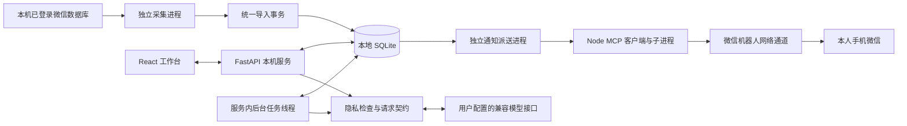
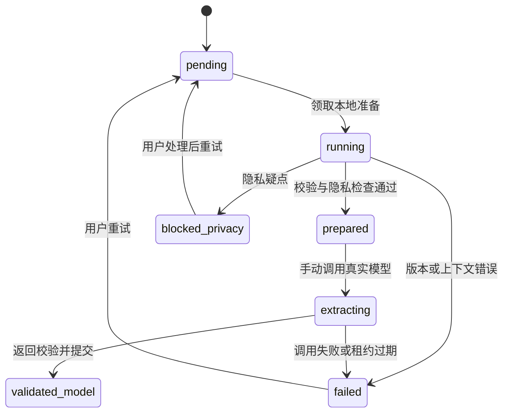

# 微信聊天记忆助手：当前系统完整技术文档

文档基准：2026-10-31（Asia/Shanghai）  
项目位置：项目根目录  
读者：使用者、后续维护开发者  
数据库版本：21  
范围：当前本机源码、数据库结构、页面和已有验收记录。本文是实现说明，不是未来需求清单。


## 目录

1. [系统定位与实现边界](#s1)
2. [架构、进程与技术栈](#s2)
3. [页面与用户操作](#s3)
4. [采集、导入与搜索](#s4)
5. [记忆、证据与人工核对](#s5)
6. [历史初始化](#s6)
7. [AI 与新消息自动处理](#s7)
8. [人物资料与隐私替换](#s8)
9. [提醒、通知与变更日志](#s9)
10. [运行生命周期与异常恢复](#s10)
11. [代码模块与依赖](#s11)
12. [配置、部署与维护](#s12)
13. [测试、验证与现有限制](#s13)
14. [完整数据库字典](#s14)
15. [完整 HTTP 接口与请求契约](#s15)
16. [文档核验清单](#s16)

<a id="s1"></a>
## 1. 系统定位与实现边界

系统在个人 Windows 电脑上运行，读取已经绑定的微信账号与“指定联系人”单人会话，保存双方文字及非文字消息的类型信息。用户能查找原话、整理记忆、核对 AI 提炼结果、设置关注词，并在新的聊天与历史有关时收到微信机器人通用提示。

目前无需自建转发服务器，也没有 Android 客户端。电脑承担业务计算；外部模型接口承担推理；微信机器人借用微信消息通道到达手机。无需自建服务器不等于完全离线：模型调用和机器人发送都需要网络及相应外部服务。

| 业务 | 当前实现 | 关键边界 |
| --- | --- | --- |
| 微信采集 | 已接固定账号与指定联系人会话；首次历史导入及持续检查 | 不是所有联系人采集，不自动切换账号，不读取群聊 |
| 聊天搜索 | 本地 FTS5 字符分词，短词字面搜索 | 不是语义搜索；每次最多 50 条 |
| 记忆库 | 人工整理、AI 提炼、多条原文证据、确认、更正、停用 | 待核对和已确认都可供关联检索；确认不等于训练模型 |
| 历史处理 | 全量/所选范围冻结、后台准备窗口、逐窗口手动 AI 提炼 | 没有全历史一键自动付费提炼 |
| 新消息处理 | 开启后新增实时文字自动提炼、召回历史、判断提醒价值 | 仅处理开启后入库的新文字；不是重新扫描全部旧记录 |
| 特别关注 | 精确关注词，可附带已有记忆 | 不需要 AI；匹配不代表确认意图 |
| 普通提醒 | 候选经模型判断后形成提醒 | 召回仍用字面与人物线索，可能漏掉纯语义关联 |
| 手机通知 | 机器人向扫码本人发送固定通用提示 | 不含聊天详情、无手机详情同步/已读回执 |
| 人物资料 | 人工确认别名、历史号码、有效期与证据 | 同名、共用号码不自动合并人物 |
| 隐私处理 | 本地映射、敏感疑点阻断、返回代号校验 | 自由文本识别不完备；不能承诺自动匿名化全部内容 |

当前实现边界包括：手机改用机器人提示；详情仍在电脑；数据为标准 SQLite；没有向量库、OCR、语音转写、回复生成或对指定联系人自动发送消息的业务。

<a id="s2"></a>
## 2. 架构、进程与技术栈



以上箭头表示逻辑数据流。采集进程创建不启动后台线程的应用对象，通过 `app.state.ingest` 直接复用导入函数，不通过 HTTP 将聊天上传至本机服务；独立进程通过同一 SQLite 协作。

| 层次 | 实现 |
| --- | --- |
| 界面 | React、TypeScript、原生 CSS、Vite；hash 导航，无新增路由框架 |
| 本机 HTTP | Python / FastAPI / Uvicorn，单进程，`127.0.0.1:8765` |
| 数据 | Python sqlite3、SQLite WAL、FTS5、代码内顺序迁移 |
| 模型 | httpx 调用兼容 `/chat/completions` 接口；Pydantic 校验返回 |
| 凭据 | 模型密钥经 Windows DPAPI 保护；机器人凭据另存本机文件 |
| 采集 | 本地读取模块、绑定微信进程、数据库/WAL 快照、Python 规范化导入 |
| 通知 | Python 派送 → Node → stdio MCP → 项目内微信 MCP 实现 |
| 测试 | pytest、Playwright、Node 协议测试、隔离合成数据 |

依赖版本以 requirements.lock.txt、frontend/package-lock.json 和对应依赖清单为准；本文不记录个人电脑的已安装运行时版本。

<a id="s3"></a>
## 3. 页面与用户操作

启动自动打开有效期 60 秒的一次性链接。兑换后令牌存当前标签页 sessionStorage，刷新无需重抄；重启后端后旧令牌失效，页面提示“登录已失效，请重新连接”。

| 一级菜单 | 二级页面 / hash | 使用方式与内容 |
| --- | --- | --- |
| 首页 | `#/home` | 已导入、文字、有效记忆、当前提醒；采集/机器人开关；常用入口 |
| 聊天与记忆 | `#/memory/search` | 搜索原话，选择证据供其他页面使用 |
| 聊天与记忆 | `#/memory/library` | 人工整理记忆；展开记忆库；待核对/已确认；证据、更正历史 |
| 聊天与记忆 | `#/memory/people` | 建独立人物，确认别名和号码，查提及消息 |
| 提醒中心 | `#/reminders/list` | 普通 AI 关联、特别关注卡片、处理诊断、标错隐藏 |
| 提醒中心 | `#/reminders/watch` | 添加关注词、开关关注、查看关联记忆是否仍有效 |
| 任务管理 | `#/tasks/automatic` | 开关新消息自动处理、设置最近 24 小时调用上限、查看状态 |
| 任务管理 | `#/tasks/history` | 创建历史范围、准备/预览/手动提炼、暂停/重试/取消 |
| 设置与帮助 | `#/settings/model` | 基础 API 地址、模型名称、密钥、启用、测试、删除配置 |
| 设置与帮助 | `#/settings/privacy` | 创建真实值与代号映射、本地预览、处理映射冲突 |
| 设置与帮助 | `#/settings/import` | 读取 JSON 文件或粘贴统一格式并导入 |
| 设置与帮助 | `#/settings/help` | 按模块介绍功能和常见使用步骤 |

页面通过 `hidden` 隐藏而不卸载，切换时保留搜索、选择和草稿；这不是跨刷新保存。选中证据后，顶部选择条可跳到记忆、人物、历史任务页面。桌面左侧菜单和标题区固定，右侧内容滚动；窄屏改用紧凑导航。

全局状态、提醒、运行开关和待核对数量约每 3 秒刷新；模块仅可见时轮询，标签页隐藏时全部暂停，并通过 AbortController 取消在途请求。首页当前提醒仍是有上限列表的长度之和。

记忆库默认收纳，每页展示 10 条，接口取 11 条判断下一页；展开单条才看原文证据与更正。页面切换、按钮、处理中提示采用轻量动画；`prefers-reduced-motion` 会关闭动画。AI 动态条没有百分比，表示等待处理；历史覆盖条使用实际计数，统计口径见第 6 节。

### 自动登录与轮询

backend/__main__.py 先取得工作台锁再创建应用。服务器启动就绪后打开 #login=一次性码；前端模块加载即 replaceState 清除片段，再兑换 token，仅保存在当前标签页 sessionStorage。刷新保留登录，服务重启令牌失效，独立新标签页需备用令牌；由已有页面复制或带 opener 创建的标签页可能继承浏览器会话存储。片段清除降低历史残留，不声称能清除浏览器扩展或同步在清除前已读取的地址。

usePolling 统一 AbortController 和 visibilitychange：隐藏标签页停轮询并取消在途请求；模块不可见时停止其请求，返回时立即刷新。运行状态、首页统计、当前提醒和待核对数量为全局请求，导航徽标由全局计数供给；历史任务、自动处理和策略设置只在各自模块可见时轮询。搜索/保存等用户操作请求仍按操作执行。未实现 SSE 或后台标题提示。


<a id="s4"></a>
## 4. 采集、导入与搜索

### 4.1 固定来源与读取路径

`data/collector/binding.json` 保存账号目录、账号标识、目标联系人标识、微信 PID 和进程创建时间。程序同时核验 PID 与创建时间，避免 PID 被其他进程复用；微信重启后旧绑定不能继续使用，需要重新核验绑定。

`tools/contact_reader.py` 优先核验本机绑定的联系人标识；首次绑定使用本机环境变量 WECHAT_CONTACT_NAME 指定备注或昵称，必须唯一且不是群聊。读取路径包括联系人库和消息分片；构造固定联系人的 `Msg_` 表名，仅查询该会话。只加载 vendored `wechatauto.db` 模块，不初始化其 GUI 包，也绕过会尝试其他账号并保存密钥的构造器。读取所需密钥驻留内存，不主动保存密钥缓存。

快照处理固定为 4096 字节页：读取前后核对主库与 WAL 的文件签名；验证 WAL 头、salt、帧校验和；仅应用最后已提交事务内的帧；将解密快照放到 `data/collector-tmp` 临时目录；以只读 immutable SQLite 打开并执行 quick_check。正常上下文退出会清理快照，强制终止时不能保证临时明文立即清理。快照可暂时包含整个消息分片，持久导出与业务入库只保留指定会话。

首次读取生成 `initial.json` 与绑定文件，首次导入后写 `initialized.json`。持续模式启动时重新核验所有必需数据库的密钥、账号和联系人。新分片缺少已验证密钥、联系人不唯一、发送方不能归属、文字解码失败等情况下停止，不猜测归属。

### 4.2 持续采集与更新

一次读取结束后等待约 15 秒再检查，实际周期还包含读取和入库时间。未改变的分片复用内存缓存；改变的分片重新读取目标会话。每轮仍汇总快照，并和业务库已存记录比较，不是仅靠一条游标读取增量。

源 `local_id` 与分片路径共同标识消息；账号和联系人在业务层转换为 SHA-256 标识；适配器名为 `wechat-local-db-v1`。新记录 revision=1；正文、类型、时间或角色改变时 revision 增加。类型支持 text/image/voice/video/system/unsupported，非文字正文留空，不做媒体理解。缺失源消息只计 `source_missing`，不会自动删除本地记录，也不等同于微信撤回。

每批最多 500 条变更，调用同一导入事务；整个大历史分多批提交。中断后可幂等重放已提交批次。连续三次读取 OSError/ValueError 后停止；不将聊天内容或密钥写入运行异常日志。

### 4.3 统一导入事务

公共 JSON 请求每批 1–1000 条，每条文字最多 20000 字符。只允许一个会话，并固定 account_ref/contact_ref；生产库已绑定真实会话后不能直接导入另一会话的演示文件。

```json
{
  "account_ref": "synthetic-account",
  "contact_ref": "synthetic-contact",
  "mode": "history",
  "messages": [{
    "conversation_id": "synthetic-conversation",
    "source": {"adapter": "manual-json", "partition": "example", "id": "1"},
    "sender_role": "peer",
    "event_time": "2026-10-01T10:00:00+08:00",
    "type": "text",
    "text": "合成示例：最近下午不喝咖啡。",
    "revision": 1
  }]
}
```

以上仅为格式示例，不应拿到已绑定真实会话的库中测试。`schema_version` 默认 1，`observed_at` 可选。无时区或缺失 event_time 时 event_utc=NULL；不猜测时区。

唯一键是 `(conversation_id, adapter, partition, source_id)`。来源 ID 不同的同秒同文消息分别保留。较低版本跳过；相同版本但正文/类型/角色/原始时间不一致时整批 409 回滚；较高版本覆盖当前 message，同时使相关记忆、人物证据、任务、提醒失效并更新全文索引。

`history` 不触发新提醒和自动提炼。仅全新 `live` 消息执行近期关联失效、关注更新、普通候选入队及自动任务入队；已有消息修订不作为新消息重新触发。`ingestion_checkpoint` 是该适配器分区最后提交的输入来源 ID，不是采集端已经验证的增量游标。

### 4.4 搜索

消息和记忆全文索引均先对文本 `casefold()` 后按字符空格分隔。查询构造成加引号的 FTS 字面短语，不允许用户输入变成 FTS 运算表达式。消息搜索词长度最多 200，空词或超长返回空列表；按 event_utc/id 倒序最多 50 条。记忆搜索只显示 active，可按核对状态、ID 游标分页。索引由 Python 业务事务手动维护，并非自动同步触发器。

<a id="s5"></a>
## 5. 记忆、证据与人工核对

一条记忆是“摘要＋语义标签＋版本化证据”，不是复制的一条聊天。摘要最多 2000 字符，人工证据 1–20 段；AI 返回每条最多引用 12 条本次窗口消息。

| 属性 | 允许值与含义 |
| --- | --- |
| subject | self 我、peer 对方、third_party 第三方、unknown 未知 |
| polarity | positive 肯定、negative 否定、uncertain 不确定 |
| assertion | direct 本人陈述、reported 转述、inferred 推测 |
| temporal_kind | preference 偏好、plan 计划、past_event 已发生、fact 事实、unknown 未知 |
| origin | manual 人工、model 真实模型、synthetic 合成、manual_correction 人工更正 |
| status | active 有效、stale 源版本失效、incorrect 标错停用、superseded 被更正版替代 |

每段证据保存消息 ID、消息 revision、`[span_start, span_end)` 字符范围。原文从本机 message 取出，不使用模型提供的引文。范围按 Python 字符串索引解释，不是 UTF-8 字节偏移。本人陈述的 self/peer 主体必须由同角色原文支持；结构校验不能证明语义一定正确。

指纹为摘要、标签及排序证据的 SHA-256，完全相同且仍有效的内容返回已有 ID；已停用指纹不自动复活。这是严格幂等，不是语义去重。

“确认正确”写 memory_review 的当前 version，移入已确认列表，不删除记忆、证据、不关闭关注，也不向模型训练接口提交反馈。移回待核对删除确认记录。确认状态必须匹配当前 active 版本；更正后的新记录需重新确认。关联候选对所有 active 记忆召回，不只使用已确认记忆。

“标错并停用”范围较宽：写 correction，并将该记忆依赖的消息版本写 suppressed_evidence；使用相同消息版本的其他记忆也会停用，相关任务失效、附带记忆的关注提醒撤回。它不是只隐藏一张卡片。人工“更正内容”使用原证据建立新记忆、旧记忆变 superseded，以 supersedes_id 串接历史，明确允许此次更正版使用原证据，但阻止普通流程再次自动生成被纠错内容。

原文高版本覆盖后不保留完整旧正文副本。memory_evidence 保留旧版本号；版本不匹配时 quote=null，界面提示旧引用不可用。更正历史接口沿 supersedes_id 最多取 100 条；这不是全部源文本历史仓库。

<a id="s6"></a>
## 6. 历史初始化

历史初始化发生在消息已入库之后，用于冻结要处理的文字范围、拆窗口和准备模型输入，不是创建所有数据库表。表由服务启动迁移创建，原文导入和 AI 提炼是独立阶段。

全量模式选取截止时间 T0 之前的文字（包括时间未知记录，后续准备时会报错）；分批模式选择不超过 10000 个消息 ID。每窗口最多 12 条，相邻重叠 2 条，按 UTC 时间与 ID 排序；冻结消息 ID 和 revision，后续新消息不会自动进入旧范围。只允许一个 active/paused 的非 auto 范围。

后台自动执行“本地准备”：检查源版本、时间、纠错抑制、累计 12000 字符上限、隐私替换。成功为 prepared，绝不等同于已调用 AI。跨 30 分钟、有限窗口、会话含非文字等上下文警告随请求携带；非文字警告按整个会话保守标记，不代表窗口内一定有媒体。



范围可 active/paused/cancelled；cancelled 不能恢复。暂停会使正在 running/extracting 的工作退回 pending 并清理租约，迟到结果不能提交；取消会将所属任务取消，但不删除已生成记忆。重试仅使 failed/blocked_privacy 回 pending，不把输入换成新 revision。源版本变化时需重新创建范围。

本地准备租约 60 秒；真实提炼租约 60 秒。准备租约过期可重领；模型租约过期改 failed，不自动重发计费请求。预览也会写 model_request，并将该 job 先前 issued 请求标为 superseded，但不联网。

覆盖率按 `(message_id, revision)` 去重。一条消息出现在多个重叠窗口时，只有所有相关窗口均 validated_model 才计入真实提炼覆盖；prepared 口径包括 prepared/extracting/validated_synthetic/validated_model。没有记忆输出的合法空结果也算该窗口完成提炼。当前范围不会自动改为 completed；接口单独返回 extraction_complete。列表只返回最近 20 个历史范围，每个范围前 200 个任务，当前没有任务翻页接口，因此大范围后续窗口的手动操作入口受此限制。

<a id="s7"></a>
## 7. AI 与新消息自动处理

### 7.1 模型配置与请求边界

配置包含 base_url、model、api_key、enabled。基础地址不含 `/chat/completions`，程序自动追加；远程必须 HTTPS，本机 localhost/127.0.0.1/::1 可 HTTP；不允许 URL 内凭据、查询串或片段。更换 API 地址必须重新填密钥，相同地址留空可保留已有密钥。配置写临时文件再替换；密钥用 DPAPI 加密后 Base64 存储，读取接口只返回 has_key。

模型采用非流式 JSON 输出：`stream=false`、`max_tokens=4096`、`response_format={type:json_object}`。httpx 超时配置 30 秒（网络操作超时，不是严格全程总时限），不跟随重定向、不采用环境代理；HTTP 必须 200，响应最多 256000 字节，finish_reason 必须 stop，content 必须字符串。测试调用只发固定合成连接检查，不发聊天。HTTP 成功但 JSON 不满足要求仍失败。

模型“允许调用”开关是实际发送门槛；新消息自动处理还有独立开关。手动提炼与连接测试记录到统一 usage_ledger，但不使用自动调用数额度，所以自动额度不是全系统费用上限。

### 7.2 提炼契约

提示词版本 `extract-v2-zh`。外发字段为 source_ref（s1 等本次临时编号）、role、隐私替换后的 text、上下文限制与警告。系统不附带账号标识、源 ID、文件路径、完整映射表、独立的精确时间字段；但正文自身的日期未被统一删除，`exact_dates_omitted` 不能理解为正文完全无日期。

输出为 `{"memories":[...]}`，最多 30 条，每条具备摘要、subject/polarity/assertion/temporal_kind 四个语义标签和 source_refs。摘要提示要求简体中文；实际最低程序校验是真实模型摘要必须含汉字，不是完整中文语言检测。允许空 memories。聊天中的命令被提示视作数据，程序没有给模型开放工具执行能力；这降低越权面，不保证模型理解绝无误差。

提交前同时复核：任务范围仍 active、租约/owner、源版本、隐私检查、映射指纹、完整输入哈希、返回字段类型与额外字段、引用编号、代号合法性。代号只能来自当前请求；本地还原后再写记忆。同请求重复提交相同结果幂等，不同结果拒绝；整批记忆原子提交，任一失败不会只保存一半。

### 7.3 新消息自动链路

1. 用户开启自动处理，建立 `mode=auto` 的 initialization，auto_control 指向它。
2. 新增 live 且有已知 UTC 时间的文字入库，最近 120 秒最多 8 条上下文中取文字建 auto_extract job，ready_at=当前入库时刻+10 秒。
3. 新上下文将范围内旧 pending/processing 自动任务置 superseded，对应 job 取消；已经完成的旧记忆不因此删除。10 秒是处理前等待，不是手机通知总时延保证。
4. 后台优先准备 auto_extract，准备完成且等待到时、配置允许、额度足够时，auto_message 变 processing，租约 300 秒。
5. 调用一次模型提炼，随后重算当前可用历史候选；只在触发消息来自 peer 时有普通关联候选。self 新消息可提炼并使旧关联失效，但不会独立产生新的普通提醒。
6. 最多执行 3 次候选判断；其余 pending 候选标 rejected/candidate_limit。判断 true 形成 confirmed_model，false 为 rejected；不以字面匹配直接当确认。
7. 自动任务结束为 done/partial/failed/blocked_privacy；结果已被新上下文替代或暂停时，不覆盖 superseded。
8. 独立机器人派送器发现有效提醒后发送通用通知。

候选先对近期文字和记忆摘要做字符二元组交集计分，附加有证据人物提及交集，最多召回 10 条。所有历史证据必须严格早于近期窗口最早消息，防止刚提炼的当前片段被当历史提醒。判断输入含当前文字、历史摘要/证据、近期角色消息、语义标签、经隐私处理的人物候选，累计限制 12000 字符；人物提及最多 40 条。模型只返回严格布尔 `confirmed`，不确定、闲聊、已解决或无提醒价值时应返回 false。

默认最近 24 小时自动调用上限 200，可设 1–2000。每次请求发送前预留 usage_ledger；旧 auto_call 已迁入账本，保留旧表但不再写入，失败也计入；不是自然日归零，也不按 Token/金额计费。额度满时未开始的任务等待；一窗口最多 1 次提炼＋3 次判断。部分完成不会自动无限补发。自动任务 processing 租约过期标 failed/interrupted，避免中断后重复计费。

暂停自动处理会取消尚未完成的自动窗口、使相关 pending/judging/confirmed_model 关联失效，但保留已保存记忆；已发出的 API 请求可能仍收费。恢复只建新范围并处理此后新入库消息。程序重启与用户“暂停”不同：持久开关仍启用时，待处理任务可继续；过期的已开始任务按失败处理。超过入库新鲜度的补采消息只进入历史补提炼出口，不触发实时提醒；队列开始处理及发送前分别检查有效期。

### 用量与反馈底座

手动提炼、自动提炼/判断和连接测试统一在 usage_ledger 调用前以 reserved 状态预留，输入用 UTF-8 字节数加开销保守估算，输出预留 4096。合法 usage 返回后记录输入、输出；开始尝试写出请求头后转为 unknown；已发请求的缺失、不合法 usage 或超时保留原预留。能确认发送前失败时转 released 并清零预留，不计自动调用次数。reserved 与 unknown 都计入并发调用数；开始写请求头不等于服务端接受，无法确认时保守占用。自动调用仍按账本的 automatic 类型滚动 24 小时计数，旧 auto_call 只作历史兼容。现已提供滚动 24 小时 Token/金额上限和持久批量运行；默认不启用全局预算，批量运行必须显式给出窗口数及 Token 上限。金额模式只允许在当前模型与接口单价已确认时启用。

反馈仅保存在本机数据库，确认、重新核对和标错绑定记忆版本及证据版本；源修订由触发器使反馈失效。它不是召回相关性标签，不代表未被召回候选的质量。原文修订只让已有 deferred_message 重新进入手动出口，不重发实时提醒。job_message 保存窗口消息版本关系，GET 状态聚合只读且不解析窗口 JSON。

### 只读召回与本机基线

`backend.associations.rank_candidates(db, trigger_id)` 只读返回旧二元组算法的前 10 条候选，包含 memory_id、memory_version、trigger_revision 和 score。`enqueue_candidates` 调用它后才执行 INSERT OR IGNORE。打分、人物加分、同分按记忆 ID 降序、证据早于窗口起点等行为保持不变；没有 IDF、向量或阈值调优。

召回先读取有效记忆的 ID、版本和摘要并计算词面分数。无人物线索时，仅为非零分记忆预取证据的时间和版本，不选择消息正文；有人物线索时，为保留纯人物命中，需要检查全部有效记忆的历史正文。证据 ID 集合以绑定 JSON 数组传给 SQLite，避免分块参数上限，并按记忆分组流式消费，避免在 Python 中同时保留全部证据正文。人物提及规则只加载一次，供当前窗口和历史证据复用。`evidence_before` 可接收已预取证据，仍执行相同的严格时间和版本条件。摘要词集使用进程内、最多 32768 项的 LRU 缓存，键包含记忆 ID、版本和摘要内容；不缓存证据有效性或人物关系，不持久化缓存。

`tests/legacy_retrieval.py` 冻结重构前算法，`tests/legacy_entity_context.py` 同时冻结旧人物提及规则。测试逐条比对候选顺序、版本、分数及实际入队结果；人物线索有/无及词面命中密集/稀疏四种场景，在不同记忆规模下检查查询次数固定，并验证每记忆 1/20 段证据下的行数、正文投影及结果一致性。固定语句数不代表读取量或 CPU 开销固定；人物线索场景的历史读取仍随记忆规模增长，并在 mode=ro/query_only 连接验证查询无写入。评估脚本、样本和产物仅存本机 data/eval，不进入发布。当前只提供分层冻结抽样、旧检索器运行、无标签 SQL/耗时报告和合成规模基线；交互标注、标签有效性校验、相关性指标及成对比较尚未实现。候选可用性直接复用生产 evidence_before，不另写时间规则。

### 硬预算与持久批量提炼

入口：设置与帮助 → 调用预算；任务管理 → 历史初始化 → 有预算的批量提炼。每次调用在 usage_ledger 的同一 BEGIN IMMEDIATE 事务内检查已有自动调用数上限、滚动 24 小时预算和所属批次预算后预留；多个入口并发共用此闸门。批量提炼仍通过 issue_request、隐私替换/阻断和 commit_response，不增加绕过隐私与证据契约的模型路径。

预算窗口：全局为滚动 24 小时；单批为 batch_run 生命周期。两者同时检查。批量 max_windows 限定分配窗口和最多实际调用数；单价绑定 base_url 与 model，切换后金额模式阻止发送，需重新确认。Token 上限必须不少于 4096，窗口数 1–100。输入用 UTF-8 字节数加固定开销保守估算，输出预留 4096；这是本机额度闸门，不能保证供应商账单绝对不超过估算。

金额使用整数微元（1 元 = 1000000 微元），单价为每百万 Token 的微元数。输入采用输入价/缓存输入价较高值，输出采用输出价/推理输出价较高值，忽略优惠保守计价；若供应商有这些 Token 之外的独立费用，须由用户填写合并后的保守价。没有自动抓取供应商价格，亦不承诺精确还原账单。每个调用保存当时有效单价，不因之后编辑单价而重算旧账。

汇总按状态取值：settled 使用实际 input_tokens+output_tokens 及按冻结单价计算的 actual_cost；reserved/unknown 使用预留；released 为零，不把预留和实际叠加。无法计价不按免费处理：金额模式下，只要对应窗口有未计价调用或当前单价失配，就阻止新调用。旧 legacy 调用若缺输入估算，在启用硬预算后也会阻止发送，直到其移出滚动窗口；不会清空账本绕过限制。

reserved 持有 120 秒租约。后台只在存在过期预留时将其保守改为 unknown，不释放未知费用；发送前失败才释放。运行或配置发生变化导致确认未发出时，沿用 released；已开始写请求头及超时结果保留占用。模型可能超时、计费或返回异常，已发请求无法撤回。

batch_run/batch_step 持久保存冻结窗口 ID、运行上限、模型与状态；请求幂等键防止重复提交，同一历史范围只允许一个 active/paused 批次，活动窗口只被一个批次占用。后台工作线程顺序调用，不占用一次 HTTP 请求。预算不足转 paused，未发送窗口仍 prepared；全局额度不足可调整后手动继续；单批上限创建后固定，不足时取消后按新上限新建运行，已完成窗口不再分配。中断且结果未知的窗口不自动重发；失败和未知窗口不因“继续批量”重新计费。仍待处理的其他窗口可以继续，失败窗口需先人工核验，再通过历史任务的显式重试与新批次操作处理。

暂停/取消不撤销已发请求；发送前会再次检查批次状态。取消历史范围仅将未完成的 deferred_message 回到待处理，validated_model 的 job 与完全提炼的消息保留，避免再次付费提炼。此前的 cancelled 范围若已重置完成状态，迁移不推测恢复已丢失的运行状态。

版本 21 将预算表与消息索引合并为一次迁移：message_time(event_utc DESC,id DESC) 支持后续日期/游标搜索；message_conversation_time(conversation_id,event_utc DESC,id DESC) 支持现有近期上下文。当前尚未交付搜索日期过滤/翻页 UI。导入在显式写事务内召回；自动重算的只读排名发生在首条 INSERT 隐式开启写事务之前。此版本没有把导入召回改成后台任务，也没有交付“1000 条人物召回不超过 100 毫秒”的保证。

<a id="s8"></a>
## 8. 人物资料与隐私替换

人物 person 与隐私映射 entity_value 是不同概念。人物可同名、号码可属于多人；人物 label 不等于自动身份识别。person_property 支持 alias/phone、有效期、确认说明、可选原文证据，新增时必须 confirmed=true。号码写对应 PHONE 隐私映射；别名关系本身不自动成为 PERSON 替换规则。

有效期是 `[valid_from,valid_to)`，输入必须带时区并转换 UTC。查找别名/号码返回候选、歧义与时间不确定标记，`identity_confirmed=false`。查询模式为按当前人工记录回溯，不是声称重建当时所有身份信息。人物消息浏览按 ID 游标每页 50 条，内部可能扫描大量消息。

进入 AI 关联的人物关系要求有证据、证据版本未变且证据早于当前窗口；无证据关系可在本机管理与查找，但不作为 AI 有证据的人物上下文。撤回关系不删除旧代号，防止历史含义被改写。

隐私映射支持 PERSON/PHONE/EMAIL/ADDRESS/ID，随机代号稳定存本机。电话规范化移除空格/连字符，对完整中国手机号才移除 +86/0086 前缀，其他种类保持字面值。替换只执行一遍，避免替换后的代号再次被处理。

原文已包含合法代号样式时先阻断；未替换内容出现手机号、邮箱、身份证样式或住址/病历/诊断等疑点也阻断。规则不覆盖所有姓名、地址、日期、金额或自由表达。`preview_only` 仅表示本地检查通过，没有代表全局模型已关闭；实际发送由模型配置与任务路径决定。

同一规范化值有多个旧代号时产生映射冲突。用户明确确认候选组并选择未来使用的代号；服务器比较 expected_tokens 防止基于旧页面覆盖变化。mapping_resolution 不重写历史映射真实值。映射表、决议和规范化版本整体参与模型指纹，变化会拒绝迟到结果并使已确认关联重新检查。

<a id="s9"></a>
## 9. 提醒、通知与变更日志

### 9.1 两种提醒

特别关注由 watch_item 定义，对方文字包含完整关注词（casefold 后子串匹配）时生成“可能相关”。可选择已有 active 记忆作为历史依据，历史证据必须早于当前窗口。近期 120 秒/8 条内补充会更新已有卡片，self 补充只更新不新建；同窗口内已标错卡片不复活。关闭/重新启用关注都会增加 revision 并撤回旧提醒。

普通关联由 association 表保存召回与判断状态，只有 confirmed_model 或演示的 confirmed_synthetic 出现在普通卡片。显示与发送前重新核验来源、记忆版本、上下文及映射指纹，不再符合时持久化 stale。标错普通关联只 dismissed 此关联，不自动删除历史记忆。合成确认不会进入真实普通通知派送。

### 9.2 机器人链路与去重

机器人登录、派送开关、AI 自动开关互相独立。通知程序每轮优先关注提醒，否则普通模型提醒，每轮最多一条，之后等待约 10 秒。启动后可处理已有未尝试的有效提醒，不只处理启动后生成的提醒。

BotSender 启动 `node tools/wechat_bot.mjs notify`，不传联系人、正文或任意收件人参数。Node 通过项目内 MCP 获取账号，必须恰好一个配置完成的本人账号，使用其 userId 作为接收人，并要求本机保存本人会话上下文令牌。通知正文固定为“有一条待查看提醒，请在电脑工作台查看详情”，不含聊天内容。

发送前同一事务检查有效性、15 分钟有效期、发送时本地勿扰和 2 小时记忆冷却，再预占 uncertain；网络 I/O 在事务之外执行。队列与发送共用有效性筛选。accepted 表示通道接受，不代表手机展示。

Node 机器模式看门狗约 40 秒，关闭子进程另留 3 秒；Python 子进程等待上限 55 秒。历史上对本人手机的合成通知已有用户确认收到且弹通知，但长期会话有效性、离线/换网恢复和所有手机环境未穷尽验证。已发送微信消息不会因本地撤回而消失。

### 9.3 Outbox 不等于发送队列接口

outbox / ordinary_outbox 由 SQLite 触发器记录提醒版本变化，使用独立 seq 游标。`backend/outbox.py` 的 changes/ordinary_changes 以游标取事件并合并为当前状态，返回 ID/status/revision，不返回聊天。它们是本地函数，没有手机读取 HTTP 路由、设备注册、游标确认或已读协议。

实际机器人派送直接查 reminder/association 与发送记录，不通过 outbox 消费。删除或回滚发送记录可能引起重复通知，不能将其当缓存随意清空。

### 执行路径与默认值

导入层按消息 event_utc 与入库时刻比较：5 分钟内且未来偏差不超过 2 分钟，才作为新消息触发关注、关联候选和自动处理。过旧、明显未来或时间未知的新增文字仍入库，并记录到 deferred_message。原有历史模式仍不触发实时业务。消息年龄不使用采集到达时间替代。

发送有效期独立为 15 分钟，仍从原始消息 event_utc 计算，允许采集、防抖、模型和排队延迟。自动队列在开始处理前检查有效期，失效转 expired 并进入手动历史提炼出口；已开始的模型调用不能撤回，真实发送时再次检查。设置字段均为整数秒。

真实关注与普通提醒在同一 BEGIN IMMEDIATE 事务内核对有效性、年龄、发送时刻电脑本地时间的勿扰、冷却与重复，再预占 uncertain，提交后发网络请求。默认勿扰 23:00–08:00，同一记忆冷却 7200 秒；无关联记忆的关注按关注项冷却。起止相同关闭勿扰，结束边界不含在内。受限记录置 suppressed 并记录原因，保留卡片，不自动补发。真实手动发送同样受限；显式合成测试记录 synthetic=1，豁免策略且不写旧真实发送表。

冷却同时读取 notification_record、notification_attempt 和 association_notification 中 accepted/uncertain，升级前记录仍生效。accepted 只表示通道接受；uncertain 不自动重发。唯一键防止同一个项目在同一通道重复预占，旧表约束不改。


<a id="s10"></a>
## 10. 运行生命周期与异常恢复

真实 `data` 目录的后端启动时持有 Windows workbench 字节锁，并写唯一 session 标记。采集/通知启动时绑定当前 session，循环检查 stop.request 和 session 是否仍有效。正常退出创建两个停止文件；强制结束时操作系统释放锁，子程序检测原 session 失效，不会被后来新开的工作台接管。

关闭浏览器不会结束后台。关闭工作台命令行窗口会使两个受管程序停止；已经发起的读取、API 调用或发送可能短暂收尾。采集在源读取完成后再查 session，避免结束后开始新一轮入库。自动处理在每次新增模型调用前检查停止事件，但已经发出的网络请求无法撤回。后台线程停止等待上限 15 秒，不应理解为所有外部请求的硬终止期限。

独立 collector/bot 单实例锁避免重复启动。运行接口综合锁、状态文件、心跳与 stop.request 返回 starting/running/stopping/stopped/unresponsive/error；状态更新时间超过 90 秒且持锁可标 unresponsive。采集详情另外有 watching/retrying/history_imported/stale 等状态，不能和运行接口枚举混用。

PreparationWorker 串行循环恢复过期模型任务、准备一个窗口、处理自动任务；演示模式使用 fixture。活跃时等待约 0.05 秒，空闲约 0.5 秒。SQLite 锁忙等待 1 秒再试；其他未处理异常停止线程并输出不含聊天的错误码，页面可“恢复后台准备”。仅重新开启线程不等于自动重试失败付费任务。

<a id="s11"></a>
## 11. 代码模块与依赖

### 11.1 后端与采集/通知适配器

| 文件（相对项目根目录） | 职责 |
| --- | --- |
| `backend/__main__.py` | 生成应用、显示会话令牌、绑定回环地址启动服务 |
| `backend/app.py` | 应用组装、边界中间件、生命周期、统一导入、搜索、关注/提醒接口 |
| `backend/models.py` | 严格请求模型、消息契约、时间转换 |
| `backend/store.py` | SQLite 连接、19 版顺序迁移、FTS 字符分词 |
| `backend/collector.py` | 源行规范化、版本比较、500 条分批入库、采集状态 |
| `backend/wechat_snapshot.py` | 源库/WAL 一致性、解密临时快照与只读校验 |
| `backend/memories.py` | 证据记忆、确认、停用、更正链、索引与来源失效 |
| `backend/jobs.py` | 历史范围、窗口、本地准备、租约和覆盖统计 |
| `backend/model_contract.py` | 提炼提示、请求指纹、隐私与返回契约、原子提交 |
| `backend/extraction.py` | 合成 provider 编排、过期提炼恢复；真实发送在 ai_settings |
| `backend/ai_settings.py` | DPAPI、模型配置、HTTP 调用、测试与手动提炼 |
| `backend/automatic.py` | 新 live 消息入队、防抖、自动额度、真实提炼与判断编排 |
| `backend/worker.py` | 服务内单后台线程、循环与异常状态 |
| `backend/associations.py` | 近期上下文、候选召回、判断、指纹核验、普通提醒 |
| `backend/watches.py` | 关注词命中、近期卡片更新与撤回 |
| `backend/entities.py` | 人物、别名、号码、有效期、引用证据及回溯消息 |
| `backend/entity_context.py` | 供关联判断使用的有证据人物提及候选 |
| `backend/privacy.py` | 稳定代号、号码规范化、替换预览、疑点阻断 |
| `backend/mapping_conflicts.py` | 规范化映射冲突、人工决议 |
| `backend/outbox.py` | 两种本地变更日志的游标合并读取 |
| `backend/notifications.py` | 发送预占、去重、结果记录；另有 ServerChan 适配类 |
| `backend/bot_sender.py` | Python 到固定 Node 通知客户端桥接 |
| `backend/runtime.py` | 工作台/子程序锁、session 生命周期、开关与状态 |
| `backend/__init__.py` | Python 包入口标记 |
| `tools/wechat_source.py` | 仅加载 vendor 数据库模块，来源目录探测 |
| `tools/contact_reader.py` | 固定账号/指定联系人解析、分片读取、首次绑定导出 |
| `tools/collect_contact.py` | 首次导入、持续采集、进程绑定与停止处理 |
| `tools/bot_dispatch.py` | 通知派送循环、隔离合成队列样本 |
| `tools/wechat_bot.mjs` | 项目 MCP 登录/检查/固定本人测试与通知 |

### 11.2 前端

`main.tsx` 负责登录、主状态、轮询、页面组装、消息搜索、导入、关注与隐私预览；`Navigation.tsx` 定义菜单/hash/保留挂载；`style.css` 定义布局、适配和动画；`Processing.tsx` 是无百分比的状态动效。

记忆模块为 `MemoryEditor.tsx`（整理/关联关注）、`MemoryLibrary.tsx`（核对分页）、`MemoryRevision.tsx`（更正/历史）。人物模块为 `Entities.tsx`、`EntityLookup.tsx`、`EntityMessages.tsx`。提醒模块为 `OrdinaryReminders.tsx`、`AssociationStatus.tsx`。任务为 `Tasks.tsx`、`Automatic.tsx`；设置为 `AISettings.tsx`、`MappingConflicts.tsx`；运行开关为 `RuntimeControls.tsx`；使用帮助为 `Help.tsx`。组件共用由主界面传入的 API 函数和操作回调，没有全局状态管理库。

### 11.3 第三方代码和测试工具

`tools/wechatauto-replica` 是来源读取所依赖的第三方源码目录，当前业务仅使用数据库模块；其中 GUI、发送、朋友圈等大量能力不代表本项目启用这些业务。`tools/wechat-mcp` 是本地第三方 MCP 实现，当前桥接仅用账号、登录、测试接收及固定通知发送路径；媒体和任意好友发送不暴露为本项目工作台接口。其 sendMessage 本地业务回执修复有独立协议测试，升级 vendor 时需保留并核验现有行为。

`tools/synthetic_demo.py`、`context_fixture.py` 提供隔离演示；`browser_check.py` 启动临时测试服务；`smoke.py`、`initialization_restart_check.py`、`check_collector_control.py`、`automatic_acceptance.py` 分别用于冒烟、任务恢复、采集控制与模型合成验收。`notification_demo.py` 默认仅本地模拟；加 `--serverchan-test` 才真实调用 Server酱（凭据从环境变量 SERVERCHAN_SENDKEY 或交互输入读取，不持久保存）。`notification-demo.cmd` 对应本地模拟，`notification-wechat-test.cmd` 对应 Server酱测试。这个备用测试适配器未接入工作台日常派送；机器人测试入口则可能真实发送本人通知。

新增模块：backend/backups.py 管理升级备份；backend/login.py 管理一次性登录码；backend/policy.py 管理通知策略；backend/phase1_schema.py 定义版本 20 单次迁移；backend/usage.py 管理调用账本；frontend/src/usePolling.ts 管理可见性轮询；NotificationSettings.tsx 展示通知设置和上次升级失败；tools/generate_reference.py 生成数据库与接口文档并供测试检查。

<a id="s12"></a>
## 12. 配置、部署与维护

### 12.1 文件与状态

| 路径 | 内容与保留规则 |
| --- | --- |
| `data/memory.sqlite3` 及 `-wal` / `-shm` | 原文、记忆、任务、隐私映射、发送记录；不是临时缓存 |
| `data/ai-settings.json` | 基础地址、模型、启用状态、DPAPI 密文 key_encrypted |
| `data/collector/binding.json` | 本机来源绑定，含账号路径/标识；不对外分享 |
| `data/collector/initial.json` | 指定会话首次导出，包含真实聊天；并非匿名样本 |
| `data/collector/initialized.json` | 首次导入标记，不是完整数据校验报告 |
| `data/collector/status.json`、`worker.log` | 采集心跳、计数与运行诊断 |
| `data/collector/collector.lock`、`stop.request` | 采集锁和停止信号；锁文件存在不代表持锁 |
| `data/collector-tmp` | 读取期间临时解密快照；异常强杀可能留下文件 |
| `data/bot/status.json`、`worker.log`、`bot.lock`、`stop.request` | 通知运行状态与控制 |
| `data/runtime/workbench.lock`、`session` | 工作台存活锁及非凭据性质的生命周期标识 |
| `data/wechat-bot` | 机器人账号凭据、本人会话上下文、临时目录；未做 DPAPI 保护 |
| `data/bot-acceptance` | 隔离合成队列及持久发送去重记录 |
| `data/backups` | 升级前自动备份与人工备份；自动文件保留最近 5 份 |
| `frontend/dist` | 已构建静态页面，由 FastAPI 托管 |
| `.venv`、`frontend/node_modules`、`tools/wechat-mcp/node_modules` | 项目依赖，重建依赖清单而不是业务数据库 |
| `docs/screenshots`、`samples`、`tests` | 合成验收截图、合成输入、测试源码 |

### 12.2 启动与重建

日常双击项目根目录 `run.cmd`，访问 `http://127.0.0.1:8765`，自动登录；失败时输入窗口备用令牌，从首页启用采集/机器人。机器人已登录不等于派送正在运行；启用 AI 配置不等于自动处理已开启。自动调用开关持久保存，但采集/机器人不会因为重新打开页面而自行启动。

`setup.cmd` 创建虚拟环境、按 `requirements.lock.txt` 安装 Python 包、在 frontend 执行 npm ci 和构建。它不完成微信绑定、机器人登录，也不自动安装/构建所有 vendor 目录，不能视为完整一键交付安装包。源码与已编译 vendor 内容、各 lock 文件均需保持一致。

```powershell
# 项目根目录：安装本项目依赖与构建前端
.\setup.cmd
# 单独重建前端（先进入 frontend）
npm.cmd ci
npm.cmd run build
# 机器人 MCP（先进入 tools\wechat-mcp；保留本地回执修复）
npm.cmd ci --ignore-scripts
npm.cmd run build
```

常用入口：`collect-contact.cmd` / `stop-contact.cmd` 控制已绑定采集；`wechat-bot-login.cmd` 扫码；`wechat-bot-notifications.cmd` 派送；`wechat-bot-test.cmd` / `wechat-bot-queue-test.cmd` 是可能真实发送的合成测试。`demo.cmd` / `demo-context.cmd` 使用隔离临时库，和真实工作台共用端口，不能同时运行。首次绑定属于本机开发工具操作，尚无通用联系人选择/重新绑定向导。

### 12.3 安全与访问边界

仅监听回环；Host 精确允许 localhost:8765/127.0.0.1:8765；有 Origin 时同样严格限制；`/api/` 要求 Bearer 会话令牌并用恒定时间比较。没有账户系统、多租户、角色权限、远程设备登录。FastAPI 自带 docs/redoc/openapi HTTP 路由关闭。

正常响应设置 no-store、nosniff、no-referrer、CSP（self 资源、禁止嵌入）。边界中间件提前返回的拒绝响应未经过后续头设置。React 使用文本渲染聊天，不执行聊天中的 HTML。静态前端不需要令牌，业务 API 才需要。不能将服务改成公网监听后直接当多用户服务使用。

业务数据库和映射表为明文 SQLite；机器人凭据是本机文件；模型 Key 有 DPAPI 但不代表整库加密。DPAPI 密文不保证能被另一个 Windows 用户直接解密。项目没有验证卷加密、彻底擦除或自动全量脱敏。

### 12.4 运维现状与排查

| 现象 | 当前可用检查与处理 |
| --- | --- |
| 页面 401 / 刷新失败 | 检查服务是否运行，使用当前启动窗口令牌；旧页面可能只显示上次数据 |
| 采集停止或绑定失效 | 看运行状态；微信重启后需重新核验进程/账号/联系人绑定，不自动回退其他账号 |
| 新消息没提炼 | 检查是否新增 live 文字、时间已知、自动开关、模型开关/密钥、额度、后台线程、隐私阻断 |
| 历史 prepared 但无记忆 | prepared 仅是本地准备；需手动发起提炼；合法空 memories 也可能无新增记忆 |
| 模型 failed / 超时 | 查看任务/自动记录；不盲目重试，超时可能已收费；源版本变化需新范围 |
| 提醒没弹手机 | 先确认是否生成有效提醒、机器人是否运行、登录与本人上下文是否有效；查看 accepted/uncertain |
| 机器人 uncertain 后停止 | 先核对手机；记录保留，不清库重发；再次启动可处理其他未尝试提醒 |
| 数据库忙 | worker 会有限间隔重试；其他接口受 SQLite 10 秒连接等待限制，不保证永不锁冲突 |
| 历史全量列表只显示部分窗口 | 当前每范围返回前 200 个 job，没有后续任务分页入口 |

已实现升级前自动备份和最近 5 份保留；尚无图形化恢复向导。首次真实升级前停后台并完整复制 data/；手动升级备份至少保留 14 天且确认新版本稳定后再人工清理，不自动删除；独立备份恢复及再次升级由合成测试覆盖。

### 迁移备份和恢复

版本变化才执行迁移保护：持有工作台锁后同时取得采集和机器人锁，写入方未停止则拒绝升级。备份前检查可用空间至少为 SQLite 页大小估算的两倍加 64 MiB，SQLite 在线 backup 后检查 integrity_check 和 user_version，再将临时文件重命名。任一备份步骤失败不执行迁移。

自动文件固定前缀 migration-auto-，目录 data/backups，成功迁移后只清理该前缀的旧文件，保留最新 5 份；人工备份不清理。五份备份是五份明文聊天副本。代码检查环境变量标识的 OneDrive 目录并拒绝在那里备份；其他同步软件不能自动穷举，部署者仍须确保数据目录不在任何云同步范围。

首次真实升级先停止工作台、采集、机器人，完整复制 data/（包含当时存在的 -wal 和 -shm），保留于本机忽略的 private/ 目录。恢复时先停所有后台，保留当前数据目录，在独立目录恢复完整副本；不要将某次数据库文件与另一次 WAL 混用。自动 SQLite 备份是独立完整数据库，可在隔离目录恢复后执行完整性和版本检查，再用匹配版本程序启动；当前版本启动旧备份会再次迁移。没有降级迁移。


<a id="s13"></a>
## 13. 测试、验证与现有限制

回归使用隔离合成数据、模拟模型和发送器，不读取真实微信、不产生模型费用。Phase 1 增加十万条补提炼状态查询、无效队首、空闲写事务、并发调用数和版本化反馈测试；CI 使用 Windows、Python 3.10，构建机器人协议依赖和前端后运行测试及浏览器验收。

真实验收依据包括：此前真实会话导入及新消息更新验证；用户确认两轮本人手机合成通知弹出；已配置模型用隔离合成输入完成 2 次调用、1 条确认关联、模拟发送一次（公开文档不收录个人验收记录）。这些不构成长期稳定性或全部自然语言语义准确率保证。

| 测试文件组 | 主要覆盖 |
| --- | --- |
| test_core / collector / wechat_snapshot | 导入、来源版本、字面搜索、源规范化、WAL 提交与快照 |
| test_memories / replacement / memory_review | 证据、纠错传播、更正链、版本确认与分页 |
| test_jobs / worker_recovery / extraction | 固定范围、租约、恢复、合成提炼 |
| test_model_contract / injection_boundary / recent_context | 返回契约、聊天指令边界、上下文变化与迟到结果 |
| test_automatic / ai_settings | 自动调用门槛、额度、暂停、HTTP/配置与 DPAPI 路径 |
| test_entities / entity_* / normalization / mapping_conflicts | 人物关系、历史号码、提及候选、规范化与冲突 |
| test_associations / association_diagnostics / watch_context / memory_watches | 普通判断、诊断、近期关注和附带记忆 |
| test_outbox / ordinary_outbox / notifications / bot_sender | 变更日志、预占去重、发送异常 |
| test_runtime / workbench_lifetime | 进程开关、锁、工作台退出联动 |
| frontend/e2e/workflow.mjs / context.mjs | 登录、导航、表单保留、搜索/记忆/隐私、窄屏、动效及合成上下文 |
| tests/wechat_bot_protocol.test.mjs | 机器人协议业务回执解释；离线模拟，不发消息 |

复现命令（不要在真实服务占用 8765 时启动浏览器测试）：

```powershell
.\.venv\Scripts\python.exe -m pytest -q
.\.venv\Scripts\python.exe -m tools.browser_check
.\.venv\Scripts\python.exe -m tools.browser_check --context
node --test tests/wechat_bot_protocol.test.mjs
```

现有限制还包括：没有已量化的提醒准确率/漏报率评估集、长时间在线与网络切换验收、付费 Token/金额仪表盘、全局并发调用控制、语义向量召回、自动话题边界、统一人工处理全部失败队列、完整数据库源修订历史、多设备详情和同步回执。这里描述的是当前边界，不是本次实施计划。

状态文案已按真实执行路径更新：worker 的 scope 表示准备窗口和按开关执行自动处理，普通关联诊断的 scope 仅表示候选诊断；privacy.preview 的 external_enabled=false 仅表示此次本地预览不外发，不能解释为全系统禁止模型或机器人调用。机器人通道接受显示为“已发送（通道已接受）”，不代表手机已展示。

<a id="s14"></a>

## 14. 数据库字典（自动生成）

当前版本：21。以下 DDL 包含表字段、默认值、约束、外键、索引和触发器；不包含任何业务数据。

### `batch_one_running`（index）

```sql

CREATE UNIQUE INDEX batch_one_running ON batch_run(initialization_id) WHERE state IN ('active','paused');

```

### `batch_step_active`（index）

```sql

CREATE UNIQUE INDEX batch_step_active ON batch_step(job_id) WHERE state IN ('pending','processing');

```

### `job_initialization`（index）

```sql

CREATE INDEX job_initialization ON job(initialization_id,id);

```

### `job_message_source`（index）

```sql

CREATE INDEX job_message_source ON job_message(message_id,revision,job_id);

```

### `job_state`（index）

```sql

CREATE INDEX job_state ON job(state,initialization_id);

```

### `message_conversation_time`（index）

```sql

CREATE INDEX message_conversation_time ON message(conversation_id,event_utc DESC,id DESC);

```

### `message_time`（index）

```sql

CREATE INDEX message_time ON message(event_utc DESC,id DESC);

```

### `notification_cooldown`（index）

```sql

CREATE INDEX notification_cooldown ON notification_record(channel,memory_id,created_at);

```

### `usage_at`（index）

```sql

CREATE INDEX usage_at ON usage_ledger(kind,at);

```

### `usage_batch`（index）

```sql

CREATE INDEX usage_batch ON usage_ledger(batch_id);

```

### `usage_reserved_lease`（index）

```sql

CREATE INDEX usage_reserved_lease ON usage_ledger(lease_until) WHERE state='reserved';

```

### `usage_time`（index）

```sql

CREATE INDEX usage_time ON usage_ledger(at);

```

### `association`（table）

```sql

CREATE TABLE association (
 id INTEGER PRIMARY KEY, trigger_id INTEGER NOT NULL REFERENCES message(id),
 trigger_revision INTEGER NOT NULL, memory_id INTEGER NOT NULL REFERENCES memory(id),
 memory_version INTEGER NOT NULL, state TEXT NOT NULL DEFAULT 'pending',
 owner TEXT, lease_until REAL, error TEXT, context_hash TEXT,
 UNIQUE(trigger_id,trigger_revision,memory_id,memory_version)
);

```

### `association_notification`（table）

```sql

CREATE TABLE association_notification (
 association_id INTEGER NOT NULL REFERENCES association(id), channel TEXT NOT NULL,
 state TEXT NOT NULL, created_at REAL NOT NULL, PRIMARY KEY(association_id,channel)
);

```

### `auto_call`（table）

```sql

CREATE TABLE auto_call (id INTEGER PRIMARY KEY, at REAL NOT NULL);

```

### `auto_control`（table）

```sql

CREATE TABLE auto_control (
 id INTEGER PRIMARY KEY CHECK(id=1), enabled INTEGER NOT NULL DEFAULT 0,
 initialization_id INTEGER REFERENCES initialization(id), daily_limit INTEGER NOT NULL DEFAULT 200
);

```

### `auto_message`（table）

```sql

CREATE TABLE auto_message (
 trigger_id INTEGER PRIMARY KEY REFERENCES message(id), job_id INTEGER NOT NULL REFERENCES job(id),
 state TEXT NOT NULL DEFAULT 'pending', ready_at REAL NOT NULL, lease_until REAL,
 error TEXT, created_at TEXT NOT NULL DEFAULT CURRENT_TIMESTAMP
);

```

### `batch_run`（table）

```sql

CREATE TABLE batch_run (
 id INTEGER PRIMARY KEY, initialization_id INTEGER NOT NULL REFERENCES initialization(id),
 request_key TEXT NOT NULL UNIQUE, request_hash TEXT NOT NULL,
 state TEXT NOT NULL DEFAULT 'active', reason TEXT,
 max_windows INTEGER NOT NULL, token_limit INTEGER NOT NULL, amount_limit INTEGER,
 model TEXT NOT NULL, base_url TEXT NOT NULL,
 created_at REAL NOT NULL
);

```

### `batch_step`（table）

```sql

CREATE TABLE batch_step (
 run_id INTEGER NOT NULL REFERENCES batch_run(id), job_id INTEGER NOT NULL REFERENCES job(id),
 state TEXT NOT NULL DEFAULT 'pending', lease_until REAL,
 PRIMARY KEY(run_id,job_id)
);

```

### `budget_policy`（table）

```sql

CREATE TABLE budget_policy (
 id INTEGER PRIMARY KEY CHECK(id=1), enabled INTEGER NOT NULL DEFAULT 0,
 token_limit INTEGER NOT NULL DEFAULT 1000000, amount_limit INTEGER,
 model TEXT NOT NULL DEFAULT '', base_url TEXT NOT NULL DEFAULT '',
 input_rate INTEGER, output_rate INTEGER, cached_rate INTEGER, reasoning_rate INTEGER
);

```

### `conversation`（table）

```sql

CREATE TABLE conversation (
 id TEXT PRIMARY KEY, account_ref TEXT NOT NULL, contact_ref TEXT NOT NULL
);

```

### `correction`（table）

```sql

CREATE TABLE correction (
 id INTEGER PRIMARY KEY, memory_id INTEGER NOT NULL REFERENCES memory(id),
 reason TEXT NOT NULL, created_at TEXT NOT NULL DEFAULT CURRENT_TIMESTAMP
);

```

### `deferred_message`（table）

```sql

CREATE TABLE deferred_message (
 message_id INTEGER PRIMARY KEY REFERENCES message(id), message_revision INTEGER NOT NULL,
 reason TEXT NOT NULL, initialization_id INTEGER REFERENCES initialization(id)
);

```

### `entity_value`（table）

```sql

CREATE TABLE entity_value (
 id INTEGER PRIMARY KEY, kind TEXT NOT NULL, value TEXT NOT NULL,
 token TEXT NOT NULL UNIQUE, UNIQUE(kind, value)
);

```

### `feedback`（table）

```sql

CREATE TABLE feedback (
 id INTEGER PRIMARY KEY, memory_id INTEGER NOT NULL REFERENCES memory(id), memory_version INTEGER NOT NULL,
 action TEXT NOT NULL, evidence_json TEXT NOT NULL, valid INTEGER NOT NULL DEFAULT 1,
 created_at TEXT NOT NULL DEFAULT CURRENT_TIMESTAMP
);

```

### `ingestion_checkpoint`（table）

```sql

CREATE TABLE ingestion_checkpoint (
 adapter TEXT NOT NULL, partition TEXT NOT NULL, cursor TEXT NOT NULL,
 PRIMARY KEY(adapter, partition)
);

```

### `initialization`（table）

```sql

CREATE TABLE initialization (
 id INTEGER PRIMARY KEY, mode TEXT NOT NULL, cutoff TEXT NOT NULL,
 state TEXT NOT NULL DEFAULT 'active', created_at TEXT NOT NULL DEFAULT CURRENT_TIMESTAMP
);

```

### `job`（table）

```sql

CREATE TABLE job (
 id INTEGER PRIMARY KEY, initialization_id INTEGER NOT NULL REFERENCES initialization(id),
 idempotency_key TEXT NOT NULL UNIQUE, kind TEXT NOT NULL DEFAULT 'prepare_window',
 state TEXT NOT NULL DEFAULT 'pending', input_json TEXT NOT NULL,
 owner TEXT, lease_until REAL, attempt INTEGER NOT NULL DEFAULT 0,
 result_json TEXT, error TEXT
);

```

### `job_message`（table）

```sql

CREATE TABLE job_message (
 job_id INTEGER NOT NULL REFERENCES job(id) ON DELETE CASCADE,
 message_id INTEGER NOT NULL REFERENCES message(id), revision INTEGER NOT NULL,
 PRIMARY KEY(job_id,message_id)
);

```

### `mapping_policy`（table）

```sql

CREATE TABLE mapping_policy (normalization_version INTEGER NOT NULL);

```

### `mapping_resolution`（table）

```sql

CREATE TABLE mapping_resolution (
 kind TEXT NOT NULL, normalized_value TEXT NOT NULL, token_group TEXT NOT NULL,
 selected_token TEXT NOT NULL REFERENCES entity_value(token), note TEXT NOT NULL,
 updated_at TEXT NOT NULL DEFAULT CURRENT_TIMESTAMP,
 PRIMARY KEY(kind,normalized_value)
);

```

### `memory`（table）

```sql

CREATE TABLE memory (
 id INTEGER PRIMARY KEY, summary TEXT NOT NULL, subject TEXT NOT NULL,
 polarity TEXT NOT NULL, assertion TEXT NOT NULL, temporal_kind TEXT NOT NULL,
 status TEXT NOT NULL DEFAULT 'active', origin TEXT NOT NULL DEFAULT 'manual',
 version INTEGER NOT NULL DEFAULT 1, created_at TEXT NOT NULL DEFAULT CURRENT_TIMESTAMP,
 fingerprint TEXT NOT NULL UNIQUE
, supersedes_id INTEGER REFERENCES memory(id));

```

### `memory_evidence`（table）

```sql

CREATE TABLE memory_evidence (
 memory_id INTEGER NOT NULL REFERENCES memory(id),
 message_id INTEGER NOT NULL REFERENCES message(id), message_revision INTEGER NOT NULL,
 span_start INTEGER NOT NULL, span_end INTEGER NOT NULL,
 PRIMARY KEY(memory_id,message_id,span_start,span_end)
);

```

### `memory_fts`（table）

```sql

CREATE VIRTUAL TABLE memory_fts USING fts5(summary, tokenize='unicode61');

```

### `memory_fts_config`（table）

```sql

CREATE TABLE 'memory_fts_config'(k PRIMARY KEY, v) WITHOUT ROWID;

```

### `memory_fts_content`（table）

```sql

CREATE TABLE 'memory_fts_content'(id INTEGER PRIMARY KEY, c0);

```

### `memory_fts_data`（table）

```sql

CREATE TABLE 'memory_fts_data'(id INTEGER PRIMARY KEY, block BLOB);

```

### `memory_fts_docsize`（table）

```sql

CREATE TABLE 'memory_fts_docsize'(id INTEGER PRIMARY KEY, sz BLOB);

```

### `memory_fts_idx`（table）

```sql

CREATE TABLE 'memory_fts_idx'(segid, term, pgno, PRIMARY KEY(segid, term)) WITHOUT ROWID;

```

### `memory_review`（table）

```sql

CREATE TABLE memory_review (
 memory_id INTEGER PRIMARY KEY REFERENCES memory(id),
 confirmed_version INTEGER NOT NULL, confirmed_at TEXT NOT NULL DEFAULT CURRENT_TIMESTAMP
);

```

### `message`（table）

```sql

CREATE TABLE message (
 id INTEGER PRIMARY KEY, conversation_id TEXT NOT NULL REFERENCES conversation(id),
 adapter TEXT NOT NULL, source_id TEXT NOT NULL, partition TEXT NOT NULL,
 sender_role TEXT NOT NULL, event_time TEXT, event_utc TEXT, observed_at TEXT,
 text TEXT NOT NULL, type TEXT NOT NULL, revision INTEGER NOT NULL,
 UNIQUE(conversation_id, adapter, partition, source_id)
);

```

### `message_fts`（table）

```sql

CREATE VIRTUAL TABLE message_fts USING fts5(text, tokenize='unicode61');

```

### `message_fts_config`（table）

```sql

CREATE TABLE 'message_fts_config'(k PRIMARY KEY, v) WITHOUT ROWID;

```

### `message_fts_content`（table）

```sql

CREATE TABLE 'message_fts_content'(id INTEGER PRIMARY KEY, c0);

```

### `message_fts_data`（table）

```sql

CREATE TABLE 'message_fts_data'(id INTEGER PRIMARY KEY, block BLOB);

```

### `message_fts_docsize`（table）

```sql

CREATE TABLE 'message_fts_docsize'(id INTEGER PRIMARY KEY, sz BLOB);

```

### `message_fts_idx`（table）

```sql

CREATE TABLE 'message_fts_idx'(segid, term, pgno, PRIMARY KEY(segid, term)) WITHOUT ROWID;

```

### `model_request`（table）

```sql

CREATE TABLE model_request (
 id TEXT PRIMARY KEY, job_id INTEGER NOT NULL REFERENCES job(id),
 input_hash TEXT NOT NULL, mapping_hash TEXT NOT NULL, prompt_version TEXT NOT NULL,
 provider TEXT NOT NULL, state TEXT NOT NULL DEFAULT 'issued',
 payload_json TEXT NOT NULL, created_at TEXT NOT NULL DEFAULT CURRENT_TIMESTAMP,
 result_hash TEXT, memory_ids_json TEXT
);

```

### `notification_attempt`（table）

```sql

CREATE TABLE notification_attempt (
 reminder_id INTEGER NOT NULL REFERENCES reminder(id),
 channel TEXT NOT NULL,
 state TEXT NOT NULL CHECK(state IN ('uncertain','accepted','rejected')),
 attempts INTEGER NOT NULL DEFAULT 1,
 updated_at TEXT NOT NULL DEFAULT CURRENT_TIMESTAMP,
 PRIMARY KEY(reminder_id,channel)
);

```

### `notification_policy`（table）

```sql

CREATE TABLE notification_policy (
 id INTEGER PRIMARY KEY CHECK(id=1), freshness_seconds INTEGER NOT NULL DEFAULT 300,
 validity_seconds INTEGER NOT NULL DEFAULT 900, future_seconds INTEGER NOT NULL DEFAULT 120,
 quiet_enabled INTEGER NOT NULL DEFAULT 1, quiet_start TEXT NOT NULL DEFAULT '23:00',
 quiet_end TEXT NOT NULL DEFAULT '08:00', cooldown_seconds INTEGER NOT NULL DEFAULT 7200
);

```

### `notification_record`（table）

```sql

CREATE TABLE notification_record (
 id INTEGER PRIMARY KEY, kind TEXT NOT NULL, item_id INTEGER NOT NULL, channel TEXT NOT NULL,
 trigger_id INTEGER NOT NULL REFERENCES message(id), memory_id INTEGER REFERENCES memory(id),
 watch_id INTEGER REFERENCES watch_item(id), state TEXT NOT NULL, reason TEXT,
 synthetic INTEGER NOT NULL DEFAULT 0, created_at REAL NOT NULL, updated_at REAL NOT NULL,
 UNIQUE(kind,item_id,channel,synthetic)
);

```

### `ordinary_outbox`（table）

```sql

CREATE TABLE ordinary_outbox (
 seq INTEGER PRIMARY KEY AUTOINCREMENT,
 association_id INTEGER NOT NULL REFERENCES association(id),
 revision INTEGER NOT NULL,
 created_at TEXT NOT NULL DEFAULT CURRENT_TIMESTAMP,
 UNIQUE(association_id,revision)
);

```

### `outbox`（table）

```sql

CREATE TABLE outbox (
 seq INTEGER PRIMARY KEY AUTOINCREMENT, reminder_id INTEGER NOT NULL REFERENCES reminder(id),
 revision INTEGER NOT NULL, created_at TEXT NOT NULL DEFAULT CURRENT_TIMESTAMP,
 UNIQUE(reminder_id,revision)
);

```

### `person`（table）

```sql

CREATE TABLE person (
 id INTEGER PRIMARY KEY, label TEXT NOT NULL, token TEXT NOT NULL UNIQUE
);

```

### `person_property`（table）

```sql

CREATE TABLE person_property (
 id INTEGER PRIMARY KEY, person_id INTEGER NOT NULL REFERENCES person(id),
 kind TEXT NOT NULL, value TEXT NOT NULL, value_token TEXT,
 valid_from TEXT, valid_to TEXT, confirmation_note TEXT NOT NULL,
 status TEXT NOT NULL DEFAULT 'active',
 created_at TEXT NOT NULL DEFAULT CURRENT_TIMESTAMP
);

```

### `property_evidence`（table）

```sql

CREATE TABLE property_evidence (
 property_id INTEGER NOT NULL REFERENCES person_property(id),
 message_id INTEGER NOT NULL REFERENCES message(id), message_revision INTEGER NOT NULL,
 span_start INTEGER NOT NULL, span_end INTEGER NOT NULL,
 PRIMARY KEY(property_id,message_id,span_start,span_end)
);

```

### `reminder`（table）

```sql

CREATE TABLE reminder (
 id INTEGER PRIMARY KEY, trigger_id INTEGER NOT NULL REFERENCES message(id),
 watch_id INTEGER NOT NULL REFERENCES watch_item(id), watch_revision INTEGER NOT NULL,
 reason TEXT NOT NULL, status TEXT NOT NULL DEFAULT 'active', context_json TEXT NOT NULL DEFAULT '[]',
 UNIQUE(trigger_id, watch_id, watch_revision)
);

```

### `sqlite_sequence`（table）

```sql

CREATE TABLE sqlite_sequence(name,seq);

```

### `suppressed_evidence`（table）

```sql

CREATE TABLE suppressed_evidence (
 message_id INTEGER NOT NULL REFERENCES message(id), message_revision INTEGER NOT NULL,
 PRIMARY KEY(message_id,message_revision)
);

```

### `usage_ledger`（table）

```sql

CREATE TABLE usage_ledger (
 id INTEGER PRIMARY KEY, kind TEXT NOT NULL, model TEXT NOT NULL, at REAL NOT NULL,
 state TEXT NOT NULL, reserved_input INTEGER NOT NULL, reserved_output INTEGER NOT NULL,
 input_tokens INTEGER, output_tokens INTEGER, legacy_id INTEGER UNIQUE
, batch_id INTEGER REFERENCES batch_run(id), reserved_cost INTEGER, actual_cost INTEGER, input_rate INTEGER, output_rate INTEGER, lease_until REAL);

```

### `watch_item`（table）

```sql

CREATE TABLE watch_item (
 id INTEGER PRIMARY KEY, user_text TEXT NOT NULL, enabled INTEGER NOT NULL DEFAULT 1,
 revision INTEGER NOT NULL DEFAULT 1
, source_memory_id INTEGER REFERENCES memory(id));

```

### `association_published`（trigger）

```sql

CREATE TRIGGER association_published AFTER UPDATE OF state ON association
WHEN OLD.state!=NEW.state AND (NEW.state IN ('confirmed_synthetic','confirmed_model')
 OR EXISTS(SELECT 1 FROM ordinary_outbox WHERE association_id=NEW.id)) BEGIN
 INSERT INTO ordinary_outbox(association_id,revision)
 SELECT NEW.id,COALESCE(MAX(revision),0)+1 FROM ordinary_outbox WHERE association_id=NEW.id;
END;

```

### `deferred_cancel`（trigger）

```sql

CREATE TRIGGER deferred_cancel AFTER UPDATE OF state ON initialization
WHEN NEW.state='cancelled' BEGIN
 UPDATE deferred_message SET initialization_id=NULL WHERE initialization_id=NEW.id AND NOT (
  EXISTS(SELECT 1 FROM job_message x JOIN job j ON j.id=x.job_id
   WHERE j.initialization_id=NEW.id AND x.message_id=deferred_message.message_id AND x.revision=deferred_message.message_revision)
  AND NOT EXISTS(SELECT 1 FROM job_message x JOIN job j ON j.id=x.job_id
   WHERE j.initialization_id=NEW.id AND x.message_id=deferred_message.message_id AND x.revision=deferred_message.message_revision AND j.state!='validated_model')
 );
 UPDATE batch_run SET state='cancelled',reason='initialization_cancelled' WHERE initialization_id=NEW.id AND state IN ('active','paused');
 UPDATE batch_step SET state='cancelled' WHERE run_id IN (SELECT id FROM batch_run WHERE initialization_id=NEW.id) AND state='pending';
END;

```

### `deferred_revision`（trigger）

```sql

CREATE TRIGGER deferred_revision AFTER UPDATE OF revision ON message
WHEN NEW.revision!=OLD.revision BEGIN
 UPDATE deferred_message SET message_revision=NEW.revision,initialization_id=NULL,reason='source_revised'
 WHERE message_id=NEW.id;
END;

```

### `feedback_revision`（trigger）

```sql

CREATE TRIGGER feedback_revision AFTER UPDATE OF revision ON message WHEN NEW.revision!=OLD.revision BEGIN
 UPDATE feedback SET valid=0 WHERE EXISTS(SELECT 1 FROM json_each(evidence_json) e
 WHERE json_extract(e.value,'$.message_id')=NEW.id AND json_extract(e.value,'$.message_revision')!=NEW.revision);
END;

```

### `job_message_insert`（trigger）

```sql

CREATE TRIGGER job_message_insert AFTER INSERT ON job BEGIN
 INSERT INTO job_message SELECT NEW.id,json_extract(value,'$.id'),json_extract(value,'$.revision')
 FROM json_each(NEW.input_json,'$.messages');
END;

```

### `reminder_changed`（trigger）

```sql

CREATE TRIGGER reminder_changed AFTER UPDATE OF status,reason ON reminder
WHEN OLD.status!=NEW.status OR OLD.reason!=NEW.reason BEGIN
 INSERT INTO outbox(reminder_id,revision)
 SELECT NEW.id,COALESCE(MAX(revision),0)+1 FROM outbox WHERE reminder_id=NEW.id;
END;

```

### `reminder_context_changed`（trigger）

```sql

CREATE TRIGGER reminder_context_changed AFTER UPDATE OF trigger_id,context_json ON reminder
WHEN (OLD.trigger_id!=NEW.trigger_id OR OLD.context_json!=NEW.context_json)
 AND OLD.status=NEW.status AND OLD.reason=NEW.reason BEGIN
 INSERT INTO outbox(reminder_id,revision)
 SELECT NEW.id,COALESCE(MAX(revision),0)+1 FROM outbox WHERE reminder_id=NEW.id;
END;

```

### `reminder_created`（trigger）

```sql

CREATE TRIGGER reminder_created AFTER INSERT ON reminder BEGIN
 INSERT INTO outbox(reminder_id,revision) VALUES(NEW.id,1);
END;

```

<a id="s15"></a>

## 15. HTTP 接口与请求契约（自动生成）

接口受本机 Host/Origin 检查；除一次性登录码兑换外，API 需要当前会话 Bearer。未声明 response_model 的成功响应须结合业务章节及处理函数理解。

| 方法 | 路径 | 处理函数 |

| --- | --- | --- |

| POST | `/api/ai/extract/{job_id}` | `extract_api_ai_extract__job_id__post` |

| DELETE | `/api/ai/settings` | `delete_api_ai_settings_delete` |

| GET | `/api/ai/settings` | `settings_api_ai_settings_get` |

| PUT | `/api/ai/settings` | `update_api_ai_settings_put` |

| POST | `/api/ai/test` | `test_api_ai_test_post` |

| GET | `/api/automatic` | `status_api_automatic_get` |

| PUT | `/api/automatic` | `update_api_automatic_put` |

| POST | `/api/automatic/deferred-range` | `deferred_range_api_automatic_deferred_range_post` |

| GET | `/api/batches` | `listing_api_batches_get` |

| POST | `/api/batches` | `start_api_batches_post` |

| POST | `/api/batches/{run_id}/control` | `control_api_batches__run_id__control_post` |

| GET | `/api/budgets` | `get_api_budgets_get` |

| PUT | `/api/budgets` | `put_api_budgets_put` |

| GET | `/api/entities` | `listing_api_entities_get` |

| POST | `/api/entities` | `create_api_entities_post` |

| GET | `/api/entities/lookup` | `lookup_api_entities_lookup_get` |

| GET | `/api/entities/{person_id}/messages` | `messages_api_entities__person_id__messages_get` |

| POST | `/api/entities/{person_id}/properties` | `add_api_entities__person_id__properties_post` |

| POST | `/api/entities/{person_id}/properties/{property_id}/retract` | `retract_api_entities__person_id__properties__property_id__retract_post` |

| POST | `/api/import` | `ingest_api_import_post` |

| GET | `/api/initializations` | `listing_api_initializations_get` |

| POST | `/api/initializations` | `start_api_initializations_post` |

| POST | `/api/initializations/process-next` | `process_next_api_initializations_process_next_post` |

| POST | `/api/initializations/{init_id}/control` | `control_api_initializations__init_id__control_post` |

| GET | `/api/mapping-conflicts` | `listing_api_mapping_conflicts_get` |

| POST | `/api/mapping-conflicts` | `resolve_api_mapping_conflicts_post` |

| POST | `/api/mappings` | `mapping_api_mappings_post` |

| GET | `/api/memories` | `listing_api_memories_get` |

| POST | `/api/memories` | `add_api_memories_post` |

| GET | `/api/memories/review-counts` | `review_counts_api_memories_review_counts_get` |

| POST | `/api/memories/{memory_id}/correct` | `correct_api_memories__memory_id__correct_post` |

| GET | `/api/memories/{memory_id}/history` | `history_api_memories__memory_id__history_get` |

| POST | `/api/memories/{memory_id}/replace` | `replace_api_memories__memory_id__replace_post` |

| POST | `/api/memories/{memory_id}/review/{action}` | `review_memory_api_memories__memory_id__review__action__post` |

| POST | `/api/model-requests/preview/{job_id}` | `preview_request_api_model_requests_preview__job_id__post` |

| GET | `/api/notification-policy` | `get_api_notification_policy_get` |

| PUT | `/api/notification-policy` | `update_api_notification_policy_put` |

| GET | `/api/ordinary-reminders` | `listing_api_ordinary_reminders_get` |

| GET | `/api/ordinary-reminders/diagnostics` | `diagnostics_api_ordinary_reminders_diagnostics_get` |

| POST | `/api/ordinary-reminders/{candidate_id}/dismiss` | `dismiss_api_ordinary_reminders__candidate_id__dismiss_post` |

| POST | `/api/privacy/preview` | `privacy_preview_api_privacy_preview_post` |

| GET | `/api/reminders` | `reminders_api_reminders_get` |

| POST | `/api/reminders/{reminder_id}/dismiss` | `dismiss_api_reminders__reminder_id__dismiss_post` |

| GET | `/api/runtime` | `runtime_status_api_runtime_get` |

| POST | `/api/runtime/{name}/{action}` | `runtime_control_api_runtime__name___action__post` |

| GET | `/api/search` | `search_api_search_get` |

| POST | `/api/session/exchange` | `exchange_api_session_exchange_post` |

| GET | `/api/status` | `status_api_status_get` |

| GET | `/api/watches` | `watches_api_watches_get` |

| POST | `/api/watches` | `watch_add_api_watches_post` |

| PATCH | `/api/watches/{watch_id}` | `watch_state_api_watches__watch_id__patch` |

| GET | `/api/worker` | `worker_status_api_worker_get` |

| POST | `/api/worker/restart` | `restart_worker_api_worker_restart_post` |

### 参数、请求体和声明响应

```json

{
  "components": {
    "schemas": {
      "Correction": {
        "additionalProperties": false,
        "properties": {
          "reason": {
            "default": "用户标错",
            "maxLength": 1000,
            "minLength": 1,
            "title": "Reason",
            "type": "string"
          }
        },
        "title": "Correction",
        "type": "object"
      },
      "Evidence": {
        "additionalProperties": false,
        "properties": {
          "message_id": {
            "exclusiveMinimum": 0.0,
            "title": "Message Id",
            "type": "integer"
          },
          "message_revision": {
            "minimum": 1.0,
            "title": "Message Revision",
            "type": "integer"
          },
          "span_end": {
            "exclusiveMinimum": 0.0,
            "title": "Span End",
            "type": "integer"
          },
          "span_start": {
            "minimum": 0.0,
            "title": "Span Start",
            "type": "integer"
          }
        },
        "required": [
          "message_id",
          "message_revision",
          "span_start",
          "span_end"
        ],
        "title": "Evidence",
        "type": "object"
      },
      "Exchange": {
        "additionalProperties": false,
        "properties": {
          "code": {
            "maxLength": 200,
            "minLength": 20,
            "title": "Code",
            "type": "string"
          }
        },
        "required": [
          "code"
        ],
        "title": "Exchange",
        "type": "object"
      },
      "HTTPValidationError": {
        "properties": {
          "detail": {
            "items": {
              "$ref": "#/components/schemas/ValidationError"
            },
            "title": "Detail",
            "type": "array"
          }
        },
        "title": "HTTPValidationError",
        "type": "object"
      },
      "ImportRequest": {
        "additionalProperties": false,
        "properties": {
          "account_ref": {
            "maxLength": 200,
            "minLength": 1,
            "title": "Account Ref",
            "type": "string"
          },
          "contact_ref": {
            "maxLength": 200,
            "minLength": 1,
            "title": "Contact Ref",
            "type": "string"
          },
          "messages": {
            "items": {
              "$ref": "#/components/schemas/Message"
            },
            "maxItems": 1000,
            "minItems": 1,
            "title": "Messages",
            "type": "array"
          },
          "mode": {
            "default": "history",
            "enum": [
              "history",
              "live"
            ],
            "title": "Mode",
            "type": "string"
          }
        },
        "required": [
          "account_ref",
          "contact_ref",
          "messages"
        ],
        "title": "ImportRequest",
        "type": "object"
      },
      "Initialization": {
        "additionalProperties": false,
        "properties": {
          "message_ids": {
            "items": {
              "type": "integer"
            },
            "maxItems": 10000,
            "title": "Message Ids",
            "type": "array"
          },
          "mode": {
            "enum": [
              "full",
              "batch"
            ],
            "title": "Mode",
            "type": "string"
          }
        },
        "required": [
          "mode"
        ],
        "title": "Initialization",
        "type": "object"
      },
      "Mapping": {
        "additionalProperties": false,
        "properties": {
          "kind": {
            "enum": [
              "PERSON",
              "PHONE",
              "EMAIL",
              "ADDRESS",
              "ID"
            ],
            "title": "Kind",
            "type": "string"
          },
          "value": {
            "maxLength": 500,
            "minLength": 2,
            "title": "Value",
            "type": "string"
          }
        },
        "required": [
          "kind",
          "value"
        ],
        "title": "Mapping",
        "type": "object"
      },
      "MemoryDraft": {
        "additionalProperties": false,
        "properties": {
          "assertion": {
            "enum": [
              "direct",
              "reported",
              "inferred"
            ],
            "title": "Assertion",
            "type": "string"
          },
          "evidence": {
            "items": {
              "$ref": "#/components/schemas/Evidence"
            },
            "maxItems": 20,
            "minItems": 1,
            "title": "Evidence",
            "type": "array"
          },
          "polarity": {
            "enum": [
              "positive",
              "negative",
              "uncertain"
            ],
            "title": "Polarity",
            "type": "string"
          },
          "subject": {
            "enum": [
              "self",
              "peer",
              "third_party",
              "unknown"
            ],
            "title": "Subject",
            "type": "string"
          },
          "summary": {
            "maxLength": 2000,
            "minLength": 1,
            "title": "Summary",
            "type": "string"
          },
          "temporal_kind": {
            "enum": [
              "preference",
              "plan",
              "past_event",
              "fact",
              "unknown"
            ],
            "title": "Temporal Kind",
            "type": "string"
          }
        },
        "required": [
          "summary",
          "subject",
          "polarity",
          "assertion",
          "temporal_kind",
          "evidence"
        ],
        "title": "MemoryDraft",
        "type": "object"
      },
      "Message": {
        "additionalProperties": false,
        "properties": {
          "conversation_id": {
            "maxLength": 200,
            "minLength": 1,
            "title": "Conversation Id",
            "type": "string"
          },
          "event_time": {
            "anyOf": [
              {
                "type": "string"
              },
              {
                "type": "null"
              }
            ],
            "title": "Event Time"
          },
          "observed_at": {
            "anyOf": [
              {
                "type": "string"
              },
              {
                "type": "null"
              }
            ],
            "title": "Observed At"
          },
          "revision": {
            "default": 1,
            "minimum": 1.0,
            "title": "Revision",
            "type": "integer"
          },
          "schema_version": {
            "const": 1,
            "default": 1,
            "title": "Schema Version",
            "type": "integer"
          },
          "sender_role": {
            "enum": [
              "self",
              "peer",
              "system"
            ],
            "title": "Sender Role",
            "type": "string"
          },
          "source": {
            "$ref": "#/components/schemas/Source"
          },
          "text": {
            "default": "",
            "maxLength": 20000,
            "title": "Text",
            "type": "string"
          },
          "type": {
            "default": "text",
            "enum": [
              "text",
              "image",
              "voice",
              "video",
              "system",
              "unsupported"
            ],
            "title": "Type",
            "type": "string"
          }
        },
        "required": [
          "conversation_id",
          "source",
          "sender_role"
        ],
        "title": "Message",
        "type": "object"
      },
      "Person": {
        "additionalProperties": false,
        "properties": {
          "label": {
            "maxLength": 200,
            "minLength": 1,
            "title": "Label",
            "type": "string"
          }
        },
        "required": [
          "label"
        ],
        "title": "Person",
        "type": "object"
      },
      "Preview": {
        "additionalProperties": false,
        "properties": {
          "text": {
            "maxLength": 20000,
            "minLength": 1,
            "title": "Text",
            "type": "string"
          }
        },
        "required": [
          "text"
        ],
        "title": "Preview",
        "type": "object"
      },
      "Property": {
        "additionalProperties": false,
        "properties": {
          "confirmation_note": {
            "maxLength": 1000,
            "minLength": 1,
            "title": "Confirmation Note",
            "type": "string"
          },
          "confirmed": {
            "title": "Confirmed",
            "type": "boolean"
          },
          "evidence": {
            "items": {
              "$ref": "#/components/schemas/Evidence"
            },
            "maxItems": 20,
            "title": "Evidence",
            "type": "array"
          },
          "kind": {
            "enum": [
              "alias",
              "phone"
            ],
            "title": "Kind",
            "type": "string"
          },
          "valid_from": {
            "anyOf": [
              {
                "type": "string"
              },
              {
                "type": "null"
              }
            ],
            "title": "Valid From"
          },
          "valid_to": {
            "anyOf": [
              {
                "type": "string"
              },
              {
                "type": "null"
              }
            ],
            "title": "Valid To"
          },
          "value": {
            "maxLength": 200,
            "minLength": 1,
            "title": "Value",
            "type": "string"
          }
        },
        "required": [
          "kind",
          "value",
          "confirmed",
          "confirmation_note"
        ],
        "title": "Property",
        "type": "object"
      },
      "Replacement": {
        "additionalProperties": false,
        "properties": {
          "assertion": {
            "enum": [
              "direct",
              "reported",
              "inferred"
            ],
            "title": "Assertion",
            "type": "string"
          },
          "expected_version": {
            "minimum": 1.0,
            "title": "Expected Version",
            "type": "integer"
          },
          "polarity": {
            "enum": [
              "positive",
              "negative",
              "uncertain"
            ],
            "title": "Polarity",
            "type": "string"
          },
          "subject": {
            "enum": [
              "self",
              "peer",
              "third_party",
              "unknown"
            ],
            "title": "Subject",
            "type": "string"
          },
          "summary": {
            "maxLength": 2000,
            "minLength": 1,
            "title": "Summary",
            "type": "string"
          },
          "temporal_kind": {
            "enum": [
              "preference",
              "plan",
              "past_event",
              "fact",
              "unknown"
            ],
            "title": "Temporal Kind",
            "type": "string"
          }
        },
        "required": [
          "expected_version",
          "summary",
          "subject",
          "polarity",
          "assertion",
          "temporal_kind"
        ],
        "title": "Replacement",
        "type": "object"
      },
      "Resolution": {
        "additionalProperties": false,
        "properties": {
          "confirmed": {
            "title": "Confirmed",
            "type": "boolean"
          },
          "expected_tokens": {
            "items": {
              "type": "string"
            },
            "maxItems": 100,
            "minItems": 2,
            "title": "Expected Tokens",
            "type": "array"
          },
          "kind": {
            "enum": [
              "PERSON",
              "PHONE",
              "EMAIL",
              "ADDRESS",
              "ID"
            ],
            "title": "Kind",
            "type": "string"
          },
          "note": {
            "maxLength": 500,
            "minLength": 1,
            "title": "Note",
            "type": "string"
          },
          "selected_token": {
            "maxLength": 100,
            "minLength": 1,
            "title": "Selected Token",
            "type": "string"
          },
          "value": {
            "maxLength": 500,
            "minLength": 2,
            "title": "Value",
            "type": "string"
          }
        },
        "required": [
          "kind",
          "value",
          "expected_tokens",
          "selected_token",
          "confirmed",
          "note"
        ],
        "title": "Resolution",
        "type": "object"
      },
      "Review": {
        "additionalProperties": false,
        "properties": {
          "expected_version": {
            "minimum": 1.0,
            "title": "Expected Version",
            "type": "integer"
          }
        },
        "required": [
          "expected_version"
        ],
        "title": "Review",
        "type": "object"
      },
      "Source": {
        "additionalProperties": false,
        "properties": {
          "adapter": {
            "maxLength": 100,
            "minLength": 1,
            "title": "Adapter",
            "type": "string"
          },
          "id": {
            "maxLength": 300,
            "minLength": 1,
            "title": "Id",
            "type": "string"
          },
          "partition": {
            "maxLength": 300,
            "minLength": 1,
            "title": "Partition",
            "type": "string"
          }
        },
        "required": [
          "adapter",
          "id",
          "partition"
        ],
        "title": "Source",
        "type": "object"
      },
      "Start": {
        "additionalProperties": false,
        "properties": {
          "amount_limit": {
            "anyOf": [
              {
                "maximum": 1000000000000.0,
                "minimum": 1.0,
                "type": "integer"
              },
              {
                "type": "null"
              }
            ],
            "title": "Amount Limit"
          },
          "initialization_id": {
            "exclusiveMinimum": 0.0,
            "title": "Initialization Id",
            "type": "integer"
          },
          "max_windows": {
            "default": 5,
            "maximum": 100.0,
            "minimum": 1.0,
            "title": "Max Windows",
            "type": "integer"
          },
          "request_key": {
            "maxLength": 100,
            "minLength": 16,
            "title": "Request Key",
            "type": "string"
          },
          "token_limit": {
            "default": 100000,
            "maximum": 1000000000.0,
            "minimum": 4096.0,
            "title": "Token Limit",
            "type": "integer"
          }
        },
        "required": [
          "initialization_id",
          "request_key"
        ],
        "title": "Start",
        "type": "object"
      },
      "ValidationError": {
        "properties": {
          "ctx": {
            "title": "Context",
            "type": "object"
          },
          "input": {
            "title": "Input"
          },
          "loc": {
            "items": {
              "anyOf": [
                {
                  "type": "string"
                },
                {
                  "type": "integer"
                }
              ]
            },
            "title": "Location",
            "type": "array"
          },
          "msg": {
            "title": "Message",
            "type": "string"
          },
          "type": {
            "title": "Error Type",
            "type": "string"
          }
        },
        "required": [
          "loc",
          "msg",
          "type"
        ],
        "title": "ValidationError",
        "type": "object"
      },
      "Watch": {
        "additionalProperties": false,
        "properties": {
          "source_memory_id": {
            "anyOf": [
              {
                "exclusiveMinimum": 0.0,
                "type": "integer"
              },
              {
                "type": "null"
              }
            ],
            "title": "Source Memory Id"
          },
          "user_text": {
            "maxLength": 500,
            "minLength": 1,
            "title": "User Text",
            "type": "string"
          }
        },
        "required": [
          "user_text"
        ],
        "title": "Watch",
        "type": "object"
      },
      "WatchState": {
        "additionalProperties": false,
        "properties": {
          "enabled": {
            "title": "Enabled",
            "type": "boolean"
          }
        },
        "required": [
          "enabled"
        ],
        "title": "WatchState",
        "type": "object"
      },
      "backend__ai_settings__Settings": {
        "additionalProperties": false,
        "properties": {
          "api_key": {
            "default": "",
            "format": "password",
            "title": "Api Key",
            "type": "string",
            "writeOnly": true
          },
          "base_url": {
            "maxLength": 500,
            "title": "Base Url",
            "type": "string"
          },
          "enabled": {
            "default": false,
            "title": "Enabled",
            "type": "boolean"
          },
          "model": {
            "maxLength": 200,
            "minLength": 1,
            "title": "Model",
            "type": "string"
          }
        },
        "required": [
          "base_url",
          "model"
        ],
        "title": "Settings",
        "type": "object"
      },
      "backend__automatic__Control": {
        "additionalProperties": false,
        "properties": {
          "daily_limit": {
            "default": 200,
            "maximum": 2000.0,
            "minimum": 1.0,
            "title": "Daily Limit",
            "type": "integer"
          },
          "enabled": {
            "title": "Enabled",
            "type": "boolean"
          }
        },
        "required": [
          "enabled"
        ],
        "title": "Control",
        "type": "object"
      },
      "backend__batches__Control": {
        "additionalProperties": false,
        "properties": {
          "action": {
            "pattern": "^(pause|resume|cancel)$",
            "title": "Action",
            "type": "string"
          }
        },
        "required": [
          "action"
        ],
        "title": "Control",
        "type": "object"
      },
      "backend__budgets__Settings": {
        "additionalProperties": false,
        "properties": {
          "amount_limit": {
            "anyOf": [
              {
                "maximum": 1000000000000.0,
                "minimum": 1.0,
                "type": "integer"
              },
              {
                "type": "null"
              }
            ],
            "title": "Amount Limit"
          },
          "base_url": {
            "default": "",
            "maxLength": 500,
            "title": "Base Url",
            "type": "string"
          },
          "cached_rate": {
            "anyOf": [
              {
                "maximum": 1000000000000.0,
                "minimum": 0.0,
                "type": "integer"
              },
              {
                "type": "null"
              }
            ],
            "title": "Cached Rate"
          },
          "enabled": {
            "default": false,
            "title": "Enabled",
            "type": "boolean"
          },
          "input_rate": {
            "anyOf": [
              {
                "maximum": 1000000000000.0,
                "minimum": 0.0,
                "type": "integer"
              },
              {
                "type": "null"
              }
            ],
            "title": "Input Rate"
          },
          "model": {
            "default": "",
            "maxLength": 200,
            "title": "Model",
            "type": "string"
          },
          "output_rate": {
            "anyOf": [
              {
                "maximum": 1000000000000.0,
                "minimum": 0.0,
                "type": "integer"
              },
              {
                "type": "null"
              }
            ],
            "title": "Output Rate"
          },
          "reasoning_rate": {
            "anyOf": [
              {
                "maximum": 1000000000000.0,
                "minimum": 0.0,
                "type": "integer"
              },
              {
                "type": "null"
              }
            ],
            "title": "Reasoning Rate"
          },
          "token_limit": {
            "default": 1000000,
            "maximum": 1000000000.0,
            "minimum": 4096.0,
            "title": "Token Limit",
            "type": "integer"
          }
        },
        "title": "Settings",
        "type": "object"
      },
      "backend__jobs__Control": {
        "additionalProperties": false,
        "properties": {
          "action": {
            "enum": [
              "pause",
              "resume",
              "cancel",
              "retry"
            ],
            "title": "Action",
            "type": "string"
          }
        },
        "required": [
          "action"
        ],
        "title": "Control",
        "type": "object"
      },
      "backend__policy__Settings": {
        "additionalProperties": false,
        "properties": {
          "cooldown_seconds": {
            "default": 7200,
            "maximum": 86400.0,
            "minimum": 0.0,
            "title": "Cooldown Seconds",
            "type": "integer"
          },
          "freshness_seconds": {
            "default": 300,
            "maximum": 3600.0,
            "minimum": 60.0,
            "title": "Freshness Seconds",
            "type": "integer"
          },
          "future_seconds": {
            "default": 120,
            "maximum": 300.0,
            "minimum": 0.0,
            "title": "Future Seconds",
            "type": "integer"
          },
          "quiet_enabled": {
            "default": true,
            "title": "Quiet Enabled",
            "type": "boolean"
          },
          "quiet_end": {
            "default": "08:00",
            "pattern": "^(?:[01]\\d|2[0-3]):[0-5]\\d$",
            "title": "Quiet End",
            "type": "string"
          },
          "quiet_start": {
            "default": "23:00",
            "pattern": "^(?:[01]\\d|2[0-3]):[0-5]\\d$",
            "title": "Quiet Start",
            "type": "string"
          },
          "validity_seconds": {
            "default": 900,
            "maximum": 86400.0,
            "minimum": 60.0,
            "title": "Validity Seconds",
            "type": "integer"
          }
        },
        "title": "Settings",
        "type": "object"
      }
    }
  },
  "info": {
    "title": "微信聊天记忆助手",
    "version": "0.1.0"
  },
  "openapi": "3.1.0",
  "paths": {
    "/api/ai/extract/{job_id}": {
      "post": {
        "operationId": "extract_api_ai_extract__job_id__post",
        "parameters": [
          {
            "in": "path",
            "name": "job_id",
            "required": true,
            "schema": {
              "title": "Job Id",
              "type": "integer"
            }
          }
        ],
        "responses": {
          "200": {
            "content": {
              "application/json": {
                "schema": {}
              }
            },
            "description": "Successful Response"
          },
          "422": {
            "content": {
              "application/json": {
                "schema": {
                  "$ref": "#/components/schemas/HTTPValidationError"
                }
              }
            },
            "description": "Validation Error"
          }
        },
        "summary": "Extract"
      }
    },
    "/api/ai/settings": {
      "delete": {
        "operationId": "delete_api_ai_settings_delete",
        "responses": {
          "200": {
            "content": {
              "application/json": {
                "schema": {}
              }
            },
            "description": "Successful Response"
          }
        },
        "summary": "Delete"
      },
      "get": {
        "operationId": "settings_api_ai_settings_get",
        "responses": {
          "200": {
            "content": {
              "application/json": {
                "schema": {}
              }
            },
            "description": "Successful Response"
          }
        },
        "summary": "Settings"
      },
      "put": {
        "operationId": "update_api_ai_settings_put",
        "requestBody": {
          "content": {
            "application/json": {
              "schema": {
                "$ref": "#/components/schemas/backend__ai_settings__Settings"
              }
            }
          },
          "required": true
        },
        "responses": {
          "200": {
            "content": {
              "application/json": {
                "schema": {}
              }
            },
            "description": "Successful Response"
          },
          "422": {
            "content": {
              "application/json": {
                "schema": {
                  "$ref": "#/components/schemas/HTTPValidationError"
                }
              }
            },
            "description": "Validation Error"
          }
        },
        "summary": "Update"
      }
    },
    "/api/ai/test": {
      "post": {
        "operationId": "test_api_ai_test_post",
        "responses": {
          "200": {
            "content": {
              "application/json": {
                "schema": {}
              }
            },
            "description": "Successful Response"
          }
        },
        "summary": "Test"
      }
    },
    "/api/automatic": {
      "get": {
        "operationId": "status_api_automatic_get",
        "responses": {
          "200": {
            "content": {
              "application/json": {
                "schema": {}
              }
            },
            "description": "Successful Response"
          }
        },
        "summary": "Status"
      },
      "put": {
        "operationId": "update_api_automatic_put",
        "requestBody": {
          "content": {
            "application/json": {
              "schema": {
                "$ref": "#/components/schemas/backend__automatic__Control"
              }
            }
          },
          "required": true
        },
        "responses": {
          "200": {
            "content": {
              "application/json": {
                "schema": {}
              }
            },
            "description": "Successful Response"
          },
          "422": {
            "content": {
              "application/json": {
                "schema": {
                  "$ref": "#/components/schemas/HTTPValidationError"
                }
              }
            },
            "description": "Validation Error"
          }
        },
        "summary": "Update"
      }
    },
    "/api/automatic/deferred-range": {
      "post": {
        "operationId": "deferred_range_api_automatic_deferred_range_post",
        "responses": {
          "200": {
            "content": {
              "application/json": {
                "schema": {}
              }
            },
            "description": "Successful Response"
          }
        },
        "summary": "Deferred Range"
      }
    },
    "/api/batches": {
      "get": {
        "operationId": "listing_api_batches_get",
        "responses": {
          "200": {
            "content": {
              "application/json": {
                "schema": {}
              }
            },
            "description": "Successful Response"
          }
        },
        "summary": "Listing"
      },
      "post": {
        "operationId": "start_api_batches_post",
        "requestBody": {
          "content": {
            "application/json": {
              "schema": {
                "$ref": "#/components/schemas/Start"
              }
            }
          },
          "required": true
        },
        "responses": {
          "200": {
            "content": {
              "application/json": {
                "schema": {}
              }
            },
            "description": "Successful Response"
          },
          "422": {
            "content": {
              "application/json": {
                "schema": {
                  "$ref": "#/components/schemas/HTTPValidationError"
                }
              }
            },
            "description": "Validation Error"
          }
        },
        "summary": "Start"
      }
    },
    "/api/batches/{run_id}/control": {
      "post": {
        "operationId": "control_api_batches__run_id__control_post",
        "parameters": [
          {
            "in": "path",
            "name": "run_id",
            "required": true,
            "schema": {
              "title": "Run Id",
              "type": "integer"
            }
          }
        ],
        "requestBody": {
          "content": {
            "application/json": {
              "schema": {
                "$ref": "#/components/schemas/backend__batches__Control"
              }
            }
          },
          "required": true
        },
        "responses": {
          "200": {
            "content": {
              "application/json": {
                "schema": {}
              }
            },
            "description": "Successful Response"
          },
          "422": {
            "content": {
              "application/json": {
                "schema": {
                  "$ref": "#/components/schemas/HTTPValidationError"
                }
              }
            },
            "description": "Validation Error"
          }
        },
        "summary": "Control"
      }
    },
    "/api/budgets": {
      "get": {
        "operationId": "get_api_budgets_get",
        "responses": {
          "200": {
            "content": {
              "application/json": {
                "schema": {}
              }
            },
            "description": "Successful Response"
          }
        },
        "summary": "Get"
      },
      "put": {
        "operationId": "put_api_budgets_put",
        "requestBody": {
          "content": {
            "application/json": {
              "schema": {
                "$ref": "#/components/schemas/backend__budgets__Settings"
              }
            }
          },
          "required": true
        },
        "responses": {
          "200": {
            "content": {
              "application/json": {
                "schema": {}
              }
            },
            "description": "Successful Response"
          },
          "422": {
            "content": {
              "application/json": {
                "schema": {
                  "$ref": "#/components/schemas/HTTPValidationError"
                }
              }
            },
            "description": "Validation Error"
          }
        },
        "summary": "Put"
      }
    },
    "/api/entities": {
      "get": {
        "operationId": "listing_api_entities_get",
        "responses": {
          "200": {
            "content": {
              "application/json": {
                "schema": {}
              }
            },
            "description": "Successful Response"
          }
        },
        "summary": "Listing"
      },
      "post": {
        "operationId": "create_api_entities_post",
        "requestBody": {
          "content": {
            "application/json": {
              "schema": {
                "$ref": "#/components/schemas/Person"
              }
            }
          },
          "required": true
        },
        "responses": {
          "200": {
            "content": {
              "application/json": {
                "schema": {}
              }
            },
            "description": "Successful Response"
          },
          "422": {
            "content": {
              "application/json": {
                "schema": {
                  "$ref": "#/components/schemas/HTTPValidationError"
                }
              }
            },
            "description": "Validation Error"
          }
        },
        "summary": "Create"
      }
    },
    "/api/entities/lookup": {
      "get": {
        "operationId": "lookup_api_entities_lookup_get",
        "parameters": [
          {
            "in": "query",
            "name": "q",
            "required": true,
            "schema": {
              "title": "Q",
              "type": "string"
            }
          },
          {
            "in": "query",
            "name": "at",
            "required": false,
            "schema": {
              "anyOf": [
                {
                  "type": "string"
                },
                {
                  "type": "null"
                }
              ],
              "title": "At"
            }
          }
        ],
        "responses": {
          "200": {
            "content": {
              "application/json": {
                "schema": {}
              }
            },
            "description": "Successful Response"
          },
          "422": {
            "content": {
              "application/json": {
                "schema": {
                  "$ref": "#/components/schemas/HTTPValidationError"
                }
              }
            },
            "description": "Validation Error"
          }
        },
        "summary": "Lookup"
      }
    },
    "/api/entities/{person_id}/messages": {
      "get": {
        "operationId": "messages_api_entities__person_id__messages_get",
        "parameters": [
          {
            "in": "path",
            "name": "person_id",
            "required": true,
            "schema": {
              "title": "Person Id",
              "type": "integer"
            }
          },
          {
            "in": "query",
            "name": "before",
            "required": false,
            "schema": {
              "anyOf": [
                {
                  "exclusiveMinimum": 0,
                  "type": "integer"
                },
                {
                  "type": "null"
                }
              ],
              "title": "Before"
            }
          }
        ],
        "responses": {
          "200": {
            "content": {
              "application/json": {
                "schema": {}
              }
            },
            "description": "Successful Response"
          },
          "422": {
            "content": {
              "application/json": {
                "schema": {
                  "$ref": "#/components/schemas/HTTPValidationError"
                }
              }
            },
            "description": "Validation Error"
          }
        },
        "summary": "Messages"
      }
    },
    "/api/entities/{person_id}/properties": {
      "post": {
        "operationId": "add_api_entities__person_id__properties_post",
        "parameters": [
          {
            "in": "path",
            "name": "person_id",
            "required": true,
            "schema": {
              "title": "Person Id",
              "type": "integer"
            }
          }
        ],
        "requestBody": {
          "content": {
            "application/json": {
              "schema": {
                "$ref": "#/components/schemas/Property"
              }
            }
          },
          "required": true
        },
        "responses": {
          "200": {
            "content": {
              "application/json": {
                "schema": {}
              }
            },
            "description": "Successful Response"
          },
          "422": {
            "content": {
              "application/json": {
                "schema": {
                  "$ref": "#/components/schemas/HTTPValidationError"
                }
              }
            },
            "description": "Validation Error"
          }
        },
        "summary": "Add"
      }
    },
    "/api/entities/{person_id}/properties/{property_id}/retract": {
      "post": {
        "operationId": "retract_api_entities__person_id__properties__property_id__retract_post",
        "parameters": [
          {
            "in": "path",
            "name": "person_id",
            "required": true,
            "schema": {
              "title": "Person Id",
              "type": "integer"
            }
          },
          {
            "in": "path",
            "name": "property_id",
            "required": true,
            "schema": {
              "title": "Property Id",
              "type": "integer"
            }
          }
        ],
        "responses": {
          "200": {
            "content": {
              "application/json": {
                "schema": {}
              }
            },
            "description": "Successful Response"
          },
          "422": {
            "content": {
              "application/json": {
                "schema": {
                  "$ref": "#/components/schemas/HTTPValidationError"
                }
              }
            },
            "description": "Validation Error"
          }
        },
        "summary": "Retract"
      }
    },
    "/api/import": {
      "post": {
        "operationId": "ingest_api_import_post",
        "requestBody": {
          "content": {
            "application/json": {
              "schema": {
                "$ref": "#/components/schemas/ImportRequest"
              }
            }
          },
          "required": true
        },
        "responses": {
          "200": {
            "content": {
              "application/json": {
                "schema": {}
              }
            },
            "description": "Successful Response"
          },
          "422": {
            "content": {
              "application/json": {
                "schema": {
                  "$ref": "#/components/schemas/HTTPValidationError"
                }
              }
            },
            "description": "Validation Error"
          }
        },
        "summary": "Ingest"
      }
    },
    "/api/initializations": {
      "get": {
        "operationId": "listing_api_initializations_get",
        "responses": {
          "200": {
            "content": {
              "application/json": {
                "schema": {}
              }
            },
            "description": "Successful Response"
          }
        },
        "summary": "Listing"
      },
      "post": {
        "operationId": "start_api_initializations_post",
        "requestBody": {
          "content": {
            "application/json": {
              "schema": {
                "$ref": "#/components/schemas/Initialization"
              }
            }
          },
          "required": true
        },
        "responses": {
          "200": {
            "content": {
              "application/json": {
                "schema": {}
              }
            },
            "description": "Successful Response"
          },
          "422": {
            "content": {
              "application/json": {
                "schema": {
                  "$ref": "#/components/schemas/HTTPValidationError"
                }
              }
            },
            "description": "Validation Error"
          }
        },
        "summary": "Start"
      }
    },
    "/api/initializations/process-next": {
      "post": {
        "operationId": "process_next_api_initializations_process_next_post",
        "responses": {
          "200": {
            "content": {
              "application/json": {
                "schema": {}
              }
            },
            "description": "Successful Response"
          }
        },
        "summary": "Process Next"
      }
    },
    "/api/initializations/{init_id}/control": {
      "post": {
        "operationId": "control_api_initializations__init_id__control_post",
        "parameters": [
          {
            "in": "path",
            "name": "init_id",
            "required": true,
            "schema": {
              "title": "Init Id",
              "type": "integer"
            }
          }
        ],
        "requestBody": {
          "content": {
            "application/json": {
              "schema": {
                "$ref": "#/components/schemas/backend__jobs__Control"
              }
            }
          },
          "required": true
        },
        "responses": {
          "200": {
            "content": {
              "application/json": {
                "schema": {}
              }
            },
            "description": "Successful Response"
          },
          "422": {
            "content": {
              "application/json": {
                "schema": {
                  "$ref": "#/components/schemas/HTTPValidationError"
                }
              }
            },
            "description": "Validation Error"
          }
        },
        "summary": "Control"
      }
    },
    "/api/mapping-conflicts": {
      "get": {
        "operationId": "listing_api_mapping_conflicts_get",
        "responses": {
          "200": {
            "content": {
              "application/json": {
                "schema": {}
              }
            },
            "description": "Successful Response"
          }
        },
        "summary": "Listing"
      },
      "post": {
        "operationId": "resolve_api_mapping_conflicts_post",
        "requestBody": {
          "content": {
            "application/json": {
              "schema": {
                "$ref": "#/components/schemas/Resolution"
              }
            }
          },
          "required": true
        },
        "responses": {
          "200": {
            "content": {
              "application/json": {
                "schema": {}
              }
            },
            "description": "Successful Response"
          },
          "422": {
            "content": {
              "application/json": {
                "schema": {
                  "$ref": "#/components/schemas/HTTPValidationError"
                }
              }
            },
            "description": "Validation Error"
          }
        },
        "summary": "Resolve"
      }
    },
    "/api/mappings": {
      "post": {
        "operationId": "mapping_api_mappings_post",
        "requestBody": {
          "content": {
            "application/json": {
              "schema": {
                "$ref": "#/components/schemas/Mapping"
              }
            }
          },
          "required": true
        },
        "responses": {
          "200": {
            "content": {
              "application/json": {
                "schema": {}
              }
            },
            "description": "Successful Response"
          },
          "422": {
            "content": {
              "application/json": {
                "schema": {
                  "$ref": "#/components/schemas/HTTPValidationError"
                }
              }
            },
            "description": "Validation Error"
          }
        },
        "summary": "Mapping"
      }
    },
    "/api/memories": {
      "get": {
        "operationId": "listing_api_memories_get",
        "parameters": [
          {
            "in": "query",
            "name": "q",
            "required": false,
            "schema": {
              "default": "",
              "title": "Q",
              "type": "string"
            }
          },
          {
            "in": "query",
            "name": "review",
            "required": false,
            "schema": {
              "default": "all",
              "enum": [
                "all",
                "pending",
                "confirmed"
              ],
              "title": "Review",
              "type": "string"
            }
          },
          {
            "in": "query",
            "name": "limit",
            "required": false,
            "schema": {
              "default": 100,
              "maximum": 100,
              "minimum": 1,
              "title": "Limit",
              "type": "integer"
            }
          },
          {
            "in": "query",
            "name": "before",
            "required": false,
            "schema": {
              "default": 0,
              "minimum": 0,
              "title": "Before",
              "type": "integer"
            }
          }
        ],
        "responses": {
          "200": {
            "content": {
              "application/json": {
                "schema": {}
              }
            },
            "description": "Successful Response"
          },
          "422": {
            "content": {
              "application/json": {
                "schema": {
                  "$ref": "#/components/schemas/HTTPValidationError"
                }
              }
            },
            "description": "Validation Error"
          }
        },
        "summary": "Listing"
      },
      "post": {
        "operationId": "add_api_memories_post",
        "requestBody": {
          "content": {
            "application/json": {
              "schema": {
                "$ref": "#/components/schemas/MemoryDraft"
              }
            }
          },
          "required": true
        },
        "responses": {
          "200": {
            "content": {
              "application/json": {
                "schema": {}
              }
            },
            "description": "Successful Response"
          },
          "422": {
            "content": {
              "application/json": {
                "schema": {
                  "$ref": "#/components/schemas/HTTPValidationError"
                }
              }
            },
            "description": "Validation Error"
          }
        },
        "summary": "Add"
      }
    },
    "/api/memories/review-counts": {
      "get": {
        "operationId": "review_counts_api_memories_review_counts_get",
        "responses": {
          "200": {
            "content": {
              "application/json": {
                "schema": {}
              }
            },
            "description": "Successful Response"
          }
        },
        "summary": "Review Counts"
      }
    },
    "/api/memories/{memory_id}/correct": {
      "post": {
        "operationId": "correct_api_memories__memory_id__correct_post",
        "parameters": [
          {
            "in": "path",
            "name": "memory_id",
            "required": true,
            "schema": {
              "title": "Memory Id",
              "type": "integer"
            }
          }
        ],
        "requestBody": {
          "content": {
            "application/json": {
              "schema": {
                "$ref": "#/components/schemas/Correction"
              }
            }
          },
          "required": true
        },
        "responses": {
          "200": {
            "content": {
              "application/json": {
                "schema": {}
              }
            },
            "description": "Successful Response"
          },
          "422": {
            "content": {
              "application/json": {
                "schema": {
                  "$ref": "#/components/schemas/HTTPValidationError"
                }
              }
            },
            "description": "Validation Error"
          }
        },
        "summary": "Correct"
      }
    },
    "/api/memories/{memory_id}/history": {
      "get": {
        "operationId": "history_api_memories__memory_id__history_get",
        "parameters": [
          {
            "in": "path",
            "name": "memory_id",
            "required": true,
            "schema": {
              "title": "Memory Id",
              "type": "integer"
            }
          }
        ],
        "responses": {
          "200": {
            "content": {
              "application/json": {
                "schema": {}
              }
            },
            "description": "Successful Response"
          },
          "422": {
            "content": {
              "application/json": {
                "schema": {
                  "$ref": "#/components/schemas/HTTPValidationError"
                }
              }
            },
            "description": "Validation Error"
          }
        },
        "summary": "History"
      }
    },
    "/api/memories/{memory_id}/replace": {
      "post": {
        "operationId": "replace_api_memories__memory_id__replace_post",
        "parameters": [
          {
            "in": "path",
            "name": "memory_id",
            "required": true,
            "schema": {
              "title": "Memory Id",
              "type": "integer"
            }
          }
        ],
        "requestBody": {
          "content": {
            "application/json": {
              "schema": {
                "$ref": "#/components/schemas/Replacement"
              }
            }
          },
          "required": true
        },
        "responses": {
          "200": {
            "content": {
              "application/json": {
                "schema": {}
              }
            },
            "description": "Successful Response"
          },
          "422": {
            "content": {
              "application/json": {
                "schema": {
                  "$ref": "#/components/schemas/HTTPValidationError"
                }
              }
            },
            "description": "Validation Error"
          }
        },
        "summary": "Replace"
      }
    },
    "/api/memories/{memory_id}/review/{action}": {
      "post": {
        "operationId": "review_memory_api_memories__memory_id__review__action__post",
        "parameters": [
          {
            "in": "path",
            "name": "memory_id",
            "required": true,
            "schema": {
              "title": "Memory Id",
              "type": "integer"
            }
          },
          {
            "in": "path",
            "name": "action",
            "required": true,
            "schema": {
              "enum": [
                "confirm",
                "reopen"
              ],
              "title": "Action",
              "type": "string"
            }
          }
        ],
        "requestBody": {
          "content": {
            "application/json": {
              "schema": {
                "$ref": "#/components/schemas/Review"
              }
            }
          },
          "required": true
        },
        "responses": {
          "200": {
            "content": {
              "application/json": {
                "schema": {}
              }
            },
            "description": "Successful Response"
          },
          "422": {
            "content": {
              "application/json": {
                "schema": {
                  "$ref": "#/components/schemas/HTTPValidationError"
                }
              }
            },
            "description": "Validation Error"
          }
        },
        "summary": "Review Memory"
      }
    },
    "/api/model-requests/preview/{job_id}": {
      "post": {
        "operationId": "preview_request_api_model_requests_preview__job_id__post",
        "parameters": [
          {
            "in": "path",
            "name": "job_id",
            "required": true,
            "schema": {
              "title": "Job Id",
              "type": "integer"
            }
          }
        ],
        "responses": {
          "200": {
            "content": {
              "application/json": {
                "schema": {}
              }
            },
            "description": "Successful Response"
          },
          "422": {
            "content": {
              "application/json": {
                "schema": {
                  "$ref": "#/components/schemas/HTTPValidationError"
                }
              }
            },
            "description": "Validation Error"
          }
        },
        "summary": "Preview Request"
      }
    },
    "/api/notification-policy": {
      "get": {
        "operationId": "get_api_notification_policy_get",
        "responses": {
          "200": {
            "content": {
              "application/json": {
                "schema": {}
              }
            },
            "description": "Successful Response"
          }
        },
        "summary": "Get"
      },
      "put": {
        "operationId": "update_api_notification_policy_put",
        "requestBody": {
          "content": {
            "application/json": {
              "schema": {
                "$ref": "#/components/schemas/backend__policy__Settings"
              }
            }
          },
          "required": true
        },
        "responses": {
          "200": {
            "content": {
              "application/json": {
                "schema": {}
              }
            },
            "description": "Successful Response"
          },
          "422": {
            "content": {
              "application/json": {
                "schema": {
                  "$ref": "#/components/schemas/HTTPValidationError"
                }
              }
            },
            "description": "Validation Error"
          }
        },
        "summary": "Update"
      }
    },
    "/api/ordinary-reminders": {
      "get": {
        "operationId": "listing_api_ordinary_reminders_get",
        "responses": {
          "200": {
            "content": {
              "application/json": {
                "schema": {}
              }
            },
            "description": "Successful Response"
          }
        },
        "summary": "Listing"
      }
    },
    "/api/ordinary-reminders/diagnostics": {
      "get": {
        "operationId": "diagnostics_api_ordinary_reminders_diagnostics_get",
        "responses": {
          "200": {
            "content": {
              "application/json": {
                "schema": {}
              }
            },
            "description": "Successful Response"
          }
        },
        "summary": "Diagnostics"
      }
    },
    "/api/ordinary-reminders/{candidate_id}/dismiss": {
      "post": {
        "operationId": "dismiss_api_ordinary_reminders__candidate_id__dismiss_post",
        "parameters": [
          {
            "in": "path",
            "name": "candidate_id",
            "required": true,
            "schema": {
              "title": "Candidate Id",
              "type": "integer"
            }
          }
        ],
        "responses": {
          "200": {
            "content": {
              "application/json": {
                "schema": {}
              }
            },
            "description": "Successful Response"
          },
          "422": {
            "content": {
              "application/json": {
                "schema": {
                  "$ref": "#/components/schemas/HTTPValidationError"
                }
              }
            },
            "description": "Validation Error"
          }
        },
        "summary": "Dismiss"
      }
    },
    "/api/privacy/preview": {
      "post": {
        "operationId": "privacy_preview_api_privacy_preview_post",
        "requestBody": {
          "content": {
            "application/json": {
              "schema": {
                "$ref": "#/components/schemas/Preview"
              }
            }
          },
          "required": true
        },
        "responses": {
          "200": {
            "content": {
              "application/json": {
                "schema": {}
              }
            },
            "description": "Successful Response"
          },
          "422": {
            "content": {
              "application/json": {
                "schema": {
                  "$ref": "#/components/schemas/HTTPValidationError"
                }
              }
            },
            "description": "Validation Error"
          }
        },
        "summary": "Privacy Preview"
      }
    },
    "/api/reminders": {
      "get": {
        "operationId": "reminders_api_reminders_get",
        "responses": {
          "200": {
            "content": {
              "application/json": {
                "schema": {}
              }
            },
            "description": "Successful Response"
          }
        },
        "summary": "Reminders"
      }
    },
    "/api/reminders/{reminder_id}/dismiss": {
      "post": {
        "operationId": "dismiss_api_reminders__reminder_id__dismiss_post",
        "parameters": [
          {
            "in": "path",
            "name": "reminder_id",
            "required": true,
            "schema": {
              "title": "Reminder Id",
              "type": "integer"
            }
          }
        ],
        "responses": {
          "200": {
            "content": {
              "application/json": {
                "schema": {}
              }
            },
            "description": "Successful Response"
          },
          "422": {
            "content": {
              "application/json": {
                "schema": {
                  "$ref": "#/components/schemas/HTTPValidationError"
                }
              }
            },
            "description": "Validation Error"
          }
        },
        "summary": "Dismiss"
      }
    },
    "/api/runtime": {
      "get": {
        "operationId": "runtime_status_api_runtime_get",
        "responses": {
          "200": {
            "content": {
              "application/json": {
                "schema": {}
              }
            },
            "description": "Successful Response"
          }
        },
        "summary": "Runtime Status"
      }
    },
    "/api/runtime/{name}/{action}": {
      "post": {
        "operationId": "runtime_control_api_runtime__name___action__post",
        "parameters": [
          {
            "in": "path",
            "name": "name",
            "required": true,
            "schema": {
              "enum": [
                "collector",
                "bot"
              ],
              "title": "Name",
              "type": "string"
            }
          },
          {
            "in": "path",
            "name": "action",
            "required": true,
            "schema": {
              "enum": [
                "start",
                "stop"
              ],
              "title": "Action",
              "type": "string"
            }
          }
        ],
        "responses": {
          "200": {
            "content": {
              "application/json": {
                "schema": {}
              }
            },
            "description": "Successful Response"
          },
          "422": {
            "content": {
              "application/json": {
                "schema": {
                  "$ref": "#/components/schemas/HTTPValidationError"
                }
              }
            },
            "description": "Validation Error"
          }
        },
        "summary": "Runtime Control"
      }
    },
    "/api/search": {
      "get": {
        "operationId": "search_api_search_get",
        "parameters": [
          {
            "in": "query",
            "name": "q",
            "required": false,
            "schema": {
              "default": "",
              "title": "Q",
              "type": "string"
            }
          }
        ],
        "responses": {
          "200": {
            "content": {
              "application/json": {
                "schema": {}
              }
            },
            "description": "Successful Response"
          },
          "422": {
            "content": {
              "application/json": {
                "schema": {
                  "$ref": "#/components/schemas/HTTPValidationError"
                }
              }
            },
            "description": "Validation Error"
          }
        },
        "summary": "Search"
      }
    },
    "/api/session/exchange": {
      "post": {
        "operationId": "exchange_api_session_exchange_post",
        "requestBody": {
          "content": {
            "application/json": {
              "schema": {
                "$ref": "#/components/schemas/Exchange"
              }
            }
          },
          "required": true
        },
        "responses": {
          "200": {
            "content": {
              "application/json": {
                "schema": {}
              }
            },
            "description": "Successful Response"
          },
          "422": {
            "content": {
              "application/json": {
                "schema": {
                  "$ref": "#/components/schemas/HTTPValidationError"
                }
              }
            },
            "description": "Validation Error"
          }
        },
        "summary": "Exchange"
      }
    },
    "/api/status": {
      "get": {
        "operationId": "status_api_status_get",
        "responses": {
          "200": {
            "content": {
              "application/json": {
                "schema": {}
              }
            },
            "description": "Successful Response"
          }
        },
        "summary": "Status"
      }
    },
    "/api/watches": {
      "get": {
        "operationId": "watches_api_watches_get",
        "responses": {
          "200": {
            "content": {
              "application/json": {
                "schema": {}
              }
            },
            "description": "Successful Response"
          }
        },
        "summary": "Watches"
      },
      "post": {
        "operationId": "watch_add_api_watches_post",
        "requestBody": {
          "content": {
            "application/json": {
              "schema": {
                "$ref": "#/components/schemas/Watch"
              }
            }
          },
          "required": true
        },
        "responses": {
          "200": {
            "content": {
              "application/json": {
                "schema": {}
              }
            },
            "description": "Successful Response"
          },
          "422": {
            "content": {
              "application/json": {
                "schema": {
                  "$ref": "#/components/schemas/HTTPValidationError"
                }
              }
            },
            "description": "Validation Error"
          }
        },
        "summary": "Watch Add"
      }
    },
    "/api/watches/{watch_id}": {
      "patch": {
        "operationId": "watch_state_api_watches__watch_id__patch",
        "parameters": [
          {
            "in": "path",
            "name": "watch_id",
            "required": true,
            "schema": {
              "title": "Watch Id",
              "type": "integer"
            }
          }
        ],
        "requestBody": {
          "content": {
            "application/json": {
              "schema": {
                "$ref": "#/components/schemas/WatchState"
              }
            }
          },
          "required": true
        },
        "responses": {
          "200": {
            "content": {
              "application/json": {
                "schema": {}
              }
            },
            "description": "Successful Response"
          },
          "422": {
            "content": {
              "application/json": {
                "schema": {
                  "$ref": "#/components/schemas/HTTPValidationError"
                }
              }
            },
            "description": "Validation Error"
          }
        },
        "summary": "Watch State"
      }
    },
    "/api/worker": {
      "get": {
        "operationId": "worker_status_api_worker_get",
        "responses": {
          "200": {
            "content": {
              "application/json": {
                "schema": {}
              }
            },
            "description": "Successful Response"
          }
        },
        "summary": "Worker Status"
      }
    },
    "/api/worker/restart": {
      "post": {
        "operationId": "restart_worker_api_worker_restart_post",
        "responses": {
          "200": {
            "content": {
              "application/json": {
                "schema": {}
              }
            },
            "description": "Successful Response"
          }
        },
        "summary": "Restart Worker"
      }
    }
  }
}

```

<a id="s16"></a>
## 16. 文档核验清单

第 14、15 节由 `python -m tools.generate_reference` 生成，测试逐字比对隔离数据库 sqlite_master 与 OpenAPI 路由、参数模型。版本 19 引入通知策略；版本 20 合并窗口索引、修订触发器、用量账本和反馈表。一次性登录码在浏览器启动命令行中短暂可见，同一操作系统用户的其他进程可能读取；有效期 60 秒、一次性消费不消除这个本机边界。

- 本文核验基准为 2026-10-31；业务行为依据当前本地源码，非旧计划推断。
- 页面、后台、采集、模型、机器人、人物、隐私、更正、任务与通知去重均有对应实现位置。
- 当前已知产品限制写在相关章节；优化提议不混入本文。原始需求中尚未实现的功能不作为当前能力。
- 没有收录真实聊天、账号标识、API Key、机器人凭据或会话令牌；示例均为合成内容。


